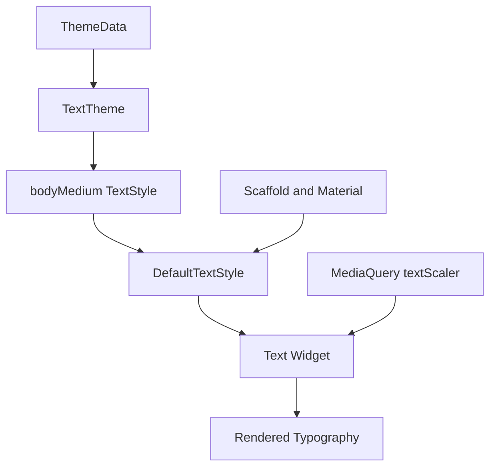

# Theming Beyond Colors: Text Themes, Typography Scaling, and Theme Extension

## English

Most people think of ThemeData as a bag of colors, but the part that actually shapes your app's typography is the TextTheme — a set of named TextStyles (displayLarge, headlineMedium, titleSmall, bodyMedium, labelLarge and so on) that Material widgets consult by default. When you write Text('Hi'), Flutter does not pick some arbitrary font size; it looks up the ambient DefaultTextStyle, which Material's Scaffold and Material widget derive from Theme.of(context).textTheme.bodyMedium. That means changing one entry in your TextTheme cascades through every widget that has not overridden it, which is the whole point: consistent type scale without hunting down hardcoded fontSize values.

The Material 3 type scale is organised into three families — display/headline (large, expressive text), title (medium emphasis, e.g. card headers), and body/label (reading text and small UI labels) — each with three sizes (Large/Medium/Small). Flutter's ThemeData constructor can take a full TextTheme, or you can use the copyWith helpers to tweak a single style, e.g. textTheme: base.textTheme.copyWith(bodyMedium: base.textTheme.bodyMedium?.copyWith(height: 1.5)). The height property is a multiplier of the font size, not a pixel value, so it scales with the text — a detail that trips people up when they try to force a fixed line box.

Accessibility interacts with typography through textScaler (formerly textScaleFactor). The OS-level font size setting on Android and iOS is surfaced through MediaQuery, and Flutter applies it to text automatically unless you opt out. A layout that uses fixed heights for text rows will clip when the user cranks the system font to 200%, so the robust pattern is to let text size drive the container (intrinsic sizing, or minimum heights rather than fixed ones) and to test with MediaQuery(data: MediaQuery.of(context).copyWith(textScaler: TextScaler.linear(2.0)), child: ...).

Finally, ThemeData has an extensions mechanism: ThemeExtension<T> lets you define your own typed token bundle (say, a BrandColors class holding success, warning, and info colours that Material does not provide) and attach it to the theme. You read it with Theme.of(context).extension<BrandColors>()! and it participates in theme animation via lerp, so switching between light and dark themes interpolates your custom tokens too. This is the sanctioned way to extend the design system without subclassing ThemeData or stuffing values into a global singleton.

Put together, theming is really three layers: the semantic colour scheme, the typographic scale, and your own extensions. Treating them as one coherent design-token system — defined once, consumed through Theme.of — is what keeps a large app visually consistent when a designer changes the type ramp six months in.

## 中文

大部分人以為 ThemeData 只係一袋顏色，但真正塑造應用程式字體排印嘅部分其實係 TextTheme——一組有名嘅 TextStyle（displayLarge、headlineMedium、titleSmall、bodyMedium、labelLarge 等等），Material 元件預設會查閱佢哋。當你寫 Text('Hi') 嗰陣，Flutter 並唔係隨便揀個字級；佢會查當時嘅 DefaultTextStyle，而 Material 嘅 Scaffold 同 Material 元件會由 Theme.of(context).textTheme.bodyMedium 衍生出呢個 style。即係話，改動 TextTheme 其中一項，會連鎖影響所有無覆寫佢嘅元件，呢個正正就係重點：保持一致嘅字級階梯，唔使四圍搵硬編碼嘅 fontSize。

Material 3 嘅字級階梯分成三個家族——display/headline（大型、有表現力嘅文字）、title（中等強調，例如卡片標題）、body/label（閱讀文字同細小 UI 標籤）——每個家族各有三個尺寸（Large/Medium/Small）。ThemeData 建構函式可以接收完整嘅 TextTheme，或者你可以用 copyWith 輔助方法微調單一 style，例如 textTheme: base.textTheme.copyWith(bodyMedium: base.textTheme.bodyMedium?.copyWith(height: 1.5))。height 屬性係字級嘅倍數，唔係像素值，所以佢會隨文字縮放——呢個細節往往令人困惑，尤其係當你想強制固定行高嗰陣。

無障礙同字體排印透過 textScaler（前稱 textScaleFactor）互動。Android 同 iOS 嘅系統字級設定會經 MediaQuery 呈現，Flutter 預設會自動套用到文字，除非你選擇退出。如果版面用固定高度裝文字，當用戶將系統字級調到 200% 就會被裁切，所以穩健嘅做法係畀文字尺寸決定容器（用 intrinsic sizing，或者用最小高度而唔係固定高度），並且用 MediaQuery(data: MediaQuery.of(context).copyWith(textScaler: TextScaler.linear(2.0)), child: ...) 嚟測試。

最後，ThemeData 有擴展機制：ThemeExtension<T> 讓你定義自己嘅型別化 token 組合（例如一個 BrandColors 類別，裝住 Material 無提供嘅 success、warning、info 顏色），並附加到 theme 上。你用 Theme.of(context).extension<BrandColors>()! 讀取，而佢會經 lerp 參與主題動畫，所以喺淺色同深色主題之間切換時，你嘅自訂 token 都會一齊插值。呢個係官方認可嘅方式去擴展設計系統，唔使繼承 ThemeData 或者將數值塞入全域單例。

總括而言，主題其實有三層：語意化配色方案、字體排印階梯，同埋你自己嘅擴展。將佢哋當成一套連貫嘅設計 token 系統——定義一次、經 Theme.of 消費——就係令大型應用程式喺設計師半年後改動字級階梯時，視覺上仍然保持一致嘅關鍵。

## Key Takeaway

ThemeData is a three-layer design-token system — colour scheme, text theme, and ThemeExtension — and consuming it through Theme.of keeps typography and custom tokens consistent across a large app.

## Related Concepts
- TextTheme and Material 3 type scale
- ThemeExtension and design tokens

## Diagram

