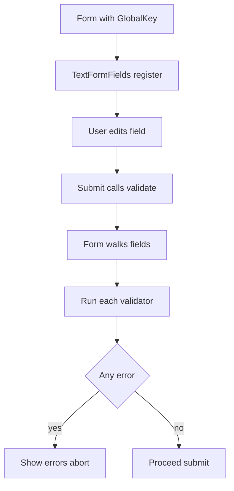

# Forms, Validation, and Focus: Wiring a Real Form Without Fighting It

## English

A Flutter Form is deceptively simple: you wrap TextFormFields in a Form widget, give it a GlobalKey<FormState>, and call formKey.currentState!.validate() on submit. What is actually happening is that Form is an InheritedWidget-ish ancestor that registers every descendant FormField, so validation is a tree-wide operation rather than something each field does in isolation. Each FormField holds a validator callback returning null for valid or a String for an error message; validate() walks the registered fields, runs their validators, and calls setState on each so the error text appears. If any returns non-null, validate() returns false and you can abort submission.

The subtlety is timing. Validators run when validate() is called and, by default, also when the user changes a field after it has been validated once (autovalidateMode). AutovalidateMode.disabled is the default: no errors until you ask. AutovalidateMode.onUserInteraction validates each field as the user types, which is friendlier for things like password strength but noisy for email fields where every keystroke looks wrong until the last one. A common compromise is to validate on submit, then switch to onUserInteraction so subsequent edits give live feedback — you can flip the Form's autovalidateMode in setState after the first submit attempt.

TextFormField also gives you a controller (TextEditingController) for reading and programmatically setting the value, and a FocusNode for controlling keyboard focus. The controller owns the text and selection; the widget is just a view onto it. If you create a controller inside build(), you will leak one on every rebuild and lose cursor position — controllers belong in State and must be disposed in dispose(). The same discipline applies to FocusNode. To move focus from one field to the next on submit, call FocusScope.of(context).nextFocus() from the field's onFieldSubmitted, or request focus on a specific node you hold.

Input formatting is the third leg. TextInputFormatter subclasses (FilteringTextInputFormatter, LengthLimitingTextInputFormatter, or your own) intercept keystrokes before they reach the controller, letting you restrict to digits, cap length, or reformat as the user types. keyboardType and textInputAction tune the soft keyboard — textInputAction: TextInputAction.next shows a Next key that triggers onFieldSubmitted, which is the idiomatic way to chain fields. Note that keyboardType is a hint, not a guarantee: hardware keyboards and paste can bypass it, so formatters and validators are where real enforcement lives.

Finally, accessibility and error surfacing: TextFormField's error text is rendered as part of the field's decoration and is announced by screen readers via the semantics tree, but only if you keep the default InputDecoration. If you build a custom error display, you may need Semantics(liveRegion: true) so the announcement fires when the error appears. And remember that validation is client-side convenience, never security — server-side validation of anything that matters is still mandatory.

## 中文

Flutter 嘅 Form 表面睇落好簡單：你將 TextFormField 包喺 Form 元件入面，畀佢一個 GlobalKey<FormState>，提交時呼叫 formKey.currentState!.validate()。實際發生嘅係：Form 係一個類似 InheritedWidget 嘅祖先，會註冊所有後代 FormField，所以驗證係一個跨越整棵樹嘅操作，而唔係每個欄位各自為政。每個 FormField 持有一個 validator 回呼，驗證透過就回傳 null，唔透過就回傳一個錯誤訊息字串；validate() 會走訪已註冊嘅欄位、執行佢哋嘅 validator，並對每個呼叫 setState，令錯誤文字出現。只要有任何一個回傳非 null，validate() 就回傳 false，你就可以中止提交。

微妙之處在於時機。Validator 會喺呼叫 validate() 時執行，而預設情況下，一旦驗證過一次之後，使用者再改動欄位亦會再執行（autovalidateMode）。AutovalidateMode.disabled 係預設值：你唔問就唔會出錯。AutovalidateMode.onUserInteraction 會隨使用者輸入逐個欄位驗證，對密碼強度之類嘅嘢較友善，但對電郵欄位就好嘈——打到最後一個字之前，每一鍵都好似錯。常見嘅折衷係：提交時先驗證，然後切換到 onUserInteraction，令之後嘅編輯有即時回饋——你可以喺第一次提交嘗試之後，喺 setState 入面切換 Form 嘅 autovalidateMode。

TextFormField 亦提供 controller（TextEditingController）用嚟讀取同以程式方式設定值，以及 FocusNode 用嚟控制鍵盤焦點。Controller 擁有文字同選取範圍；元件只係佢上面嘅一個檢視。如果你喺 build() 入面建立 controller，每次重建都會洩漏一個，而且會喪失遊標位置——controller 應該放喺 State 入面，並喺 dispose() 中釋放。同樣嘅紀律亦適用於 FocusNode。若果想喺提交時將焦點由一個欄位移到下一個，可以喺該欄位嘅 onFieldSubmitted 呼叫 FocusScope.of(context).nextFocus()，或者對你持有嘅特定 node 請求焦點。

輸入格式化係第三條支柱。TextInputFormatter 子類（FilteringTextInputFormatter、LengthLimitingTextInputFormatter，或者你自己寫嘅）會喺按鍵到達 controller 之前攔截，讓你限制只准數字、限制長度，或者隨使用者輸入即時重新格式化。keyboardType 同 textInputAction 會調整軟鍵盤——textInputAction: TextInputAction.next 會顯示一個「下一項」鍵，觸發 onFieldSubmitted，係串連欄位嘅地道做法。要注意 keyboardType 只係提示，唔係保證：實體鍵盤同貼上都可以繞過佢，所以真正嘅強制執行係喺 formatter 同 validator 度。

最後，無障礙同錯誤呈現：TextFormField 嘅錯誤文字係欄位 decoration 嘅一部分，會經 semantics tree 由螢幕閱讀器讀出，但前提係你保留預設嘅 InputDecoration。如果你自訂錯誤顯示，可能需要 Semantics(liveRegion: true)，令錯誤出現時觸發朗讀。同時要記住：驗證只係使用者端嘅便利，永遠唔係安全措施——任何重要嘅嘢，伺服器端驗證仍然係必須嘅。

## Key Takeaway

A Flutter Form is a tree-wide validation coordinator, and getting timing (autovalidateMode), controller/focus ownership, and input formatters right is what separates a smooth form from a buggy one.

## Related Concepts
- FormField and validator lifecycle
- TextInputFormatter and keyboard hints

## Diagram

