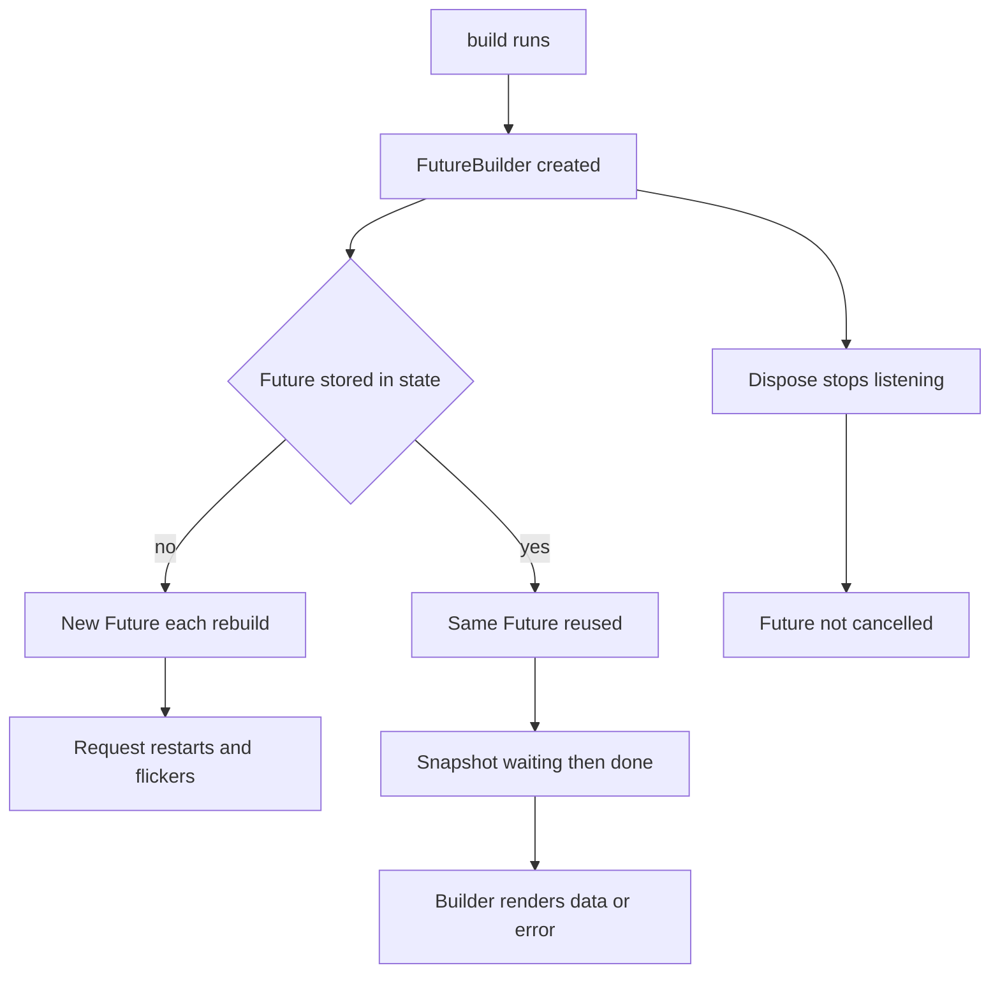

# Async UI Patterns: FutureBuilder, StreamBuilder, and Their Sharp Edges

## English

Flutter ships two widgets whose entire job is to render the state of an asynchronous value: FutureBuilder<T> and StreamBuilder<T>. Both take a future or stream plus a builder callback that receives a snapshot — an AsyncSnapshot<T> with a connectionState (waiting, active, done) and, when available, data or error. The appeal is that you do not need a StatefulWidget or setState to show a loading spinner, then the result, then an error: the widget subscribes on its own and rebuilds when the value arrives. For one-shot reads — fetch a profile, load a config — FutureBuilder is genuinely convenient.

The sharp edge is that FutureBuilder does not own the future's lifetime in the way people assume. If you write FutureBuilder(future: fetchUser(id), ...) inside build(), a new Future is created on every rebuild, which means every parent rebuild restarts the request and the builder flickers back to waiting. The fix is to create the Future once — in initState of a StatefulWidget, or by holding it in a state management layer — and pass the stored reference into the builder. The same trap exists for streams: StreamBuilder(future: someStream) where someStream is a getter that constructs a new stream each call will resubscribe constantly.

A related subtlety is that when the widget is disposed, FutureBuilder stops listening but does not cancel the underlying Future — Futures are not cancellable in Dart. The async work keeps running and its result is simply dropped. For streams, StreamBuilder does cancel its subscription on dispose, so a well-behaved stream stops producing. This asymmetry matters for anything expensive or side-effecting: a network call kicked off by a discarded FutureBuilder still hits your server, so cancellation has to be handled at the layer that owns the request (e.g. an HTTP client you can close, or a state notifier you can dispose).

Snapshot handling is where correctness lives. You must check snapshot.hasError before touching snapshot.data, because data is null while an error is present and while waiting. A robust builder looks like: if (snapshot.connectionState == ConnectionState.waiting) return spinner; if (snapshot.hasError) return errorWidget(snapshot.error!); return content(snapshot.data!). For streams, connectionState.done means the stream closed, which is different from waiting — a distinction people miss and then show a spinner forever after a stream completes.

Finally, know when not to use them. Builders are fine for leaf-level, single-source async reads, but they encourage putting async logic in the widget layer, which makes caching, retries, and sharing results across widgets awkward. Once two widgets need the same data, or you need pull-to-refresh, pagination, or optimistic updates, a state management solution that owns the future/stream outside the tree is the better shape — the builders then become thin views over already-managed state. Treat FutureBuilder and StreamBuilder as convenience widgets for simple cases, not as an architecture.

## 中文

Flutter 內建兩個元件，佢哋嘅全部職責就係渲染一個非同步值嘅狀態：FutureBuilder<T> 同 StreamBuilder<T>。兩者都接收一個 future 或 stream，加一個 builder 回呼，回呼會收到一個 snapshot——即 AsyncSnapshot<T>，帶有 connectionState（waiting、active、done），以及（當有嘅時候）data 或 error。吸引之處係你唔需要 StatefulWidget 或者 setState 就可以顯示載入中嘅轉圈、然後結果、然後錯誤：元件自己訂閱，並喺值到達時重建。對於一次性讀取——攞個 profile、載入設定——FutureBuilder 真係好方便。

尖銳嘅邊緣在於，FutureBuilder 並唔似好多人以為咁擁有 future 嘅生命週期。如果你喺 build() 入面寫 FutureBuilder(future: fetchUser(id), ...)，每次重建都會建立一個新 Future，即係每次父層重建都會重新開始請求，builder 又閃返去 waiting。解決方法係只建立 Future 一次——喺 StatefulWidget 嘅 initState 入面，或者喺狀態管理層持有——然後將儲存咗嘅引用傳入 builder。Stream 都有同一個陷阱：如果 someStream 係一個每次呼叫都建立新 stream 嘅 getter，StreamBuilder(future: someStream) 就會不斷重新訂閱。

一個相關嘅微妙點係：當元件被 dispose，FutureBuilder 會停止監聽，但唔會取消底層嘅 Future——Dart 嘅 Future 係唔可以取消嘅。非同步工作會繼續執行，結果只係被丟棄。對於 stream，StreamBuilder 喺 dispose 時確實會取消訂閱，所以行為良好嘅 stream 會停止產生值。呢個不對稱對任何昂貴或者有副作用嘅嘢都好重要：一個被丟棄嘅 FutureBuilder 所觸發嘅網絡請求仍然會打到伺服器，所以取消必須喺擁有請求嘅層處理（例如一個你可以關閉嘅 HTTP client，或者一個你可以 dispose 嘅 state notifier）。

Snapshot 處理係正確性所在。你必須喺觸碰 snapshot.data 之前檢查 snapshot.hasError，因為喺有錯誤同等待期間 data 都係 null。穩健嘅 builder 大概係：if (snapshot.connectionState == ConnectionState.waiting) return spinner; if (snapshot.hasError) return errorWidget(snapshot.error!); return content(snapshot.data!);。對於 stream，connectionState.done 代表 stream 已關閉，同 waiting 唔同——呢個區別好多人忽略，然後喺 stream 完成之後永遠顯示轉圈。

最後，要知道幾時唔應該用佢哋。Builder 對葉層級、單一來源嘅非同步讀取無問題，但佢哋鼓勵將非同步邏輯放喺元件層，令快取、重試、同跨元件共享結果變得棘手。一旦兩個元件需要同一份資料，或者你需要下拉重新整理、分頁、樂觀更新，一個喺樹外擁有 future/stream 嘅狀態管理方案就係更好嘅形態——builder 之後就變成已管理狀態上面嘅薄視圖。將 FutureBuilder 同 StreamBuilder 當作簡單情況嘅便利元件，而唔係架構。

## Key Takeaway

FutureBuilder and StreamBuilder are convenient but only safe when the future/stream is created once outside build(), errors are checked before data, and anything shared or cancellable is owned by a layer above the widget.

## Related Concepts
- AsyncSnapshot and connectionState
- Future cancellation and stream subscription lifecycle

## Diagram

