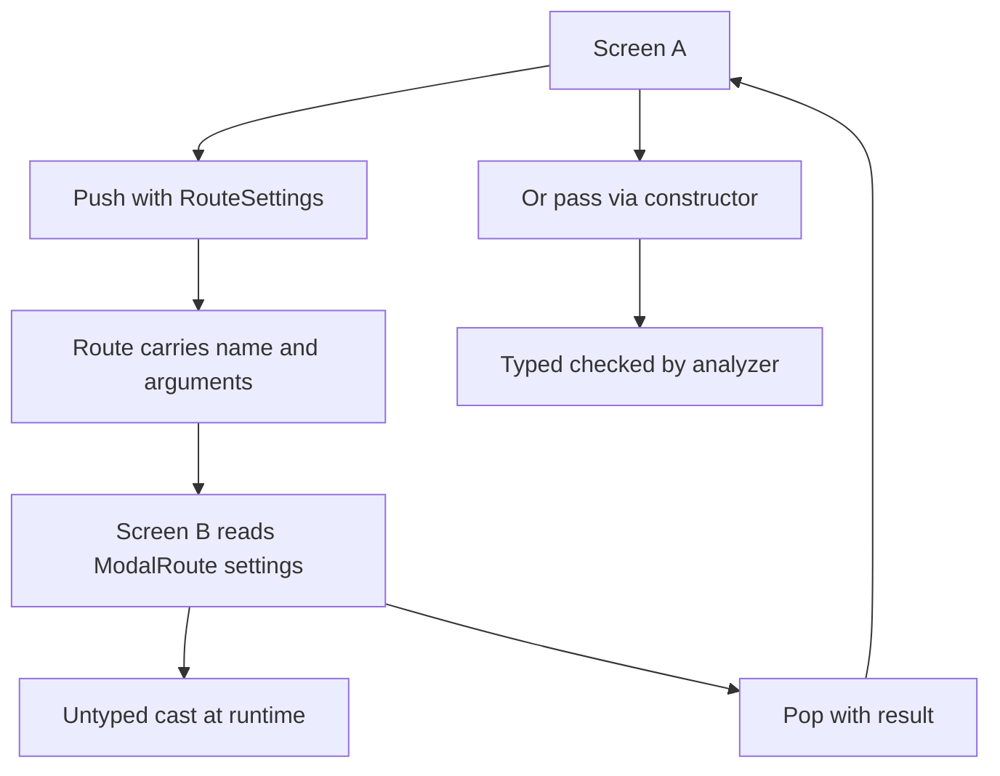

# Routes, RouteSettings, and the Data You Pass Between Screens

## English

Navigation is often taught as 'push a page, pop a page', but the more interesting question is how screens exchange data without becoming coupled. Flutter's answer starts with RouteSettings: every Route carries an optional settings object holding a name (a String identifier) and arguments (an arbitrary Object). When you call Navigator.push with a MaterialPageRoute, you can attach RouteSettings(name: '/detail', arguments: someOrderId), and the receiving screen reads ModalRoute.of(context)?.settings.arguments. This is deliberately untyped: the framework makes no attempt to check that the argument is what the destination expects, so a typo or a refactor becomes a runtime cast error rather than a compile error. That looseness is why most production apps layer a typed router on top.

The typed alternative is to pass data through a constructor. A DetailScreen(orderId: id) is checked by the analyzer, refactors cleanly, and makes the screen's dependencies visible in its signature. The trade-off is that constructor arguments only work when you build the route yourself; they break down for named routes, deep links, and any case where the OS or a browser URL is the thing deciding which screen appears, because at that moment there is no Dart code constructing the widget with your values. That is precisely the gap go_router fills: you declare path patterns like '/orders/:id', the router parses the URL into path parameters and query parameters, and it hands them to your builder as typed-ish strings you convert yourself.

A subtler point is what happens to data when you pop. Navigator.pop(context, result) sends a value back to whoever awaited the push future, so 'pick an item from a list' is naturally modelled as push-then-await rather than as a shared global. This keeps the flow local and testable: the calling widget owns the decision, the destination screen owns the selection. Contrast that with pushing a value into a global store just to read it on the next screen, which leaves stale state behind and makes it hard to reason about who set what.

Deep links make the distinction concrete. A URL arriving from outside the app has no constructor call behind it, so the route must be reconstructible purely from the path and query string. Anything the screen needs that is not in the URL, such as an auth token or a cached user profile, has to come from somewhere else: a repository, an InheritedWidget, or the router's redirect logic. Designing your routes so that the URL alone is sufficient to identify the screen, with everything else injected from ambient state, is the discipline that makes deep linking work at all.

Finally, remember that routes are widgets in a stack, not a replacement for state. Two routes can show the same underlying data, and popping one does not destroy the data the other reads. Keeping navigation state (which screen am I on) separate from domain state (what is the order) is the mental split that prevents the classic bug where a screen 'forgets' its content after a rebuild, because the content was smuggled through route arguments instead of being fetched from a source of truth.

## 中文

導航常常被教成「推一頁、彈一頁」，但更有趣的問題是：畫面之間如何交換資料，而不至於互相綁死。Flutter 的答案由 RouteSettings 開始：每個 Route 都帶著一個可選的 settings 物件，內含 name（字串識別碼）與 arguments（任意 Object）。當你呼叫 Navigator.push 並傳入 MaterialPageRoute 時，可以附上 RouteSettings(name: '/detail', arguments: someOrderId)，接收的畫面就透過 ModalRoute.of(context)?.settings.arguments 讀取。這是刻意不帶型別的：框架完全不會檢查傳進去的參數是否符合目的畫面的期望，所以打錯字或重構之後，問題會變成執行時的轉型錯誤，而不是編譯錯誤。正因為這種鬆散，大多數正式專案都會在上面再加一層有型別的路由器。

有型別的替代方案，是透過建構子傳資料。DetailScreen(orderId: id) 會被分析器檢查、重構時乾淨俐落，而且畫面的依賴一目了然。代價是：建構子參數只在你親自建立路由時才行得通；遇到具名路由、深層連結，或者由作業系統、瀏覽器網址決定要顯示哪個畫面的情況，就完全失效，因為那一刻根本沒有 Dart 程式碼用你的數值去建構 widget。這正是 go_router 填補的缺口：你宣告像 '/orders/:id' 這樣的路徑樣式，路由器把網址解析成路徑參數與查詢參數，再交給你自己的 builder，由你把字串轉成想要的型別。

更細緻的一點，是彈出（pop）時資料往哪裡去。Navigator.pop(context, result) 會把一個值送回給當初 await 那次 push 的 Future，所以「從清單中揀一項」天然就該寫成「推出去、再 await」，而不是共用一個全域狀態。這樣流程保持局部、容易測試：呼叫方擁有決定權，目的畫面擁有選取權。相反地，若只為了下一頁要讀，就把值塞進全域 store，就會留下過期狀態，也難以追查究竟是誰設定了什麼。

深層連結讓這個分別變得具體。從外部進來的網址背後並沒有任何建構子呼叫，所以路由必須單憑路徑與查詢字串就能重建。畫面需要但不在網址裡的東西，例如認證權杖或快取的使用者資料，就必須來自別處：repository、InheritedWidget，或路由器的 redirect 邏輯。把路由設計成「單靠網址就足以辨識畫面，其餘一切由環境狀態注入」，正是讓深層連結真正可行的紀律。

最後要記住：路由是堆疊中的 widget，並不是狀態的替代品。兩個路由可以顯示同一份底層資料，彈掉其中一個並不會摧毀另一個所讀的資料。把導航狀態（我現在在哪一頁）與領域狀態（這張訂單是什麼）分開，就是防止經典臭蟲的心法：畫面重建後「忘記」內容，正因為內容是夾帶在路由參數裡，而不是從真實來源取得。

## Key Takeaway

Route arguments are untyped strings and objects meant for reconstructing a screen from a URL, so keep domain data in a source of truth and navigation data in the route.

## Related Concepts
- go_router path parameters
- Navigator.pop return values

## Diagram

