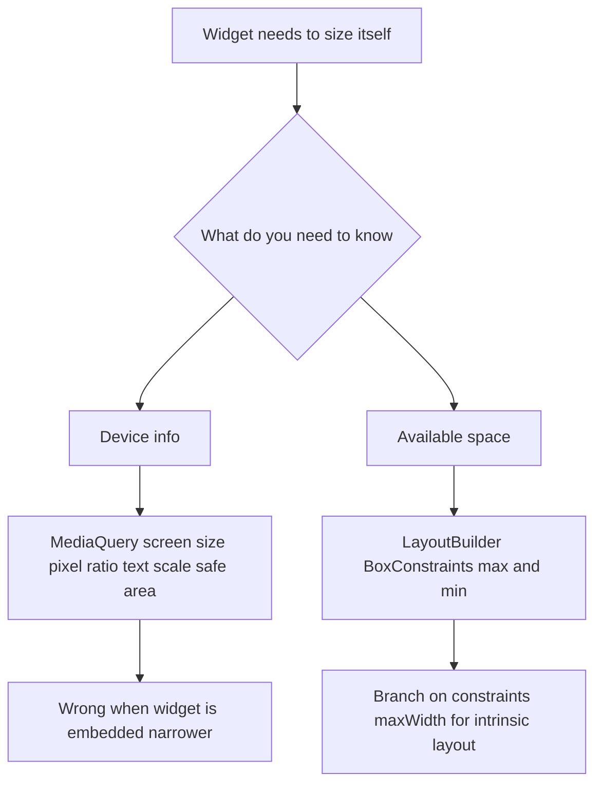

# LayoutBuilder, MediaQuery, and the Difference Between Screen and Space

## English

A common beginner mistake is to size things using MediaQuery.of(context).size, the full screen dimensions, when what actually matters is the space the widget has been given. MediaQuery tells you about the device: screen size, pixel ratio, text scale factor, safe-area insets, and orientation. It does not tell you that your widget is sitting inside a Row next to a sidebar, or inside a Padding, or inside a scrollable. If you branch on screen width to decide 'phone or tablet layout', you will get it wrong the moment the widget is embedded somewhere narrower than the screen.

LayoutBuilder is the tool that answers the real question. Its builder callback receives a BoxConstraints describing the maximum and minimum width and height the parent is willing to give. From that you can choose a layout based on available space rather than device class. A widget that switches to a two-column layout when constraints.maxWidth exceeds some threshold will behave correctly whether it is full-screen on a tablet, half-screen in a split view, or squeezed into a card on a phone. This is what people mean by 'intrinsic' responsiveness: the component reacts to its own box, not to the world.

There is a cost worth knowing. LayoutBuilder runs its builder during the layout phase, which means the subtree it builds cannot participate in certain optimisations, and nesting many of them can complicate the layout pass. It also cannot be used to size a widget based on its own children's intrinsic size in a circular way; asking for intrinsic dimensions inside a LayoutBuilder that is itself being sized by intrinsics will throw. Use it where a genuine branch in structure is needed, not for every trivial size tweak.

MediaQuery remains the right tool for things that are genuinely about the device or the user's environment. Text scaling is the clearest example: MediaQuery.textScalerOf(context) reflects the user's accessibility font-size setting, and ignoring it is an accessibility failure. Safe-area insets, expressed as MediaQuery.paddingOf(context), tell you how far to keep content from notches and home indicators. Orientation, brightness, and platform are also environment facts. The distinction is simple: MediaQuery describes the world outside your widget; LayoutBuilder describes the box your widget was handed.

A practical habit is to wrap your app's top level in a widget that reads MediaQuery once and re-exposes the pieces you care about through a small InheritedWidget, so leaf widgets do not each need a BuildContext lookup. Then use LayoutBuilder at the specific points where structure changes. The combination gives you layouts that adapt to both the user's settings and the space they actually have, which is the difference between an app that merely runs on many devices and one that feels native on each.

## 中文

初學者常見的錯誤，是用 MediaQuery.of(context).size（整個螢幕的尺寸）來決定大小，但真正重要的是這個 widget 被分配到多少空間。MediaQuery 告訴你的是裝置的事：螢幕尺寸、畫素比、文字縮放比例、安全區域內距、方向。它不會告訴你，你的 widget 正身處一個 Row 裡、旁邊還有側欄，或者被包在 Padding 裡、或者在一個可捲動區域內。如果你用螢幕寬度來判斷「手機版還是平板版」，那麼一旦這個 widget 被嵌進比螢幕更窄的地方，判斷就會出錯。

LayoutBuilder 才是回答真正問題的工具。它的 builder 回呼會收到一個 BoxConstraints，描述父層願意給予的最大與最小寬高。你可以據此按可用空間（而非裝置類別）選擇版面。一個在 constraints.maxWidth 超過某個門檻時切換成兩欄的 widget，無論是平板上全螢幕、分割畫面的一半，還是被擠進手機上的一張卡片裡，行為都會正確。這就是所謂「內在」的響應式：元件對自己的盒子作出反應，而不是對整個世界。

有個值得知道的代價。LayoutBuilder 會在佈局階段執行它的 builder，意味著它建出的子樹無法參與某些最佳化，而且大量巢狀會令佈局過程更複雜。它也不能用來以自己子項的內在尺寸來決定大小，否則會形成迴圈：在一個本身正被內在尺寸決定大小的 LayoutBuilder 裡查詢內在尺寸，會丟擲例外。把它用在真正需要結構分支的地方，而不是每個瑣碎的大小微調。

MediaQuery 仍然是處理真正關於裝置或使用者環境之事的好工具。文字縮放是最明顯的例子：MediaQuery.textScalerOf(context) 反映使用者的無障礙字型大小設定，忽略它就是無障礙上的失誤。安全區域內距以 MediaQuery.paddingOf(context) 表示，告訴你要離瀏海與 Home 指示條多遠。方向、亮度、平臺，同樣是環境事實。分野很簡單：MediaQuery 描述你 widget 之外的世界；LayoutBuilder 描述交到你手上的那個盒子。

一個實用習慣，是在 app 最頂層包一個 widget，只讀一次 MediaQuery，再透過一個小小的 InheritedWidget 把你關心的部分重新暴露出去，這樣葉節點 widget 就不必各自查 BuildContext。然後在結構真正改變的具體位置使用 LayoutBuilder。兩者結合，就能做出既適應使用者設定、又適應實際可用空間的版面——這正是「只是能在多種裝置上跑」與「在每種裝置上都感覺原生」之間的差別。

## Key Takeaway

Use MediaQuery for facts about the device and the user's environment, and LayoutBuilder for decisions about the space your widget was actually given.

## Related Concepts
- BoxConstraints
- textScaler and accessibility

## Diagram

