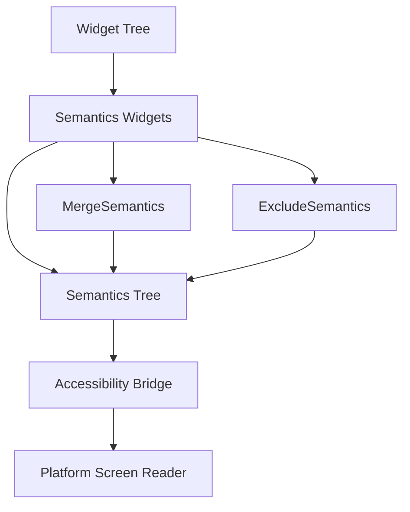

# Semantics, MergeSemantics, and the Tree Screen Readers Actually Read

## English

Flutter renders to a canvas, which means the operating system's accessibility service cannot inspect your widget tree the way it inspects a native UI. Instead, Flutter builds a separate Semantics tree and hands it to the platform through the accessibility bridge. Each node in that tree carries a label (what is spoken), a value, hints, flags such as 'is a button' or 'is enabled', and actions the screen reader can invoke. If your widget produces no semantics, a screen-reader user perceives nothing, even though sighted users see a perfectly good button.

Many Material widgets already emit semantics: a Text widget contributes its string, an IconButton contributes a button role with its tooltip as a label, a Checkbox reports checked or unchecked. Problems arise with custom compositions. A Row containing an Icon and a Text is, to a screen reader, two separate nodes unless you merge them; the reader may announce the icon's label and the text as distinct items, which is confusing. MergeSemantics merges its descendants into a single node so the pair is read as one phrase. ExcludeSemantics does the opposite, hiding decorative children so they do not clutter the traversal.

The Semantics widget is the explicit escape hatch. You can set label, value, hint, button: true, enabled: false, and onTap to expose an action. The hint is the 'what happens if I activate this' text, distinct from the label which is 'what is this'. Getting that separation right matters: a label of 'Delete' with a hint of 'Removes this item permanently' reads far better than cramming both into one string. For custom-painted widgets such as a chart or a gauge, Semantics is often the only way to make the content perceivable at all.

Two practical traps deserve mention. First, anything drawn on a canvas, including CustomPaint output, has no semantics unless you add them; a beautiful progress ring is silent. Second, semantics are order-sensitive: the traversal order follows the tree, so a layout that visually reorders children (for example, placing a badge after its parent in the tree but visually before it) can produce a confusing reading order. Testing tools can dump the semantics tree, which is the fastest way to see what a screen reader would actually encounter.

Finally, remember that semantics is not only for blind users. Screen readers, switch access, voice control, and some automated UI testing frameworks all consume the same tree. Investing in labels and roles pays off across all of them, and it forces you to articulate what each control means, which tends to improve the design for everyone. Accessibility work here is not a bolt-on; it is the act of describing your interface in a machine-readable way.

## 中文

Flutter 把畫面繪製到畫布上，這意味著作業系統的無障礙服務無法像檢查原生介面那樣檢查你的 widget 樹。取而代之，Flutter 會建立一棵獨立的 Semantics 樹，並透過無障礙橋接交給平臺。樹中每個節點都帶有 label（會被朗讀的內容）、value、hint、例如「是按鈕」「已啟用」之類的旗標，以及螢幕報讀器可以觸發的動作。如果你的 widget 沒有產生任何語意，使用報讀器的使用者就什麼都感受不到，即使看得見的使用者見到一個完好的按鈕。

許多 Material widget 本身已會產生語意：Text 貢獻它的字串，IconButton 貢獻按鈕角色並以 tooltip 作為 label，Checkbox 回報已勾選或未勾選。問題出在自訂組合。一個包含 Icon 與 Text 的 Row，對報讀器而言是兩個獨立節點，除非你把它們合併；報讀器可能把圖示的標籤與文字當成兩項分別宣讀，令人困惑。MergeSemantics 會把子孫合併成單一節點，令兩者被讀成一句。ExcludeSemantics 則相反，隱藏裝飾性的子項，以免它們幹擾瀏覽順序。

Semantics widget 是明確的逃生口。你可以設定 label、value、hint、button: true、enabled: false，以及 onTap 來暴露動作。hint 是「我啟動它會怎樣」的文字，與 label 的「這是什麼」不同。把這個區分做對很重要：label 是「刪除」、hint 是「會永久移除此專案」，遠比把兩者塞進同一字串好讀。對於自繪的 widget，例如圖表或儀錶，Semantics 往往是讓內容可被感知的唯一方法。

有兩個實務陷阱值得一提。第一，任何畫在畫布上的東西，包括 CustomPaint 的輸出，除非你加上語意，否則都是靜默的；一個漂亮的進度環對報讀器而言不存在。第二，語意對順序敏感：瀏覽順序跟隨樹的結構，所以一個在視覺上重排了子項的版面（例如徽章在樹中排在父項之後，視覺上卻在前面），可能產生混亂的閱讀順序。測試工具可以傾印語意樹，這是檢視報讀器實際會遇到什麼的最快方法。

最後要記住，語意不只服務視障使用者。螢幕報讀器、開關存取、語音控制，以及某些自動化 UI 測試框架，全都消費同一棵樹。在標籤與角色上投資，會在各方面都有回報，而且它迫使你說清楚每個控制項的意義，往往令設計對所有人都更好。這裡的無障礙工作不是附加品，而是用機器可讀的方式描述你的介面。

## Key Takeaway

Screen readers never see your widgets, only the Semantics tree, so custom compositions must merge, exclude, or explicitly label their parts.

## Related Concepts
- MergeSemantics and ExcludeSemantics
- accessibility bridge

## Diagram

