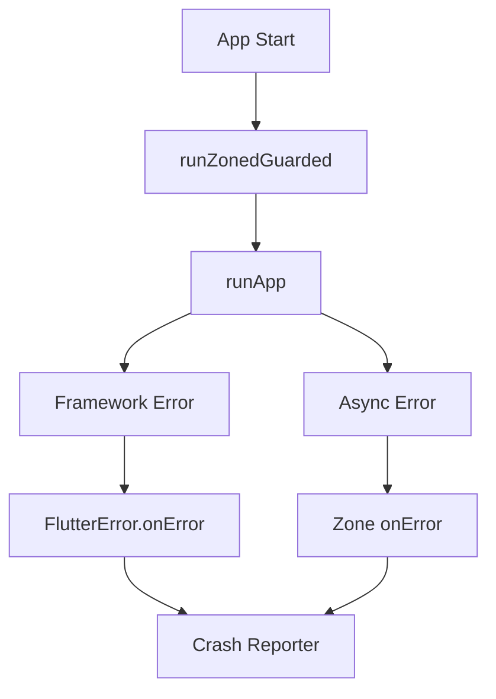

# Error Handling and Crash Reporting: From FlutterError to the Zone

## English

Flutter has several layers of error handling, and knowing which layer catches what saves hours of debugging. At the innermost level, FlutterError.onError is a global hook that fires whenever a framework-level exception occurs during build, layout, or paint — for example, a widget whose build method throws, or an overflow that the framework reports as an error. By default it prints the familiar red console message and, in debug mode, draws the red-and-yellow error widget in place of the offending subtree. If you want to send these to a crash reporter, you override FlutterError.onError, forward the FlutterErrorDetails to your reporter, and then call the original handler so debug output is preserved.

But framework errors are only half the story. Exceptions thrown inside asynchronous code — an unawaited Future that rejects, a Stream that emits an error — never pass through FlutterError.onError. Those are caught by the Dart Zone mechanism. runZonedGuarded lets you run your app inside a custom zone whose onError callback receives every uncaught asynchronous error in that zone. The standard pattern is to wrap runApp in runZonedGuarded, install FlutterError.onError inside it, and route both to the same crash reporter. Without this, a failed network call in a fire-and-forget async function can silently vanish.

A subtle but important detail: errors inside a FutureBuilder or StreamBuilder are not thrown to the zone. They are delivered to the builder as the snapshot's error field, so the widget is responsible for displaying them. The same applies to Future.catchError and try/catch around await. In other words, once you explicitly handle an error, it stops propagating — which is good for UX but means your crash reporter will never see it. Teams often add a logging call inside their error branches so that handled errors still show up in analytics.

For release builds, the stack traces you get from the Dart VM are minified or obfuscated if you used --obfuscate. Flutter can emit a symbol map during build, and crash reporting services use it to de-obfuscate traces back to readable Dart file and line numbers. Without uploading that symbol file, your production crash reports will look like a pile of hexadecimal addresses. This is the same idea as uploading dSYMs on iOS or ProGuard mappings on Android.

Finally, ErrorWidget.builder lets you replace the default red error box with something friendlier, and in release mode Flutter already swaps it for a grey box by default so end users never see developer-facing text. Custom error boundaries in Flutter are not a first-class concept like React's, but you can approximate them by wrapping a subtree in a widget that catches errors in its own build via a try/catch around a Builder, or by using packages that implement error-boundary patterns. The practical takeaway: know your three lanes — synchronous framework errors, asynchronous zone errors, and explicitly handled errors — and make sure each one ends up somewhere you can see.

## 中文

Flutter 有幾層錯誤處理機制，搞清楚邊層捉到邊種錯，可以慳返好多 debug 時間。最內層係 FlutterError.onError，佢係一個全域鈎，每當框架層面（build、layout、paint）拋出例外就會觸發，例如某個 widget 嘅 build method 拋錯，或者框架偵測到 overflow 而報錯。預設情況下佢會印出你熟悉嘅紅色 console 訊息，喺 debug mode 仲會喺出錯嘅子樹位置畫出紅黃色嘅錯誤 widget。如果你想將呢啲錯誤送去 crash reporter，就 override FlutterError.onError，將 FlutterErrorDetails 轉發去你嘅 reporter，然後再呼叫原本嘅 handler，咁 debug 輸出就唔會消失。

不過框架錯誤只係一半故事。喺非同步程式碼入面拋出嘅例外——例如一個冇 await 嘅 Future 被 reject、或者一個 Stream emit 錯誤——係唔會經過 FlutterError.onError 嘅。呢啲由 Dart 嘅 Zone 機制捕捉。runZonedGuarded 可以喺一個自訂 zone 入面執行你嘅 app，佢嘅 onError callback 會收到該 zone 內所有未被捕捉嘅非同步錯誤。標準做法係用 runZonedGuarded 包住 runApp，喺入面安裝 FlutterError.onError，兩者都送去同一個 crash reporter。冇呢層嘅話，一個 fire-and-forget 嘅 async function 入面失敗嘅網絡請求，可以無聲無息咁消失。

有個微妙但重要嘅細節：FutureBuilder 或 StreamBuilder 入面嘅錯誤唔會拋去 zone，而係以 snapshot 嘅 error 欄位交去 builder，即係由 widget 負責顯示。Future.catchError 同 await 外面嘅 try/catch 都一樣。換句話說，一旦你明確處理咗個錯誤，佢就唔會再向外傳播——對 UX 係好事，但代表你嘅 crash reporter 永遠見唔到佢。團隊通常會喺錯誤分支入面加一個 logging 呼叫，令已處理嘅錯誤都仍然喺 analytics 出現。

至於 release build，如果你用咗 --obfuscate，由 Dart VM 拎到嘅 stack trace 會係壓縮或者混淆咗嘅。Flutter 喺 build 時可以輸出 symbol map，crash reporting 服務就用佢將 trace 還原返做可讀嘅 Dart 檔案同行程式碼行號。冇上載呢個 symbol 檔，你嘅生產環境 crash report 就會係一堆十六進位位址。呢個概念同 iOS 上載 dSYMs、Android 上載 ProGuard mapping 係一樣嘅。

最後，ErrorWidget.builder 可以讓你將預設嘅紅色錯誤方塊換成較友善嘅嘢；而喺 release mode，Flutter 預設已經換成灰色方塊，等最終用戶永遠見唔到開發者面向嘅文字。Flutter 冇 React 嗰種 first-class 嘅 error boundary 概念，但你可以用一啲近似做法，例如喺 Builder 外面加 try/catch 去捕捉該子樹 build 時嘅錯誤，或者用一啲實作 error-boundary 模式嘅套件。實用嘅重點係：認清你嘅三條通道——同步框架錯誤、非同步 zone 錯誤、同明確處理咗嘅錯誤——並且確保每一條都去到你可以睇到嘅地方。

## Key Takeaway

Flutter routes errors through three separate lanes — framework errors via FlutterError.onError, async errors via the Zone, and handled errors that stop propagating — and a robust app wires all three into one crash reporter with symbol maps uploaded for release builds.

## Related Concepts
- Dart Zones
- Crash Reporting Symbolication

## Diagram

