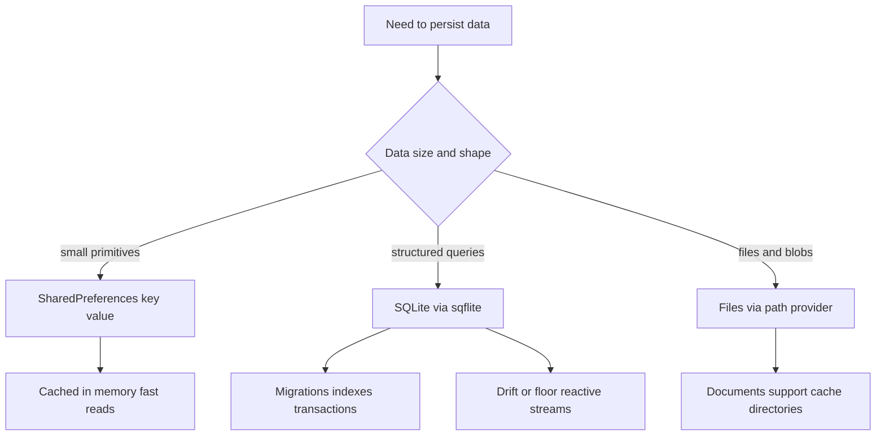

# Local Persistence: SharedPreferences, Files, and SQLite Compared

## English

Sooner or later your app has to remember something after it closes, and Flutter gives you several storage tiers with very different trade-offs. The simplest is shared_preferences, a key-value store backed by NSUserDefaults on iOS and SharedPreferences on Android. It is designed for small, primitive values — a boolean for onboarding-complete, a string for a theme preference, a few integers. Reads are synchronous once loaded because the plugin caches everything in memory at startup, which makes it fast but also means it is the wrong tool for anything large: you would be loading megabytes into RAM and writing the whole file on every set. A common mistake is stuffing a JSON blob of user data into one preference key; it works until the blob grows and every write rewrites the entire file.

For structured data with queries and relations, SQLite via the sqflite plugin (or the higher-level drift and floor packages) is the workhorse. It gives you real SQL, indexes, transactions, and migrations — which matter enormously because your schema will change between app versions. A migration strategy (a version number plus onCreate and onUpgrade callbacks) is not optional if you ship more than once; users who skip versions will hit a database whose shape does not match the code. Drift and floor add compile-time checked queries and reactive streams, so a widget can watch a table and rebuild when rows change, which is much nicer than manual refresh logic.

Between the extremes sits file storage. The path_provider plugin gives you the platform-correct directories: a documents directory for user-visible files that should be backed up, a support directory for app-internal state, a temporary/cache directory that the OS may purge at any time. Writing JSON to a file in the documents directory is a perfectly reasonable choice for medium-sized, whole-document state — a saved draft, a settings object, a downloaded dataset. The key discipline is atomic writes: write to a temporary file, then rename it into place, so a crash mid-write cannot leave a half-written file that fails to parse on next launch.

On the web target, none of these plugins behave the same way. There is no filesystem in the traditional sense; shared_preferences falls back to localStorage, and SQLite requires a WASM build with a virtual filesystem. If your app ships to web, decide early whether persistence is a hard requirement or a nice-to-have, because retrofitting it after building around sqflite is painful.

A practical rule of thumb: preferences for flags and small settings, files for documents and caches, SQLite when you need queries or more than a few hundred records. Whatever you choose, put it behind a small repository interface so the rest of the app does not care which backend is in use — that also makes it trivial to swap in an in-memory fake for tests.

## 中文

你嘅 app 遲早要喺關閉之後記住啲嘢，而 Flutter 提供幾個儲存層級，各有非常不同嘅取捨。最簡單係 shared_preferences，一個 key-value store，iOS 背後係 NSUserDefaults，Android 背後係 SharedPreferences。佢設計嚟放細小嘅原始值——例如一個 onboarding 完成嘅 boolean、一個主題偏好嘅字串、幾個整數。載入之後讀取係同步嘅，因為外掛喺啟動時已經將所有嘢 cache 喺記憶體，所以好快，但亦代表佢唔適合放大型資料：你會將幾 MB 載入 RAM，而且每次 set 都會重寫成個檔案。常見錯誤係將一大嚿使用者資料嘅 JSON 塞入一個 preference key；直到嚿嘢變大、每次寫入都重寫成個檔案，問題就出現。

對於需要查詢同關聯嘅結構化資料，透過 sqflite 外掛（或者更高階嘅 drift 同 floor 套件）用 SQLite 就係主力。佢提供真正嘅 SQL、索引、交易同 migration——呢啲嘢極之重要，因為你嘅 schema 會隨 app 版本改變。如果你會出多過一版，migration 策略（一個版本號加 onCreate 同 onUpgrade callback）就唔係可選項；跳過版本嘅使用者會撞到一個資料庫結構同程式碼唔匹配嘅情況。Drift 同 floor 加咗編譯期檢查嘅查詢同 reactive stream，令 widget 可以監察一個 table 並喺行變更時 rebuild，比手動 refresh 邏輯舒服好多。

兩個極端之間係檔案儲存。path_provider 外掛俾你平臺正確嘅目錄：documents 目錄放使用者可見、應該被備份嘅檔案；support 目錄放 app 內部狀態；temporary/cache 目錄就隨時可能被 OS 清走。將 JSON 寫入 documents 目錄嘅檔案，對中型、整份檔案式嘅狀態——例如儲存草稿、設定物件、下載咗嘅資料集——係完全合理嘅選擇。關鍵紀律係原子寫入：先寫入暫存檔，再 rename 到目標位置，咁就算寫到一半 crash，都唔會留低一個半寫嘅檔案，令下次啟動 parse 失敗。

喺 web target，呢啲外掛嘅行為完全唔同。傳統意義上冇檔案系統；shared_preferences 會 fallback 去 localStorage，而 SQLite 需要 WASM build 加一個虛擬檔案系統。如果你嘅 app 會出 web，就要早啲決定 persistence 係硬性需求定係可有可無，因為圍繞 sqflite 建構之後再補救會好痛苦。

實用嘅經驗法則：flags 同細設定用 preferences，檔案同 cache 用檔案，需要查詢或者超過幾百筆記錄就用 SQLite。無論揀邊種，都將佢收喺一個細細嘅 repository interface 後面，等 app 其餘部分唔需要理會用邊個 backend——咁樣亦令測試時換入 in-memory fake 變得輕而易舉。

## Key Takeaway

Pick storage by shape and size — preferences for flags, files for whole documents, SQLite for queries and volume — and hide the choice behind a repository so migrations, web fallbacks, and tests stay manageable.

## Related Concepts
- SQLite Migrations
- path_provider

## Diagram

