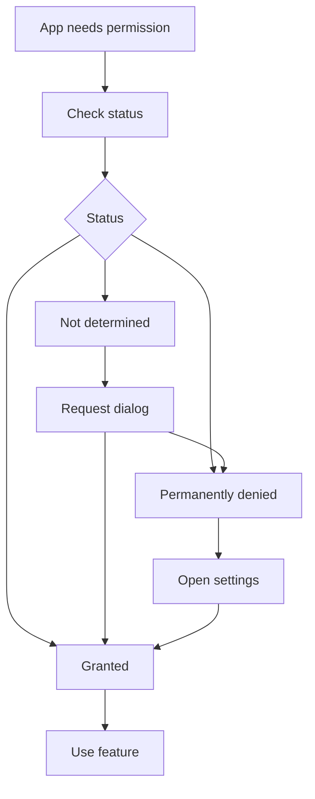

# Permission Flows and Platform Quirks: Asking Nicely and Handling Refusal

## English

Permissions are one of the places where Flutter's cross-platform promise meets the messy reality of two operating systems with different philosophies. The permission_handler plugin gives you a mostly unified API — request, check, open settings — but the behaviour underneath differs in ways that will bite you if you only test on one platform. On Android, permissions are declared in AndroidManifest.xml and, since Android 6, requested at runtime; since Android 13, media and notification permissions were split into finer-grained ones (READ_MEDIA_IMAGES, POST_NOTIFICATIONS) that older tutorials do not mention. On iOS, every sensitive capability needs an Info.plist usage-description string, and the system will terminate your app at runtime if you request a permission without one — a crash that looks mysterious until you realise the string is missing.

The most important distinction is between a permission that has never been asked and one that has been permanently denied. On iOS, once a user taps Don't Allow, the system will not show the dialog again; subsequent request calls return denied immediately. The only path forward is to send the user to Settings. On Android, the behaviour depends on version and whether the user chose Don't ask again; older Androids returned permanently denied after two refusals, newer ones let the user dismiss the dialog without a decision. A good UX handles all three states — not determined, granted, permanently denied — and shows a rationale or a Settings deep link only in the last case. Blindly calling request() in a loop just looks broken.

A second quirk is that some permissions are effectively granted at install time. Camera and location can be requested at runtime, but things like internet access on Android are normal permissions granted automatically. Requesting them at runtime does nothing and returns granted, which can confuse code that assumes every permission needs a dialog.

Timing matters too. Requesting a permission the instant the app launches, before the user understands why, is the fastest way to get denied. The better pattern is to request at the moment of use — when the user taps the camera button, when they start navigation — and to show a short in-app explanation first. This is sometimes called a pre-permission prompt: your own dialog explains the benefit, then the OS dialog appears. Apple's human interface guidelines explicitly recommend this, and it measurably improves grant rates.

Finally, remember that permissions interact with background behaviour and lifecycle. A location permission granted while the app is foreground may not cover background tracking; you need a separate always/background permission on both platforms, and iOS will periodically re-prompt users to confirm continued background access. Test permission flows on real devices across OS versions, because emulators and simulators often behave differently — especially around Settings changes and revoked permissions while the app is suspended.

## 中文

許可權係 Flutter 跨平臺承諾撞上兩個哲學不同作業系統現實嘅地方之一。permission_handler 外掛提供一個大致統一嘅 API——request、check、open settings——但底層行為嘅差異會令你只喺一個平臺測試時中招。喺 Android，許可權喺 AndroidManifest.xml 宣告，而自 Android 6 起要喺 runtime 請求；自 Android 13 起，媒體同通知許可權被拆成更細嘅（READ_MEDIA_IMAGES、POST_NOTIFICATIONS），舊教學唔會提。喺 iOS，每個敏感功能都需要一個 Info.plist usage-description 字串，如果你冇加就請求，系統會喺 runtime 直接終止你嘅 app——呢個 crash 睇落好神秘，直到你發現個字串唔見咗。

最重要嘅區分係「從未問過」同「永久拒絕」之間。喺 iOS，使用者一撳「不允許」，系統就唔會再顯示對話方塊；之後 request 會即刻返回 denied。唯一出路係送使用者去 Settings。喺 Android，行為視版本同使用者有冇揀「不再詢問」而定；舊 Android 喺兩次拒絕後返回永久拒絕，新版本就俾使用者唔作決定咁關閉對話方塊。好嘅 UX 要處理齊三種狀態——未決定、已授予、永久拒絕——並且只喺最後一種情況顯示理由或者 Settings deep link。盲目喺迴圈入面 call request() 只會睇落好似壞咗。

第二個怪癖係有啲許可權實際上喺安裝時就已經授予。相機同位置可以 runtime 請求，但 Android 上嘅網路存取之類嘅 normal permission 會自動授予。Runtime 請求佢哋乜都唔會做並返回 granted，令假設每個許可權都要對話方塊嘅程式碼困惑。

時機都好重要。App 一啟動就即刻請求許可權、使用者未明白點解之前，係最快被拒絕嘅方法。更好嘅模式係喺使用嗰一刻先請求——使用者撳相機按鈕時、開始導航時——並且先顯示一段短嘅 app 內解釋。呢個有時叫 pre-permission prompt：你自己嘅對話方塊解釋好處，然後 OS 對話方塊先出現。Apple 嘅人機介面指引明確建議咁做，而且可量度地提升授予率。

最後，記住許可權同背景行為、生命週期互相影響。喺 app 前景時授予嘅位置許可權未必涵蓋背景追蹤；兩個平臺都需要另一個 always/background 許可權，而 iOS 會定期重新提示使用者確認繼續背景存取。要喺真實裝置、跨 OS 版本測試許可權流程，因為模擬器同 simulator 嘅行為往往唔同——尤其係 Settings 變更同 app 被暫停時許可權被撤銷嘅情況。

## Key Takeaway

Permissions differ subtly between Android and iOS, so model the three states (undetermined, granted, permanently denied), request at the moment of use with a rationale, and test on real devices across OS versions.

## Related Concepts
- permission_handler
- iOS Info.plist Usage Descriptions

## Diagram

