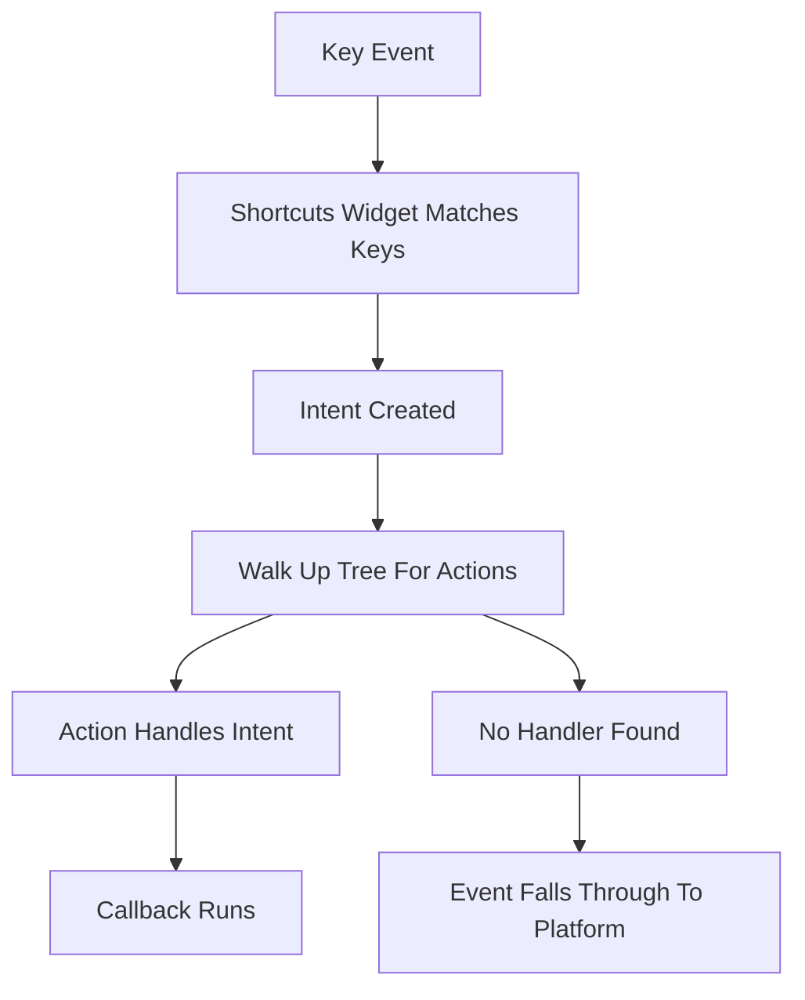

# Keyboard Shortcuts, Actions, and Intents: Flutter's Command System

## English

Most people discover Flutter's Actions and Shortcuts widgets only when they need to wire up Ctrl+S in a desktop app, but the system is far more general than that. At its heart is a three-part contract: an Intent is a small immutable object describing what the user wants to do (for example, a SaveIntent or a PasteTextIntent); an Action maps that Intent to a callback that performs it; and a Shortcuts widget binds a key combination to an Intent. When a key event arrives, Flutter walks up the widget tree looking for a Shortcuts widget that matches the pressed keys, produces the corresponding Intent, then walks up again to find an Actions widget that can handle it. If nothing handles the Intent, the key event falls through to the platform, which is why typing in a TextField still works normally.

The real power is that Intents decouple the trigger from the behaviour. A toolbar button, a menu item, and a keyboard shortcut can all dispatch the same SaveIntent, and each will find the same Action handler. You can swap the handler at a different level of the tree to change what saving means in a modal dialog versus the main window, without touching the button or the shortcut. This is essentially the command pattern from classic UI architecture, expressed as widgets.

Flutter ships with a large set of default Intents and Actions for text editing, scrolling, and focus traversal, which is why arrow keys move the cursor in a TextField without you writing anything. When you build a custom text-like widget, you often need to register your own Actions for those same Intents so that the platform's default behaviour does not fight you. The DefaultTextEditingShortcuts and DefaultTextEditingActions widgets are the canonical examples.

On desktop and web, the Shortcuts widget also handles platform differences: Cmd on macOS versus Ctrl on Windows and Linux. Flutter provides LogicalKeyboardKey and platform-aware shortcut sets so you can declare both bindings without branching on Platform.isMacOS everywhere. The same Intent can be triggered by either key combination, and the Action does not care which one fired.

A practical pitfall is focus. Shortcuts only fire when the focused node is a descendant of the Shortcuts widget, so a dialog that opens in a separate route may need its own Shortcuts wrapper. Similarly, if a TextField has focus, character keys go to the text field before your shortcut sees them, which is usually what you want but occasionally is not. Debugging is easiest by logging inside the Action's invoke method to confirm the Intent is reaching it at all.

## 中文

大部分人只會在桌面應用中想繫結 Ctrl+S 時才接觸到 Flutter 的 Actions 與 Shortcuts，但這套系統其實遠比「快捷鍵」通用得多。它的核心是一份三方契約：Intent 是一個細小而不變的物件，描述使用者想做甚麼（例如 SaveIntent 或 PasteTextIntent）；Action 把該 Intent 對應到真正執行它的回呼；Shortcuts 則把一組按鍵繫結到一個 Intent。當鍵盤事件到達時，Flutter 會沿著 widget 樹往上尋找符合所按鍵位的 Shortcuts，產生對應的 Intent，然後再往上尋找能處理它的 Actions。若沒有任何人處理該 Intent，事件便會落到平臺層，這正正是在 TextField 中打字仍然正常的原因。

真正的威力在於 Intent 把「觸發方式」與「行為」解耦。工具列按鈕、選單專案、鍵盤快捷鍵都可以派發同一個 SaveIntent，然後各自找到同一個 Action 處理器。你可以在樹的不同層級替換處理器，令「儲存」在對話方塊與主視窗中有不同含義，而毋須改動按鈕或快捷鍵。這本質上就是經典 UI 架構中的命令模式（command pattern），只是以 widget 的形式表達。

Flutter 內建了大量預設的 Intent 與 Action，涵蓋文字編輯、捲動與焦點切換，所以你在 TextField 中按方向鍵移動遊標時毋須寫任何程式碼。當你建立自訂的文字類 widget 時，往往要為同一批 Intent 註冊自己的 Action，否則平臺預設行為會與你打架。DefaultTextEditingShortcuts 與 DefaultTextEditingActions 就是最典型的例子。

在桌面與網頁上，Shortcuts 亦處理平臺差異：macOS 用 Cmd，Windows 與 Linux 用 Ctrl。Flutter 提供 LogicalKeyboardKey 以及平臺感知的快捷鍵組合，讓你可以同時宣告兩種繫結，而不必在每處都判斷 Platform.isMacOS。同一個 Intent 可以由任一組合觸發，Action 完全不在乎是哪一個。

實務上常見的陷阱是焦點。Shortcuts 只有在獲得焦點的節點是其後代時才會觸發，所以在新路由中開啟的對話方塊可能需要自己的 Shortcuts 包裹。同樣地，若 TextField 獲得焦點，字元鍵會先送到文字欄位，然後才輪到你的快捷鍵——這通常正是你想要的，但偶爾不是。除錯時最簡單的方法是在 Action 的 invoke 方法內加記錄，確認 Intent 究竟有沒有到達。

## Key Takeaway

Intents, Actions, and Shortcuts form a command system that decouples what a user wants to do from how it is triggered, so buttons, menus, and key bindings can all dispatch the same intent.

## Related Concepts
- Focus and keyboard traversal
- Command pattern in UI architecture

## Diagram

