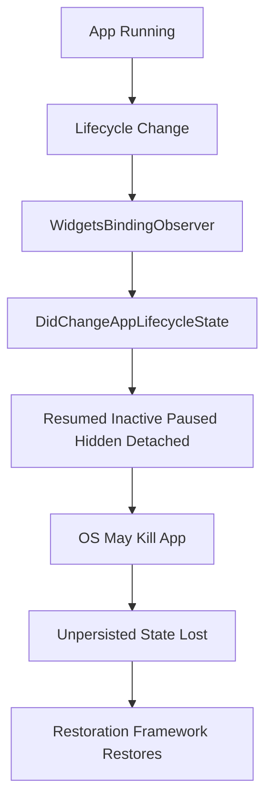

# The App Lifecycle and Restoration: What Happens When the OS Reclaims Your App

## English

Flutter apps do not run in a vacuum; the operating system can suspend them, background them, kill them under memory pressure, or restore them after a reboot, and a robust app responds sensibly to each. The WidgetsBindingObserver interface lets a widget subscribe to lifecycle changes through didChangeAppLifecycleState, which receives states such as resumed, inactive, paused, hidden, and detached. On mobile, paused usually means the app is in the background and may be killed at any moment; on desktop, inactive often means the window has lost focus but is still visible. Treating all non-resumed states as 'about to die' is a common mistake.

The hard truth is that on both iOS and Android, the OS may terminate a backgrounded app without warning to reclaim memory. Anything you have not persisted is gone. This is why Flutter offers the Restoration framework: widgets that implement RestorableProperty can save small pieces of state into a bucket that the engine persists, and on relaunch the framework calls restoreState to rebuild the widget with that saved data. RestorableInt, RestorableString, and RestorableRouteFuture are the building blocks, and the RestorationMixin wires them into a State object. The bucket is not a database; it is meant for transient UI state like scroll position, selected tab, or an in-progress form field, not for your whole domain model.

Restoration is not automatic. You must give your app a restorationScopeId in the root widget, opt individual routes in with restorablePush or similar, and mark each stateful widget that should participate. The payoff is that a user who backgrounds the app, opens twenty other apps, and comes back finds the same screen and the same draft text instead of a cold start on the home page.

Separately, lifecycle transitions are the right place to pause expensive work: stop video playback, cancel location streams, flush analytics, or save a draft to disk. Doing this in didChangeAppLifecycleState rather than in dispose is essential because the widget tree is not being torn down; the app is merely being paused. Conversely, resumed is a good moment to refresh data that may have gone stale while the app was away.

A subtlety on Android is that the activity can be destroyed and recreated for configuration changes like rotation or a theme switch, even though the process survives. Flutter handles most of this transparently, but plugins that hold native resources may need to re-register. When in doubt, log the lifecycle states your app actually receives on each platform; the sequence differs more than the documentation suggests, and observing it once saves hours of guessing.

## 中文

Flutter 應用並非活在真空之中；作業系統可以暫停它、把它放到背景、在記憶體壓力下殺掉它，或者在重新開機後還原它，而強健的應用要對每一種情況有合理反應。WidgetsBindingObserver 介面讓 widget 透過 didChangeAppLifecycleState 訂閱生命週期變化，接收 resumed、inactive、paused、hidden、detached 等狀態。在手機上，paused 通常代表應用在背景、隨時可能被殺；在桌面上，inactive 往往只代表視窗失去焦點但仍然可見。把所有非 resumed 狀態都當成「快要死掉」是常見錯誤。

殘酷的事實是：在 iOS 與 Android 上，作業系統都可能為了回收記憶體而在毫無預警下終止背景應用。你未持久化的東西都會消失。這正是 Flutter 提供 Restoration 框架的原因：實作 RestorableProperty 的 widget 可以把少量狀態存入引擎負責持久化的 bucket，重新啟動時框架會呼叫 restoreState，以儲存的資料重建 widget。RestorableInt、RestorableString、RestorableRouteFuture 是積木，而 RestorationMixin 把它們接到 State 物件上。這個 bucket 不是資料庫；它是為短暫的 UI 狀態而設，例如捲動位置、選中的分頁或填到一半的表單欄位，而不是你的整個領域模型。

還原並非自動發生。你必須在根 widget 給應用一個 restorationScopeId，用 restorablePush 之類的方法讓個別路由加入，並標記每個應參與的 stateful widget。回報是：使用者把應用放到背景、再開二十個其他應用、然後回來，會見到同一個畫面和同一段草稿文字，而不是冷啟動回到首頁。

另外，生命週期轉換正是暫停昂貴工作的好時機：停止影片播放、取消定位串流、沖刷分析事件，或把草稿寫入磁碟。要在 didChangeAppLifecycleState 而非 dispose 中做，因為 widget 樹並沒有被拆掉，應用只是被暫停。反過來說，resumed 是重新整理那些在離開期間可能已過時資料的好時機。

Android 上一個微妙之處是：即使行程仍然存活，activity 也可能因旋轉或主題切換等設定變更而被銷毀並重建。Flutter 大多透明地處理，但持有原生資源的外掛可能需要重新註冊。有疑問時，記錄你的應用在每個平臺實際收到的生命週期狀態；序列的差異比檔案所述更大，觀察一次就能省下數小時的猜測。

## Key Takeaway

Lifecycle states tell you when to pause work, and the Restoration framework lets you survive OS-initiated kills by persisting small, transient UI state rather than treating every background as fatal.

## Related Concepts
- WidgetsBindingObserver
- State restoration and restorationScopeId

## Diagram

