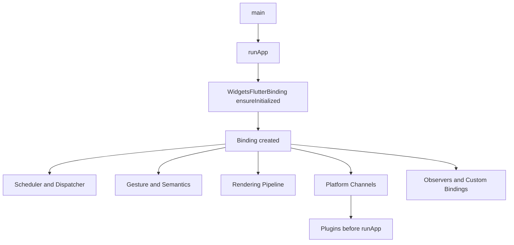

# WidgetsFlutterBinding and the Bootstrap: What Happens Before runApp

## English

Every Flutter app begins with a call to runApp, but a surprising amount happens before and around that call, and understanding it explains a class of bugs that otherwise look mysterious. The first thing runApp does is ensure a binding exists: it calls WidgetsFlutterBinding.ensureInitialized, which creates the glue object that connects the Dart side to the Flutter engine. This binding owns the scheduler, the platform dispatcher, the semantics tree, the gesture binding, and the rendering pipeline. Without it, there is no frame loop and no way to talk to the engine.

You will see WidgetsFlutterBinding.ensureInitialized called explicitly in main whenever you need to use a plugin before runApp. Plugins that talk to native code, such as shared_preferences or path_provider, require the binding to be initialized because they use platform channels, and channels cannot be created until the binding exists. Calling an async plugin method at the top of main without that line is a classic source of the 'Binding has not yet been initialized' error. The call is idempotent, so calling it more than once is harmless.

The binding is also where you register observers. WidgetsBindingObserver for lifecycle, the scheduler's addTimingsCallback for frame timing, and the platform dispatcher's setLocaleResolutionCallback all live on the binding. Custom bindings, such as those used for integration tests or for embedding Flutter in a non-standard host, subclass WidgetsFlutterBinding and mix in different behaviours. That is why testWidgets can run a widget tree without a real device: the test binding replaces the normal one.

Another bootstrap detail is the zone. Flutter runs your app inside a custom Zone that catches uncaught errors and forwards them to FlutterError.onError and the platform dispatcher. This is why an exception thrown in an async callback does not simply vanish; it becomes a red error screen in debug mode. If you want to install your own error handler, you do it by wrapping runApp in runZonedGuarded, and you must remember to call the binding's error handlers from inside.

The order of operations matters. Initialize the binding, then set up error handling, then initialise any dependencies that need platform access, then call runApp. Doing plugin work after runApp is fine, but doing it before requires the binding. Treating main as a careful bootstrap sequence rather than a one-liner pays off the first time a plugin silently fails in release mode because the binding was never set up on that code path.

## 中文

每個 Flutter 應用都始於一次 runApp 呼叫，但在這次呼叫前後其實發生了大量事情，明白這些就能解釋一批原本看似神秘的錯誤。runApp 第一件事就是確保 binding 存在：它呼叫 WidgetsFlutterBinding.ensureInitialized，建立連線 Dart 端與 Flutter 引擎的膠水物件。這個 binding 擁有排程器、平臺派發器、語意樹、手勢 binding 以及渲染管線。沒有它，就沒有幀迴圈，也無法與引擎溝通。

當你需要在 runApp 之前使用外掛時，就會在 main 中明確呼叫 WidgetsFlutterBinding.ensureInitialized。與原生碼溝通的外掛，例如 shared_preferences 或 path_provider，都需要 binding 已初始化，因為它們使用平臺通道，而通道要等 binding 存在後才能建立。在 main 頂部直接呼叫非同步外掛方法而漏了這一行，就是「Binding has not yet been initialized」錯誤的經典來源。這個呼叫是冪等的，多呼叫幾次也無害。

binding 亦是註冊觀察者的地方。生命週期用的 WidgetsBindingObserver、幀計時用的排程器 addTimingsCallback、以及平臺派發器的 setLocaleResolutionCallback，全都掛在 binding 上。自訂 binding，例如整合測試或把 Flutter 嵌入非標準宿主時所用的，會繼承 WidgetsFlutterBinding 並混入不同行為。這正是 testWidgets 可以在沒有真實裝置下執行 widget 樹的原因：測試 binding 取代了正常的 binding。

另一個啟動細節是 zone。Flutter 在一個自訂 Zone 中執行你的應用，捕捉未處理的錯誤並轉發到 FlutterError.onError 與平臺派發器。這就是為何在非同步回呼中丟擲的例外不會憑空消失，而是在除錯模式下變成紅色錯誤畫面。若你想安裝自己的錯誤處理器，就要用 runZonedGuarded 包裹 runApp，並緊記在裡面呼叫 binding 的錯誤處理器。

執行順序很重要。先初始化 binding，再設定錯誤處理，然後初始化任何需要平臺存取的依賴，最後才呼叫 runApp。在 runApp 之後做外掛工作沒有問題，但在之前做就必須有 binding。把 main 視為一段謹慎的啟動序列而非一行咒語，當你第一次遇到外掛因為某條程式路徑從未設定 binding 而在發行模式下靜靜失敗時，就會明白回報有多大。

## Key Takeaway

runApp depends on a binding that wires Dart to the engine, so plugin calls before runApp require WidgetsFlutterBinding.ensureInitialized, and treating main as an ordered bootstrap sequence prevents silent release-mode failures.

## Related Concepts
- WidgetsFlutterBinding
- runZonedGuarded and error zones

## Diagram

