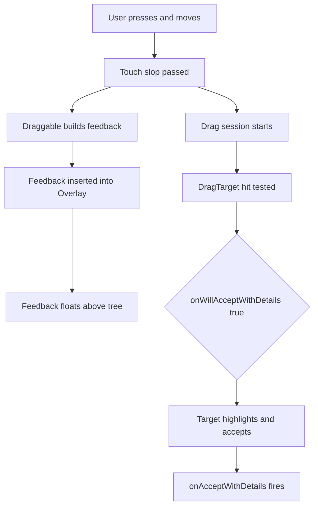

# Drag and Drop Internals: Draggable, DragTarget, and the Feedback Overlay

## English

Drag and drop in Flutter looks like magic, but it is really a small protocol between three widgets and one overlay. The Draggable widget is a gesture detector wrapped around a child: when the user presses and moves past the touch slop (the small distance a finger must travel before a drag is recognised), Draggable builds a 'feedback' widget — the thing you see floating under the finger — and inserts it into the nearest Overlay, not into the normal widget tree. That is why the feedback can escape the bounds of its parent's ClipRect or its ListView cell: it is rendered in a separate overlay stack above everything else. Meanwhile, the original child stays in place, usually dimmed or replaced via the childWhenDragging parameter, because Draggable does not remove anything from the tree. The drag is tracked by a Drag object created through the onDragStarted callback, and you can inspect its position and offset as the finger moves.

On the receiving side, DragTarget is a widget that registers itself with the same drag session. When a drag is in flight, Flutter walks the tree under the pointer (using the same hit-testing machinery that routes taps) and asks each DragTarget whether it will accept the payload. That decision is made by onWillAcceptWithDetails, which receives the dragged data plus the global offset. If it returns true, the target highlights itself through the builder's candidateData list; if the user lifts the finger over an accepting target, onAcceptWithDetails fires. The payload itself is whatever object you passed to Draggable's data parameter — there is no type enforcement at the framework level, so it is on you to cast it correctly on the receiving end.

A subtle but important detail: the feedback widget is not rebuilt by the target's setState. It lives in the Overlay's own element subtree, so if you want the feedback to react to the drag position (for example, to grow or change colour as it nears a valid target), you must use a custom Draggable that listens to the Drag update stream, or use the DragTarget's candidateData to drive changes through a shared ValueNotifier. Beginners often write setState inside onDragUpdate on the Draggable's parent and are surprised that the floating feedback does not update — because the parent rebuild does not reach the overlay entry.

Performance considerations matter here. Every active drag creates one overlay entry; if you build a drag-heavy UI such as a Kanban board, keep the feedback widget cheap (a Container with a fixed size, not a full card with images). Also remember that Draggable uses the gesture arena: if the drag is inside a scrollable, the vertical drag may be claimed by the scroll view instead. LongPressDraggable exists precisely for this: it waits for a long press before starting the drag, so a quick swipe still scrolls the list.

Finally, drag and drop is a good example of a general Flutter pattern you will meet again: a widget that needs to render outside its parent's box does so by mounting into the Overlay. Tooltips, autocomplete menus, context menus, and dropdown popups all use the same trick. Understanding that the overlay is a separate layer, driven by a global OverlayState, makes the behaviour of all these widgets predictable instead of mysterious.

## 中文

Flutter 嘅拖放（drag and drop）睇落好似魔法，但其實只係三個 widget 加一個 overlay 之間嘅小型協議。Draggable 係一個包住 child 嘅手勢偵測器：當使用者按下並移動超過 touch slop（手指要行幾遠先算開始拖嘅小距離）之後，Draggable 會建立一個「feedback」widget —— 即係你見到浮喺手指下面嗰樣嘢 —— 並將佢插入最近嘅 Overlay，而唔係插入正常嘅 widget tree。呢個就係點解 feedback 可以走出 parent 嘅 ClipRect 或者 ListView cell 邊界：佢係喺一個獨立嘅 overlay stack 上面 render，浮喺所有嘢之上。同時，原本嘅 child 會留喺原位，通常會變暗或者透過 childWhenDragging 引數換成另一個 widget，因為 Draggable 唔會喺 tree 度移除任何嘢。整個拖曳過程由 onDragStarted 回呼建立嘅 Drag 物件追蹤，你可以喺手指移動期間檢查佢嘅位置同 offset。

接收嗰邊，DragTarget 係一個向同一個拖曳 session 註冊自己嘅 widget。當有拖曳進行中，Flutter 會喺指標下面行一次 tree（用返同處理 tap 一樣嘅 hit-testing 機制），逐個問每個 DragTarget 收唔收呢個 payload。呢個決定由 onWillAcceptWithDetails 做，佢會收到被拖嘅資料加埋 global offset。如果佢 return true，個 target 就會透過 builder 嘅 candidateData 清單將自己高亮；如果使用者喺一個接受嘅 target 上面放手，onAcceptWithDetails 就會觸發。Payload 本身係你傳俾 Draggable 嘅 data 引數嗰個物件 —— framework 層面冇 type 檢查，所以喺接收端做 cast 係你自己嘅責任。

一個細微但重要嘅細節：feedback widget 唔會因為 target 嘅 setState 而 rebuild。佢住喺 Overlay 自己嘅 element subtree 入面，所以如果你想 feedback 隨拖曳位置有反應（例如越接近有效 target 就越變大或者變色），你要用一個自己監聽 Drag update stream 嘅 custom Draggable，或者用 DragTarget 嘅 candidateData 透過一個共用嘅 ValueNotifier 去驅動變化。初學者成日喺 Draggable 嘅 parent 度寫 setState 加落 onDragUpdate，然後奇怪點解浮住嗰個 feedback 唔更新 —— 因為 parent 嘅 rebuild 去唔到 overlay entry。

效能考慮喺呢度好重要。每一個進行中嘅拖曳會建立一個 overlay entry；如果你整一個拖放密集嘅 UI，例如看板（Kanban board），就要保持 feedback widget 便宜（一個固定大小嘅 Container，唔好係一張有圖嘅完整卡片）。另外要記住 Draggable 用嘅係 gesture arena：如果拖曳喺一個 scrollable 入面，垂直拖曳可能會俾 scroll view 搶咗。LongPressDraggable 正正就係為咗呢個情況而存在：佢會等長按之後先開始拖，所以快速掃一下仍然會捲動個 list。

最後，拖放係一個你之後會再遇到嘅通用 Flutter 模式嘅好例子：一個需要喺 parent box 以外 render 嘅 widget，會 mount 入 Overlay。Tooltip、autocomplete 選單、context menu、dropdown popup 全部都係用同一招。明白 overlay 係一個由全域 OverlayState 驅動嘅獨立層，會令呢啲 widget 嘅行為由神秘變成可預測。

## Key Takeaway

Draggable renders its feedback in the Overlay, not the parent tree, and DragTarget accepts payloads through hit-testing, which explains both the floating behaviour and why parent setState does not update the feedback.

## Related Concepts
- Gesture Arena and Hit Testing
- Overlay, Dialogs, and the Navigator's Stack

## Diagram

