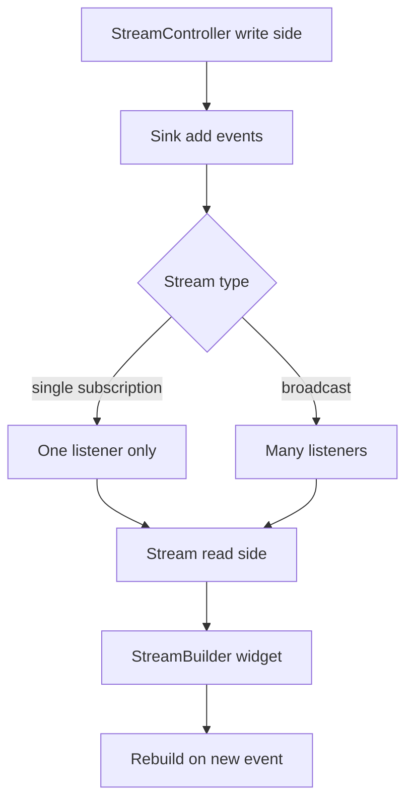

# Streams and Sinks in Flutter: The Plumbing Behind Reactive Widgets

## English

Many Flutter widgets that seem to 'listen' to something — StreamBuilder, BlocBuilder, ValueListenableBuilder, even the animation system — are all built on Dart's Stream abstraction. A Stream is a sequence of asynchronous events delivered over time, and it has two ends: a Stream (the read side) and a StreamController (the write side) which exposes a Sink. If you have ever wondered how a text field's onChanged could drive a debounced search, or how a Bloc exposes state, the answer is almost always: somewhere there is a StreamController and a widget that subscribes to its stream. Understanding this plumbing demystifies a lot of 'reactive' code that otherwise looks like magic.

There are two flavours of stream. A single-subscription stream allows only one listener for its entire lifetime; if a second widget tries to listen, you get a StateError. A broadcast stream allows many listeners, but events emitted before a listener subscribes are lost — there is no replay. This distinction is a common source of bugs: a Bloc typically uses a broadcast stream for its state so that several widgets can watch it, while a file-read stream is usually single-subscription because the file can only be read once. When you build your own controller, StreamController.broadcast() is the choice for state that many widgets observe, and a plain StreamController() is the choice when a single consumer should process each event exactly once.

StreamBuilder is the widget-level adapter: give it a stream and a builder, and it rebuilds whenever a new event arrives, passing you a snapshot with the connection state (waiting, active, done) and either data or an error. Two sharp edges to know. First, if you build the stream inside the builder or pass a new stream on every rebuild, StreamBuilder will unsubscribe and resubscribe, losing events and possibly restarting network calls — always create the stream once, in initState or a parent, and keep a reference. Second, StreamBuilder only rebuilds its own subtree; it is not a state management solution, just a bridge. For synchronous values, ValueListenableBuilder and ValueNotifier are the cheaper cousin: no stream, no async, but the same 'rebuild when the value changes' idea.

A very practical pattern is debouncing user input with streams. You take a StreamController<String>, push every keystroke into it from onChanged, and then transform the stream with operators like debounceTime (from the rxdart package) before feeding it into a StreamBuilder that performs the search. The operators are where streams shine: map, where, distinct, and debounce let you describe a pipeline declaratively, and each operator returns a new stream without mutating the original. This is the same idea as Unix pipes: each stage transforms events, and the final subscriber sees only the filtered, debounced result.

One last thing to internalise: a stream subscription is a resource. If you subscribe manually with stream.listen(...), you must cancel the subscription in dispose, or you leak. StreamBuilder does this for you automatically when it is removed from the tree, which is why preferring widgets over manual listen calls is usually safer. The mental model to keep is: controllers are owned by a stateful object (a Bloc, a service, a State), streams are handed out to widgets, and widgets subscribe via builders that manage their own subscription lifecycle. Get that ownership straight and most 'why is my UI not updating' or 'why is it updating twice' questions answer themselves.

## 中文

好多 Flutter widget 睇落好似「聽緊」某啲嘢 —— StreamBuilder、BlocBuilder、ValueListenableBuilder，甚至動畫系統 —— 其實全部都建基於 Dart 嘅 Stream 抽象。Stream 係一連串隨時間送達嘅非同步事件，佢有兩端：一個 Stream（讀嘅一邊）同一個 StreamController（寫嘅一邊），後者會 expose 一個 Sink。如果你曾經諗過一個 text field 嘅 onChanged 點樣驅動一個 debounce 咗嘅搜尋，或者一個 Bloc 點樣 expose 佢嘅 state，答案幾乎永遠都係：某處有一個 StreamController，同一個訂閱佢個 stream 嘅 widget。明白呢條水管，就會令好多原本睇落好似魔法嘅「響應式」code 變得清晰。

Stream 有兩種。單訂閱（single-subscription）stream 喺佢整個生命週期只准一個 listener；如果第二個 widget 嘗試 listen，你會收到 StateError。廣播（broadcast）stream 就準好多個 listener，但 listener 訂閱之前發出嘅事件會流失 —— 冇 replay。呢個分別係常見 bug 嘅來源：一個 Bloc 通常會用 broadcast stream 去 expose 佢嘅 state，令多個 widget 可以一齊睇；而讀檔嘅 stream 通常係 single-subscription，因為個檔只可以讀一次。當你自己整 controller 嘅時候，俾好多 widget 觀察嘅 state 就用 StreamController.broadcast()，而當每個事件應該由單一消費者處理一次嘅時候就用普通嘅 StreamController()。

StreamBuilder 係 widget 層面嘅轉接器：俾佢一個 stream 同一個 builder，佢就會喺有新事件時 rebuild，並傳一個 snapshot 俾你，入面有 connection state（waiting、active、done）同埋 data 或者 error。有兩個陷阱要知。第一，如果你喺 builder 入面建立個 stream，或者每次 rebuild 都傳一個新 stream，StreamBuilder 就會退訂再重新訂閱，流失事件，甚至可能重啟網路請求 —— 永遠喺 initState 或者 parent 度建立個 stream 一次，並保留一個 reference。第二，StreamBuilder 只會 rebuild 佢自己嗰個 subtree；佢唔係一個 state management 方案，只係一條橋。對於同步嘅值，ValueListenableBuilder 同 ValueNotifier 係便宜啲嘅表親：冇 stream、冇 async，但係同一個「值變就 rebuild」嘅概念。

一個非常實用嘅模式係用 stream 為使用者輸入做 debounce。你攞一個 StreamController<String>，喺 onChanged 將每個按鍵推入去，然後用 debounceTime（來自 rxdart package）呢類 operator 轉換個 stream，先至餵入一個做搜尋嘅 StreamBuilder。Operator 就係 stream 發光嘅地方：map、where、distinct 同 debounce 令你可以用宣告式去描述一條 pipeline，而每個 operator 都係 return 一個新 stream，唔會改動原本嗰個。呢個同 Unix pipe 係同一個概念：每一段轉換事件，最後嘅訂閱者只見到過濾咗、debounce 咗嘅結果。

最後一樣要內化嘅事：stream subscription 係一種資源。如果你用 stream.listen(...) 手動訂閱，你必須喺 dispose 度 cancel 個訂閱，否則就會 leak。StreamBuilder 喺被移出 tree 嘅時候會自動幫你做呢件事，所以一般嚟講，用 widget 好過手動 listen 會安全啲。要記住嘅心智模型係：controller 由一個有狀態嘅物件擁有（一個 Bloc、一個 service、一個 State），stream 交俾 widget，而 widget 透過 builder 訂閱，builder 會自己管理訂閱嘅生命週期。搞清呢個擁有權，大部分「點解我個 UI 唔更新」或者「點解佢更新兩次」嘅問題都會自己解答。

## Key Takeaway

Streams have a read side and a write side owned by a StreamController, and understanding single-subscription versus broadcast streams plus subscription lifecycle explains most reactive widget behaviour in Flutter.

## Related Concepts
- Async UI Patterns: FutureBuilder, StreamBuilder
- State Management: setState, Provider, Bloc and Riverpod

## Diagram

