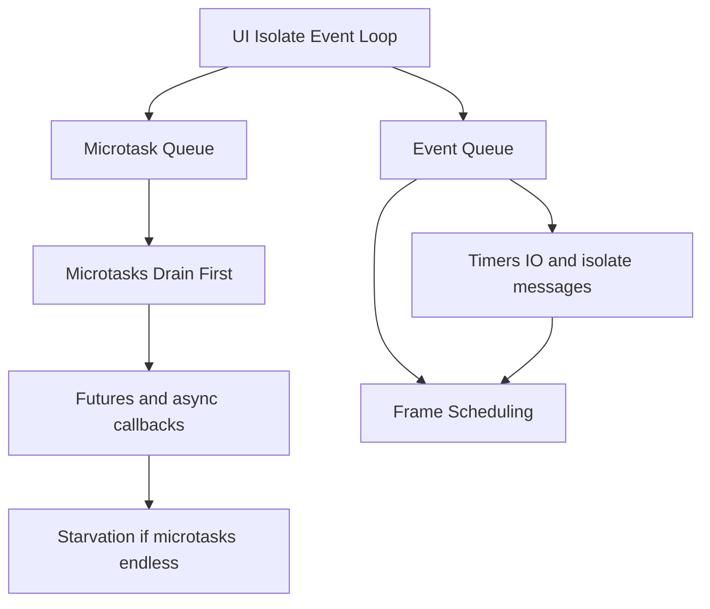

# The Isolate Group and Event Loop: What Dart Actually Schedules

## English

Dart is often described as 'single-threaded', which is true of any one isolate but misleading about the whole app. Each isolate has its own event loop and its own microtask queue, and Flutter apps typically run several isolates: the main UI isolate, a platform/engine isolate on some platforms, and any isolates you spawn with Isolate.spawn or compute. The event loop is the scheduler that decides what runs next, and understanding it explains a whole class of bugs — janky frames, futures that never complete, and setState calls that seem to happen 'late'.

The loop works in two queues. The microtask queue has priority: every microtask is drained before the loop picks up the next event. Futures that complete synchronously, scheduleMicrotask, and the completion callbacks of async functions all land here. The event queue holds I/O callbacks, timers, and messages from other isolates. The rule is simple but consequential: if you keep scheduling microtasks (for example, a Future that completes itself in a chain), the event queue never gets a turn, and timers or frame callbacks starve. This is why a tight loop of `Future.microtask` is dangerous in a way that `Future.delayed(Duration.zero)` is not — the latter goes through the event queue and lets the frame pipeline breathe.

Frame scheduling in Flutter is itself an event-loop citizen. The engine asks the framework to build and lay out a frame through the SchedulerBinding, which schedules work via the event loop. If your synchronous code on the UI isolate takes 20ms, the frame is late and you drop frames; no amount of async cleverness fixes a blocking computation. That is the entire reason isolates exist: heavy work — parsing large JSON, image decoding, encryption — is moved to a separate isolate so the UI isolate's event loop stays free. The catch is that isolates do not share memory: you send data by copying (or by transferring ownership of certain objects), which costs time proportional to the payload. Sending a 50 MB buffer to an isolate is itself expensive.

Communication between isolates uses ports. Each isolate has a ReceivePort, and you send messages to it via a SendPort. Since Dart 2.15, isolates can also be part of an isolate group that shares some internal state (notably, the same code and some VM structures), which makes spawning much cheaper than it used to be, but the programming model is still message-passing. The compute() helper wraps this pattern: it spawns an isolate, runs a top-level or static function with one argument, and returns a Future of the result. It is convenient but has a cost per call, so for repeated work you should keep a long-lived isolate with a port and reuse it.

A final practical point: the UI isolate is also where platform channel calls are initiated, and those responses come back as events on the same loop. A MethodChannel call is asynchronous precisely because it must not block the UI isolate waiting for the native side. If you ever see a Future that 'never completes', check whether its completion depends on a platform message that was never sent, or on a microtask that is itself waiting on a microtask — the event loop will happily sit there with nothing to do. Reading Flutter's async behaviour through the lens of two queues plus message ports turns a lot of folklore into mechanics.

## 中文

Dart 成日被形容為「單執行緒」，呢個講法對任何一個 isolate 嚟講係啱嘅，但對成個 app 嚟講就有誤導。每個 isolate 有自己嘅 event loop 同自己嘅 microtask queue，而 Flutter app 通常會跑幾個 isolate：主 UI isolate、某啲平臺上嘅 platform/engine isolate，仲有你自己用 Isolate.spawn 或者 compute 開嘅 isolate。Event loop 係決定下一步跑乜嘢嘅排程器，明白佢就解釋到一整類 bug —— 卡幀、永遠唔 complete 嘅 future，同埋好似「遲咗」先發生嘅 setState。

個 loop 用兩個 queue 運作。Microtask queue 有優先權：每個 microtask 都會喺 loop 攞下一個 event 之前排清。同步 complete 嘅 Future、scheduleMicrotask，同 async function 嘅完成回呼全部都落喺呢度。Event queue 就裝住 I/O 回呼、timer，同來自其他 isolate 嘅訊息。規則簡單但後果重大：如果你不停 schedule microtask（例如一個 Future 喺鏈入面自己 complete 自己），event queue 就永遠冇機會輪到，timer 同 frame 回呼就會餓死。呢個就係點解一串密集嘅 `Future.microtask` 危險，而 `Future.delayed(Duration.zero)` 唔危險 —— 後者會經 event queue，俾 frame pipeline 透氣。

Flutter 嘅 frame 排程本身就係 event loop 嘅公民。引擎透過 SchedulerBinding 叫 framework build 同 layout 一個 frame，而 SchedulerBinding 係經 event loop 排工作。如果你喺 UI isolate 嘅同步 code 用咗 20ms，個 frame 就遲，你就會 drop frame；幾多 async 技巧都補救唔到一個阻塞嘅運算。呢個就係 isolate 存在嘅全部原因：重嘅工作 —— parse 大 JSON、解碼圖片、加密 —— 會搬去另一個 isolate，令 UI isolate 嘅 event loop 保持空閒。陷阱係 isolate 之間唔共享記憶體：你係靠複製去傳資料（或者轉移某啲物件嘅擁有權），成本同 payload 大小成正比。傳一個 50 MB 嘅 buffer 去 isolate 本身就好貴。

Isolate 之間嘅通訊用 port。每個 isolate 有一個 ReceivePort，你透過 SendPort 傳訊息俾佢。由 Dart 2.15 開始，isolate 可以屬於一個 isolate group，共享部分內部狀態（特別係同一份 code 同某啲 VM 結構），令 spawn 比以前便宜好多，但程式設計模型仍然係訊息傳遞。compute() 輔助函式就包住呢個模式：佢 spawn 一個 isolate，用一個引數跑一個 top-level 或者 static function，然後 return 一個 Future 俾你攞結果。佢好方便，但每次呼叫都有成本，所以對於重複嘅工作，你應該保留一個長壽嘅 isolate 加 port 去重用。

最後一個實用重點：UI isolate 亦都係發起 platform channel 呼叫嘅地方，而啲回應會以 event 嘅形式返到同一個 loop。MethodChannel 呼叫之所以係非同步，正正就係因為佢唔可以阻塞 UI isolate 去等 native 嗰邊。如果你見到一個 Future「永遠唔 complete」，就檢查下佢嘅完成係咪依賴一個從來冇送出嘅 platform message，或者依賴一個本身又等緊另一個 microtask 嘅 microtask —— event loop 會好樂意坐喺度乜都唔做。用兩個 queue 加訊息 port 嘅角度去睇 Flutter 嘅 async 行為，就會將好多「都市傳說」變成實實在在嘅機制。

## Key Takeaway

Dart's event loop drains microtasks before events, and Flutter isolates communicate only by message-passing ports, which together explain frame scheduling, jank, and why blocking work must move off the UI isolate.

## Related Concepts
- The Dart Isolate Model and Background Work
- Isolates, Compute, and the Single-Threaded UI Trap

## Diagram

