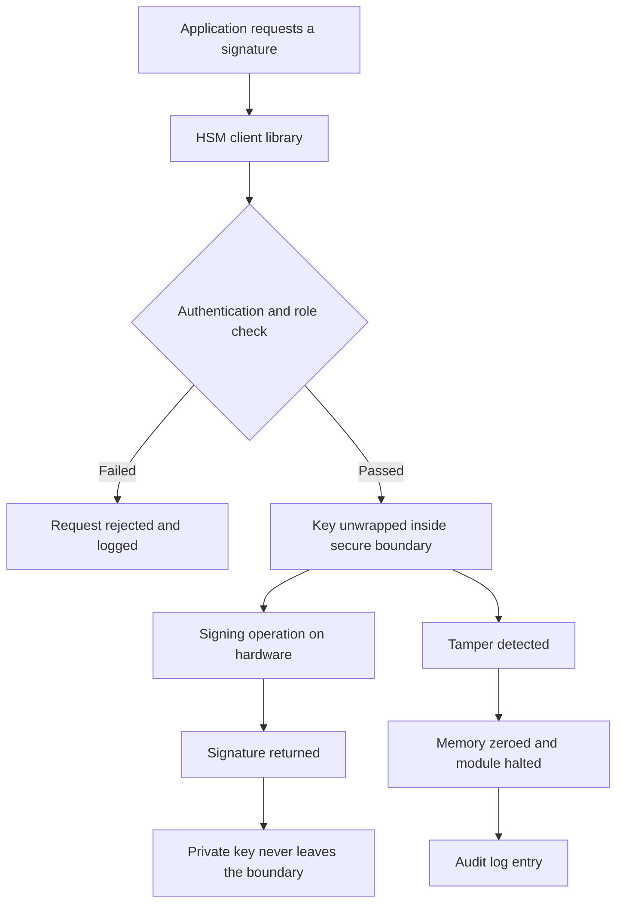

# Why Hardware Key Protection Matters: FIPS 140-2 and 140-3

### English

A private key stored in a plain file is a piece of text sitting on a disk. Any software that can read the file can copy the key and use it forever, without leaving a trace of who did it. This is why the phrase "the key was never in memory" is meaningless once the key has been written to disk, and why attackers prefer ransomware-style bulk extraction over sophisticated attacks. A Hardware Security Module (HSM) changes the physical assumption: the key is generated inside a tamper-resistant hardware boundary, and operations that use it — signing, decryption — happen inside that boundary, so the key itself never appears in the memory of a general-purpose server.

FIPS 140-2 is the US NIST standard that defines how such a module is evaluated. It has four levels, and the levels differ mostly in how much the manufacturer proved about the physical and logical protection of the module, not about the cryptography itself. Level 1 is essentially a software cryptographic module, with no physical protection requirements. Level 2 requires tamper-evident packaging — you cannot open the case without leaving obvious signs. Level 3 adds active tamper resistance: the module actively detects intrusion, zeros its memory, and shuts down, and it also requires role-based authentication and stronger key-management audit logging. Level 4 adds an enclosing tamper-resistant envelope with ongoing physical security, protecting against all physical attack scenarios, and is typically used in highly sensitive government contexts.

FIPS 140-3 is the updated version, and its big change is that it no longer certifies the module alone. It separates the *cryptographic module* from the *cryptographic module boundary* and evaluates the underlying platform — the specific hardware chip and firmware — using a Common Criteria-based approach, with the module's security policy documenting what is in scope. In practice this means a certificate can point at a specific chip revision and a specific set of hardware, and cloud HSMs are typically certified at Level 3 while their underlying platforms are certified at Level 4.

### 中文

存放於普通檔案中的私鑰，其實只是一段躺在磁碟上的文字。任何讀得到該檔案的軟件都可以複製金鑰並且永久使用它，卻不會留下是誰做的紀錄。這正是「金鑰從未存在記憶體」這句話在金鑰落地成檔案之後毫無意義的原因，也是攻擊者寧取大量資料外洩，而非費心高階攻擊的原因。Hardware Security Module（HSM）改變了這個物理假設：金鑰在防篡改的硬體邊界之內產生，而使用金鑰的操作（簽署、解密）同樣在該邊界內進行，因此金鑰本身從不會出現在通用伺服器的記憶體中。

FIPS 140-2 是美國 NIST 訂定、用來評估這類模組的標準。它的四個級別主要差別在製造商須證明模組在實體與邏輯上的保護程度，而不是密碼演算法本身。Level 1 基本上等同軟件密碼模組，沒有實體保護要求。Level 2 要求防篡改封裝：開箱會留下明顯痕跡。Level 3 加入主動防篡改能力——模組會偵測入侵、清零記憶體並關機，同時要求基於角色的認證與更嚴謹的金鑰管理審計紀錄。Level 4 再加上具持續實體防護的外層封裝，抵禦所有實體攻擊情境，通常用於高度敏感的政府場景。

FIPS 140-3 是更新版本，最大改變是不再單獨認證模組。它把「密碼模組」與「密碼模組邊界」分開，並以 Common Criteria 為基礎的方法評估底層平台——特定晶片與韌體——再由模組的安全策略文件說明範圍。實務上，憑證可以指向特定晶片版本與特定硬體組合，而雲端 HSM 通常在 Level 3 取得認證，其底層平台則獲 Level 4 認證。

## Key Takeaway
An HSM moves the private key inside a tamper-resistant boundary, and FIPS levels rate how strongly that boundary is proven to resist physical attack — from plain software up to continuous physical protection.

## Related Concepts
- Tamper Resistance
- Key Storage versus Key Usage
- Common Criteria (CC) Evaluation
- NIST Security Standards

## Diagram

