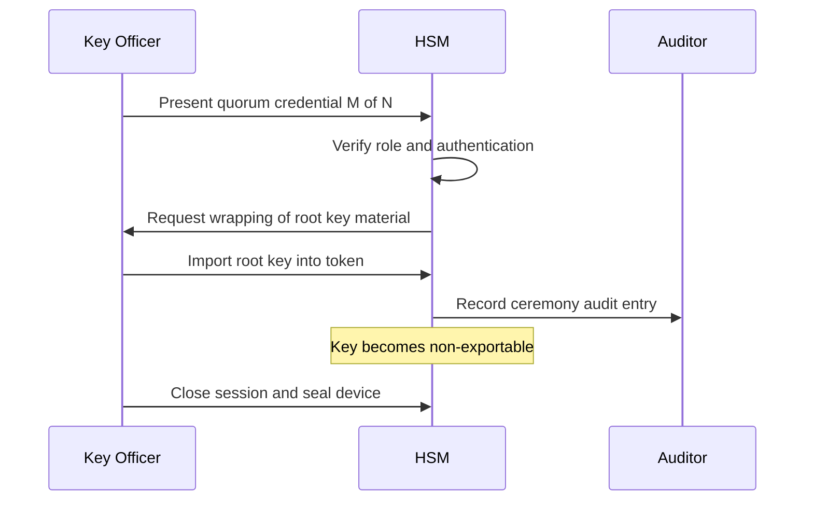

# The HSM Boundary, PKCS#11, and M-of-N Key Ceremonies

### English

The line between an HSM and ordinary key storage is not really about the hardware — it is about where the boundary sits. If your application can call `export_private_key()` and receive the raw key bytes, you have a key store with extra steps. If the only operations available are "sign this digest with key A", "decrypt this ciphertext with key B", and "derive a new key", then the key is non-exportable and the boundary is real. Most modern HSMs and cloud KMS services set the private key attribute to be non-extractable precisely so that no software bug, memory dump, or curious administrator can walk away with the key material.

PKCS#11 is the most widely implemented standard for talking to a cryptographic device. It defines a C API — functions like `C_Login`, `C_GenerateKeyPair`, `C_Sign`, and `C_FindObjects` — over a set of objects such as keys, certificates, and data blobs. Objects live inside "slots" and "tokens", sessions are opened against them, and access is controlled by a login state. Implementations exist for on-premise HSMs and for cloud KMS services, which lets the same application code work against a local device in development and a managed service in production. The newer PKCS#11 v3.1 specification adds mechanisms for asymmetric key agreement and message-based authentication codes, and makes the interface more uniform across providers.

Operating an HSM safely is also a human process, not just an API call. Before a device is put into service it undergoes a key ceremony: a formal, witnessed, photographed procedure in which the authorised officers insert the CA root key and any key-encrypting keys, with each step checked by a quorum of people. The same M-of-N thinking applies to splitting secrets. If a key is split into N shares, each held by a different person or site, then M of those shares are needed to reconstruct it — say 3 of 5, or 2 of 3. Nobody alone can steal or use the key, but if too many people leave the organisation, the key can become unrecoverable, which is why backup shares and succession planning are part of the same ceremony.

### 中文

HSM 與普通金鑰儲存的界線，重點其實不在硬件，而在邊界劃在哪裡。如果你的應用程式可以呼叫 `export_private_key()` 並拿到原始金鑰位元組，那你不過是一個多了額外步驟的 key store。若可用的操作只有「用金鑰 A 簽署這個摘要」、「用金鑰 B 解密這段密文」、「衍生一把新金鑰」，金鑰便是不可匯出的，邊界才真正成立。現今大部分 HSM 與雲端 KMS 都把私鑰屬性設定為不可抽取，正是為了防止任何軟件漏洞、記憶體傾印或起好奇心的管理員把金鑰帶走。

PKCS#11 是與密碼裝置溝通最廣泛採用的標準。它定義了一組 C API 函數（如 `C_Login`、`C_GenerateKeyPair`、`C_Sign`、`C_FindObjects`），作用於金鑰、憑證與資料物件之上。物件存放在 slot 與 token 之內，session 會對其開啟，存取權限由登入狀態控制。無論是本地 HSM 還是雲端 KMS 都有對應實作，令同一套應用程式碼可以在開發環境對接本地裝置、在生產環境對接託管服務。較新的 PKCS#11 v3.1 加入了非對稱金鑰協商與基於訊息的認證碼機制，也讓各家供應商的介面更為一致。

安全地操作 HSM 同時是一套人員流程，而不只是 API 呼叫。裝置投入服務前要進行 key ceremony：由獲授權人員共同見證與記錄的正式程序，把 CA 根金鑰與各金鑰加密金鑰逐一載入，每一步都經過法定人數核對。相同的 M-of-N 思維亦用於分割祕密：若金鑰分成 N 份、由不同的人或不同據點各自保管，則必須集齊 M 份才能重組，例如 5 取 3 或 3 取 2。單獨無人能偷走或使用金鑰；但若太多人離職，金鑰也可能無法復原，因此備份分片與接班計劃都屬於同一場儀式的一部分。

## Key Takeaway
A real HSM boundary means keys are non-exportable and only usable through defined operations, while PKCS#11 standardises that access and M-of-N ceremonies make the humans around the device as safe as the hardware.

## Related Concepts
- Non-Extractable Keys
- Key Splitting and Shamir's Scheme
- Cloud KMS
- Certificate Authority (CA)

## Diagram

