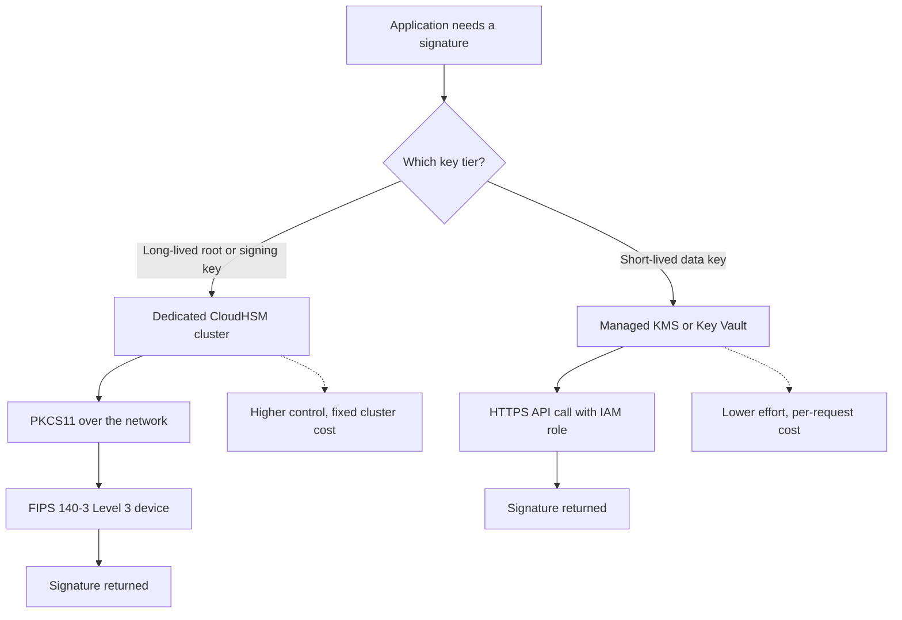

# Cloud HSMs: AWS CloudHSM and Azure Key Vault in Practice

### English

Running an on-premise HSM is expensive: the appliance costs tens of thousands of dollars, it needs its own rack, power and cooling, and it has to be physically guarded. It is also slow to scale and impossible to reach from a serverless function. Cloud HSM services exist to give you the same non-exportable, tamper-resistant key boundary without owning the box. AWS CloudHSM provides a dedicated FIPS 140-3 Level 3 cluster of hardware devices that you interact with directly through PKCS#11, so you get near-total control over the keys. Azure Key Vault and AWS KMS sit one layer up: they are managed services where the provider owns the hardware, and you call simple HTTPS APIs to sign or decrypt.

That layering is the main trade-off. A managed service gives you excellent availability, global replication, and integration with identity systems through IAM roles, but you accept the provider's operational model and pay per API call, per stored key version, or per month. A dedicated CloudHSM cluster gives you control, custom key policies and audit, and separation from the provider's key-management service, but you pay a cluster rental fee whether you use it or not, plus you pay for the instances that connect to it. A typical pattern is to keep long-lived root and signing keys in a dedicated HSM, and put short-lived data-encryption keys in the managed KMS, because the latter are created, used, and destroyed constantly.

Performance is usually the least surprising factor. A remote HSM adds a network round trip to every signing operation, so a service doing thousands of signatures per second will feel the latency. That is why designs often cache, or batch, or sign a signed timestamp instead of each individual request. Cost is the factor that surprises people: API-based KMS charges add up quickly at scale, and dedicated clusters carry a fixed monthly cost that a small project cannot justify. It is worth remembering that non-exportability is the feature you are paying for; anything that offers the same guarantees more cheaply usually does so by giving up control of the hardware, and you should decide whether that trade is acceptable for the keys in question.

### 中文

自建本地 HSM 成本高昂：機器本身要數萬美元，需要獨立機櫃、電力與冷卻，還要有實體保安。人數增加時擴充緩慢，無伺服器函數更不可能連到它。雲端 HSM 服務讓你在不擁有該設備的情況下，獲得同樣不可匯出、防篡改的金鑰邊界。AWS CloudHSM 提供專屬的 FIPS 140-3 Level 3 硬體叢集，你可以透過 PKCS#11 直接操作，對金鑰近乎全面掌控。Azure Key Vault 與 AWS KMS 則再高一層：它們是託管服務，由供應商擁有硬件，你只需呼叫簡單的 HTTPS API 來簽署或解密。

這種分層正是主要取捨。託管服務提供極佳的可用性、跨地域複製，以及透過 IAM 角色與身分系統整合的便利，但你必須接受供應商的操作模式，並按 API 呼叫次數、儲存金鑰版本數或按月收費。專屬 CloudHSM 叢集則給你控制權、自訂金鑰政策與稽核，並與供應商的金鑰管理服務分離，但無論有沒有使用都要支付叢集租用費，外加連接它的實例費用。常見做法是：長期的根金鑰與簽署金鑰放進專屬 HSM，短期的資料加密金鑰放進託管 KMS——因為後者被頻繁地建立、使用與銷毀。

效能通常反而不是最令人意外的因素。遠端 HSM 令每次簽署多一次網絡來回，每秒做數千次簽署的服務會感受到延遲。因此設計上常見快取、批次處理，或改為簽署一個已簽名的時間戳，而非逐筆簽署。成本才是最令人意外的一項：API 制收費在規模上會迅速累積，而專屬叢集的固定月費又非小項目所能承擔。別忘記你付費買的正是「不可匯出」這個特性；任何能以更低成本提供同等保證的方案，通常都是放棄了對硬件的控制，你應該自行判斷對這些金鑰而言該取捨是否可接受。

## Key Takeaway
Cloud HSMs trade control for convenience and scale: dedicated clusters give you hardware ownership and custom policy, managed vaults give you global availability and IAM integration, and cost follows whichever side you pick.

## Related Concepts
- AWS KMS
- Identity and Access Management (IAM)
- Non-Exportable Keys
- Root Certificate and Intermediate CA

## Diagram

