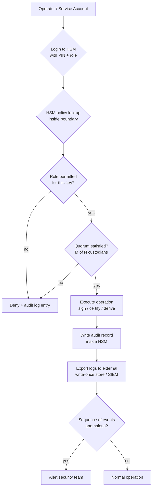

# HSM Roles, Quorums, and Day-to-Day Administration

### English

An HSM protects keys, but the thing that actually protects the HSM is *governance* — the set of rules that decide who may perform which operation, under what conditions, with what record left behind. Security literature calls these rules **roles** and **quorums**. A role is a named job with a defined set of permitted actions (generate a key, certify a certificate, sign a CSR, view audit logs); a quorum is the number of distinct role-holders who must be present before an action is permitted. A quorum of 2 out of 3 custodians means no single person can act alone, but losing one custodian does not stop the operation.

The reason is separation of duties. If the same person who owns the root CA private key could also approve its use, then compromising that one account compromises the entire trust chain. Splitting the root across three authorised officers — one generates the key, one certifies it, one activates it — means an attacker needs multiple compromises, or an insider conspiracy, to do real damage. HSMs implement this natively: the policy attached to a key states which roles may use it, and the device enforces it internally, so a misconfigured application cannot escalate. The important detail is that the policy lives *with the key inside the boundary*, not in the application configuration, which means an attacker who compromises the application server still cannot bypass the quorum.

Every HSM operation produces an audit record: who logged in, from where, what was done, with what result. These logs are the second half of the security argument, and they are the part most often neglected. The common failure is that an HSM has superb tamper resistance but nobody reads the logs, so a slow, low-and-slow key abuse goes unnoticed. A healthy operational pattern is to export audit logs to a write-once store or a SIEM (security information and event management system) outside the HSM's control, and alert on sequences that should not happen: a login at 3 a.m., a signing operation on a key that is normally used once a week, an attempted activation of the root key, a failure of the quorum. Alerting on individual events produces noise; alerting on sequences finds misuse.

Role separation also shapes day-to-day work. In a CA context there are typically distinct roles for the root CA, the issuing CA, the auditor (read-only on logs), and the backup operator — and no person should hold both "issue certificates" and "approve the certificate policy". In payment networks the same structure appears as key-usage roles (sign, decrypt, MAC, wrap), each with its own quorum, so that a compromise of the signing role alone cannot forge transactions. Cloud HSM services offer the same model through key policies and IAM roles, and the quorum becomes a matter of configuring the identity provider correctly.

Two operational realities deserve emphasis. First, HSM sessions have timeouts and PIN/credential states, and a session left logged in is an open door — the operational discipline of locking the device between ceremonies matters. Second, key ceremonies must be reproducible and witnessed: if the root CA cannot be reconstructed during a disaster with a documented, quorum-approved procedure, then the "high availability" of an HSM cluster is an illusion. Governance is not paperwork around the cryptography; in a well-run PKI it *is* the cryptography's effectiveness.

### 中文

HSM 保護金鑰，但真正保護 HSM 的是 *治理*——即決定誰可以在甚麼情況下執行哪項操作、並留下甚麼紀錄的一整套規則。安全文獻稱之為 **role**（角色）與 **quorum**（法定人數）。角色是一個具名的職責，附帶一組定義好的可執行操作（產生金鑰、證明憑證、簽署 CSR、查閱稽核紀錄）；法定人數則是執行某項操作前必須在場的不同角色持有者數目。3 選 2 代表無人能單獨行動，但失去一位保管人亦不會令操作停擺。

原因是職責分離（separation of duties）。若同一人既持有根 CA 私鑰、又能審批其使用，那麼攻破該一個帳戶就等於攻破整條信任鏈。把根金鑰分給三位授權人員——一位產生、一位證明、一位啟動——意味著攻擊者需要多次入侵或內部串謀才能造成實質損害。HSM 原生支援這套機制：金鑰所附帶的政策會指明哪些角色可以使用它，裝置在內部強制執行，因此設定錯誤的應用程式也無法越權。關鍵在於政策與金鑰一起存放 *於邊界之內*，而不是放在應用程式的設定檔裡——即使攻擊者控制了應用伺服器，依然繞不過法定人數。

每一項 HSM 操作都會產生稽核紀錄：誰登入、從哪裡、做了甚麼、結果如何。這些紀錄是安全論證的另一半，亦是最常被忽略的一環。常見的失敗模式是：HSM 有極佳的防篡改能力，但沒有人看紀錄，於是慢性的低調濫用長期無人察覺。健康的營運模式是把稽核紀錄匯出到 HSM 權限範圍之外的只寫入儲存或 SIEM（安全資訊與事件管理系統），並且對「不應該發生的序列」作出告警：凌晨三點的登入、對一條平日一星期只用一次的金鑰進行簽署、嘗試啟動根金鑰、法定人數不足。只對單一事件告警會產生噪音；對序列告警才找得到濫用。

角色分離亦影響日常運作。在 CA 情境中，通常有根 CA、簽發 CA、稽核員（對紀錄唯讀）與備份操作員等不同角色，而且不應有任何人同時持有「簽發憑證」與「審批憑證政策」。在支付網絡中，同樣的結構以金鑰使用角色（簽署、解密、MAC、包裹）呈現，各有獨立法定人數，令單純攻破簽署角色無法偽造交易。雲端 HSM 服務以金鑰政策與 IAM 角色提供同樣模型，法定人數就變成正確設定身分供應商的問題。

有兩個營運現實特別值得強調。第一，HSM 的 session 有逾時與 PIN／憑證狀態，session 長期處於已登入狀態就如大門敞開——在儀式之間把裝置上鎖的操作紀律很重要。第二，金鑰儀式必須可重現、可見證：若根 CA 在災難期間無法透過有紀錄、經法定人數批准的流程重建，則 HSM 叢集的「高可用」只是幻覺。治理不是包裝在密碼學外面的文書功夫；在運作良好的 PKI 中，治理本身就是密碼學有效性的來源。

## Key Takeaway

An HSM only protects keys as well as its governance does — roles, quorums and independently exported audit logs are what turn a tamper-resistant box into a trustworthy root of trust.

## Related Concepts
- Separation of duties and multi-custodian key access
- HSM audit logging and SIEM integration
- Key policies in cloud KMS/HSM services
- Role-based access control and quorum configuration

## Diagram

