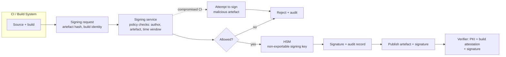

# HSMs for Code Signing, Document Signing, and Payment Keys

### English

TLS server certificates are only one of many things that need a signing key. Three other families dominate HSM deployments in practice, and each has a distinctive shape: **code signing**, **document/email signing**, and **payment or transaction signing**. Understanding how they differ explains most of the design choices you will see in real HSM estates.

Code signing is the clearest case. A code-signing certificate lets a publisher assert "this binary came from us and has not been modified." The private key that carries that assertion must be available on a build server or CI runner, which means it is exposed to machines that run unreviewed dependencies and build scripts — precisely the environment where keys get stolen. The industry answer is to keep the signing key inside an HSM and have the build system request a signature through a network service, with the HSM enforcing policy: which code may be signed, by which build identity, and under what conditions. This turns "the key was stolen" from a catastrophic compromise into a policy violation that the HSM can refuse. Some organisations go further with a hardware-backed build attestation — signing only after verifying that the build ran on a known machine with a known toolchain — so that a compromised CI runner cannot simply ask for a signature of a malicious binary. The CA/Browser Forum's Code Signing Baseline Requirements separately cap certificate lifetimes (39 months for certificates issued before 1 March 2026, 460 days from that date), because a compromised code-signing key is a supply-chain problem rather than a privacy problem.

Document and email signing (S/MIME and PDF signatures) have a different shape again. Here the key signs *content*, and the assurance that matters is long-term: a signature made today must still verify in ten years, which means the certificate needs a long validity period (S/MIME certificates commonly run for years, and email clients must therefore keep validating a chain whose root may be older than the certificate itself). The HSM's role is to protect the key while the cryptography deals with time. Long-lived keys also make revocation and compromise handling the dominant risk, so the operational emphasis shifts from ceremony frequency to key backup, escrow and recovery.

Payment and HSM estates are governed by the PCI PIN Security Standard and by the payment networks' own rules, which impose extremely tight rules on key generation, splitting, storage and audit. Payment keys are frequently split so that no single component can complete a transaction — an "assembly" of shares produces the live key for the brief moment of use, and the shares are stored separately. This is the payment industry's version of the M-of-N ceremony, and it exists because insider threat is the dominant concern.

Across all three families the recurring design pattern is the same: move the key out of general-purpose memory, keep the *policy* next to the key, and make the signing service the integration point. The application talks to a signing API; the API is the only thing that talks to the HSM; the HSM decides whether the request is allowed. Replacing "sign this digest with key X" with "sign this artefact if the caller is authorised, the artefact matches these rules, and the request is within this time window" is what converts an HSM from a fancy keyring into a control.

### 中文

TLS 伺服器憑證只是需要簽署金鑰的用途之一。實務上主導 HSM 部署的還有三大家族：**程式碼簽署**、**文件／電郵簽署**，以及**支付／交易簽署**。理解它們之間的差異，可以解釋真實 HSM 環境中大部分設計取捨。

程式碼簽署是最清楚的一種。程式碼簽署憑證讓發行方聲明「這個二進位檔出自我們之手，並且未被篡改」。承載該聲明的私鑰必須能在建置伺服器或 CI runner 上使用，也就是說它暴露在會執行未經審查的相依套件與建置腳本的機器上——而這正是金鑰被盜的環境。業界的答案，是把簽署金鑰留在 HSM 之內，由建置系統透過網絡服務請求簽署，並由 HSM 執行政策：哪些程式碼可以簽署、由哪個建置身分簽署、以及在甚麼條件下簽署。這把「金鑰被盜」由災難性事故，變成 HSM 可以拒絕的政策違規。部分機構更進一步採用硬體支持的建置證明（build attestation）——只有確認建置在已知機器上以已知工具鏈執行之後才簽署——令遭入侵的 CI runner 無法單方面要求為惡意二進位檔簽名。CA/Browser Forum 的 Code Signing Baseline Requirements 另行限制憑證有效期（2026 年 3 月 1 日之前簽發者為 39 個月，自該日起為 460 日），因為程式碼簽署金鑰被攻破是供應鏈問題，而不是私隱問題。

文件與電郵簽署（S/MIME 與 PDF 簽署）的形態又不同。該處金鑰簽署的是 *內容*，真正重要的保證是長期的：今天做出的簽署十年後仍須驗證得到，於是憑證需要很長的有效期（S/MIME 憑證常以年計），而電郵客戶端必須持續驗證一條鏈，其根憑證甚至可能比該憑證本身更老。HSM 在此的角色是保護金鑰，而時間問題交由密碼學處理。長效金鑰亦令撤銷與失竊處理成為主要風險，因此營運重點由儀式頻率轉向金鑰備份、託管與復原。

支付與 HSM 環境受 PCI PIN Security Standard 及支付網絡自身規則約束，對金鑰產生、分割、儲存與稽核有極嚴格的要求。支付金鑰經常以分割方式處理，令任何單一組件都無法完成交易——只有在使用的短暫瞬間，各份拼合成即時金鑰，而各份分開存放。這是支付業版本的 M-of-N 儀式，存在原因是內部威脅正是主要關注點。

三大家族都共享同一設計模式：把金鑰搬出通用記憶體、讓 *政策* 與金鑰住在一起，並以簽署服務作為整合點。應用程式只與簽署 API 對話，API 是唯一與 HSM 對話的元件，而 HSM 決定該請求是否被允許。把「用金鑰 X 簽署這個摘要」換成「若呼叫者有權限、該產物符合這些規則、且請求在這個時間窗內，就簽署此產物」，才是把 HSM 由花巧的鑰匙圈變成真正的控制點。

## Key Takeaway

Across code signing, document signing and payments, the same pattern wins: keep the key inside the HSM, put the authorisation rules beside the key, and let applications ask a signing service for a signature rather than holding key material.

## Related Concepts
- CA/Browser Forum Code Signing Baseline Requirements
- S/MIME and long-lived signature validation
- PCI PIN Security Standard and key splitting
- Build attestation and CI signer isolation

## Diagram

