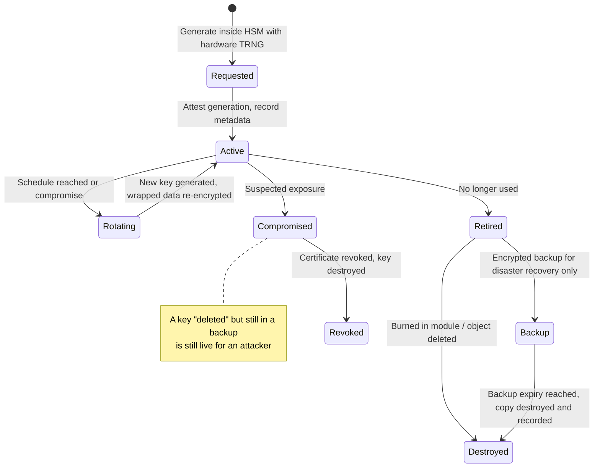

# Key Lifecycle Management: Generation, Rotation, Backup, and Destruction

### English

A key is not a permanent asset. It has a birth, a working life, a rotation, and eventually an end — and the security of a system depends as much on how those transitions are managed as on the cryptography used inside them. **Key lifecycle management** (KLM) is the discipline of moving a key through those stages without ever creating a window in which the key is exposed, lost, or reusable when it should not be.

Generation should happen inside the boundary, and it should happen with entropy you can defend. Modern modules use a hardware true random number generator (TRNG) — a physical noise source, such as thermal noise in resistors or quantum effects in a chip — rather than a software pseudo-random generator seeded from the clock, because the seed is attackable. The rule of thumb in the field is that a key generated by software is only as strong as the machine that generated it, and the machine that generated it is running the same operating system as everything else. A hardware-generated RSA-3072 or EC P-256 key inside a certified module has a defensible provenance story; a key generated by a shell script on a build server does not. Where an HSM supports attestation of key generation, that attestation should be recorded in the key's metadata — it is what an auditor asks to see.

Rotation is the least glamorous and most effective control. A key that is never rotated accumulates exposure: it may be used on machines that later get compromised, it may appear in backups that are less well protected than the live system, and it will eventually be past any validity period the ecosystem expects. The rotating keys are the one-time-use credentials of a PKI: TLS session keys and data-encryption keys should be generated fresh per session or per object, while the long-lived *key-encryption key* (KEK) that wraps them rotates on a schedule. Wrapping is important because it lets you re-key an entire data estate without re-encrypting every byte: you decrypt with the old KEK, re-encrypt with the new one. Backup needs the same discipline — backups of an HSM's key material are, inevitably, a moment of vulnerability, so they are encrypted, are themselves stored under separate protection, and are tested by restore rather than assumed.

Destruction is where most organisations are weakest, and there is a subtlety worth understanding: "destroying" a key is not about shredding a file. The key never existed as a file. What you destroy is the ability to use it — the key material is either burned inside the module, or rendered permanently unusable by deleting the object while the hardware keeps running, or (in the case of a shared HSM) simply by ensuring no backup copy survives. Erasure must be provable: you need to know that every copy has been destroyed, including copies in backups and copies in escrow, and that the destruction itself is recorded. An unrecoverable key is not the same as a deleted key; a "deleted" key that still exists in a backup is, for the attacker, still live. This is why backup retention policies, key escrow arrangements and certificate revocation all have to be part of the same plan.

The planning tool that keeps this honest is the **crypto-agility** question: "if this algorithm or key length is broken tomorrow, how long would it take us to replace every artefact that depends on it?" If the answer is months, the algorithm choice was effectively permanent, and any protocol that hard-codes it should be considered carefully — which is precisely why protocols like TLS, SSH, IPsec, DNSSEC and S/MIME all publish algorithm agility mechanisms, and why post-quantum cryptography work is largely about getting crypto-agility into systems that were built without it.

### 中文

金鑰並非永久資產。它有誕生、有工作年期、有輪換，最終有終結——而一個系統的安全性，取決於這些過渡如何被管理，本身不下於其內部的密碼學。**Key lifecycle management**（KLM，金鑰生命週期管理）這門學問，就是要把金鑰推過這些階段，同時任何一刻都不出現金鑰被曝露、遺失或在不應重用時仍被重用的窗口。

產生過程必須在邊界之內完成，而且必須使用你能夠辯護的隨機性。現今的模組使用硬件 true random number generator（TRNG）——實體噪聲源，例如電阻的熱噪聲或晶片中的量子效應——而不是用時鐘播種的軟件偽隨機生成器，因為種子是可以被攻擊的。業界的經驗法則是：軟件產生的金鑰，強度不過等於產生它的那台機器，而那台機器跑的作業系統與其他一切相同。在經認證的模組內以硬件產生 RSA-3072 或 EC P-256 金鑰，才有站得住腳的來源可追溯性；在建置伺服器上用 shell 腳本產生的金鑰則沒有。若 HSM 支援對金鑰產生過程作出證明（attestation），該證明應記錄在金鑰的中繼資料內——這正是稽核人員會問的東西。

輪換是最不吸睛、卻最有效的控制措施。從不輪換的金鑰會累積曝險：它可能在日後被攻破的機器上使用過，可能出現在保護程度不及線上系統的備份內，最終亦會超出任何生態預期的有效期。在 PKI 內，要輪換的是一次性憑證：TLS 會話金鑰與資料加密金鑰應每次會話或每個物件重新產生，而長期存在的 *key-encryption key*（KEK，用來包裹它們的金鑰）則按排程輪換。包裹之所以重要，是因為它讓你可以為整個資料存量換金鑰而不必逐位元重新加密：用舊 KEK 解密，再用新 KEK 加密即可。備份需要同樣的紀律——HSM 金鑰物料的備份不可避免地是一個脆弱時刻，因此它們會被加密、由獨立的保護措施保管，並且以「真的做過還原演練」而非「假設可以還原」來驗證。

銷毀是多數機構最薄弱的一環，而當中有一個值得理解的微妙之處：「銷毀」金鑰並非指把一個檔案碎紙。該金鑰從來不曾以檔案形式存在。你真正銷毀的是 *使用它的能力*——金鑰物料要麼在模組內被燒毀，要麼在硬件繼續運行的情況下被永久刪除而無法復原，要麼（在共用 HSM 的情況下）確保沒有任何備份副本存活。刪除必須是可證明的：你要知道每一份副本都已銷毀，包括備份內的、以及託管（escrow）中的，而銷毀這件事本身亦要有紀錄。無法復原的金鑰不等於已刪除的金鑰——一枚「已刪除」但仍存在於備份內的金鑰，對攻擊者而言仍然是活的。這正是備份保留政策、金鑰託管安排與憑證撤銷必須屬於同一個計劃的原因。

令這套流程保持誠實的規劃工具，是 *crypto-agility*（密碼敏捷性）這個問題：「如果這個演算法或金鑰長度明日被破解，要多久才能替換所有依賴它的產物？」若答案是幾個月，那麼當初的演算法選擇等同永久決定，任何把它寫死的協議都應被仔細檢視——TLS、SSH、IPsec、DNSSEC 與 S/MIME 都因此出版了演算法敏捷性機制，而後量子密碼學的研究重點，很大程度上正是要把密碼敏捷性帶進那些在沒有它的情況下建成的系統。

## Key Takeaway

Key security is mostly a lifecycle problem: the strength of your algorithms matters less than whether keys are hardware-generated, rotated on schedule, backed up with provable destruction, and replaceable quickly when an algorithm breaks.

## Related Concepts
- Hardware true random number generators and key generation attestation
- Key wrapping and KEK rotation for crypto-agility
- Provable key destruction across backups and escrow
- Post-quantum migration and algorithm agility

## Diagram

