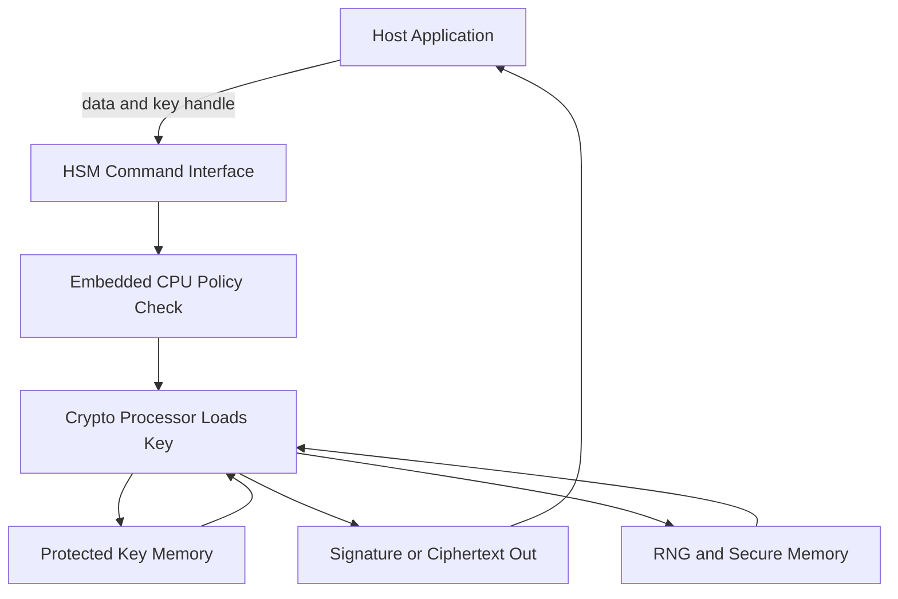

# How an HSM Actually Performs Cryptography Inside the Tamper Boundary

## English

It is tempting to imagine an HSM as a safe that merely stores keys, but the important point is that the keys never leave the box even while they are in use. When an application asks an HSM to sign a document, the host machine sends only the data to be signed and a reference (a handle or key label) to the key. The HSM's internal cryptographic processor loads the key from protected memory, performs the operation inside the tamper boundary, and returns only the signature or ciphertext. The plaintext key value never crosses the network or the bus. This is the fundamental architectural difference from storing a key in a file protected by file permissions: with a file, the key must be read into RAM to be used, and anyone who can read that RAM (via a memory dump, a debugger, or a cold-boot attack) can steal it.

Inside the module, the ingredients are usually a general-purpose embedded CPU for command parsing and policy enforcement, one or more dedicated cryptographic co-processors or FPGAs that do the heavy modular arithmetic for RSA and elliptic-curve operations, a hardware random number generator (RNG) that seeds key generation, and non-volatile secure memory for key storage. Sensitive intermediate values such as the private exponent during an RSA operation live only in registers and on-chip memory that is cleared between operations. Some designs use physically unclonable functions (PUFs) or battery-backed SRAM that zeroises when power is removed, so an attacker who yanks the power gets nothing.

A concrete example makes the boundary vivid. Suppose a web server needs to terminate TLS. It sends the TLS handshake parameters to the HSM and receives back the signature over the handshake transcript; the HSM also performs the RSA or ECDHE key exchange step so the session key is derived inside the module. The server never sees the long-term private key. Even if the server is fully compromised by an attacker with root, the worst they can do is ask the HSM to sign things while the HSM is unlocked — they cannot copy the key out and use it elsewhere.

Performance matters here too. Because every private-key operation is a round trip into dedicated silicon, HSMs are engineered for high signing throughput (thousands of RSA-2048 signatures per second on large appliances) but they are not general-purpose computers. Bulk symmetric encryption is usually offloaded elsewhere, with the HSM protecting only the key-encryption keys. This is why designs often use an envelope scheme: the HSM holds a master key, and that master key wraps the many data keys used for actual traffic.

The mental model to keep is: the HSM is not a vault you take keys out of, it is a calculator you hand inputs to and get outputs from, where the working state is sealed inside tamper-responsive hardware. That inversion — use without exposure — is what makes the security property meaningful.

## 中文

很多人會把 HSM 想像成一個只負責存放金鑰的夾萬，但真正關鍵的地方在於：金鑰即使正在被使用，也永遠不會離開這個盒子。當應用程式要求 HSM 簽署一份文件時，主機只會送出將要簽署的資料，以及一個指向金鑰的參考（例如 handle 或金鑰標籤）。HSM 內部的密碼處理器會從受保護的記憶體載入金鑰，在防篡改邊界之內完成運算，然後只回傳簽章或密文。金鑰的明文數值從來不會經過網絡或匯流排。這與「把金鑰放在受檔案權限保護的檔案中」有根本的架構差異：用檔案的話，金鑰必須被讀進 RAM 才能使用，任何能讀取該 RAM 的人（透過記憶體傾印、除錯器或冷開機攻擊）都可以把它偷走。

在模組內部，組件通常包括：一顆通用嵌入式 CPU 負責解析指令與執行政策、一或多顆專用密碼協處理器或 FPGA 負責 RSA 與橢圓曲線運算中繁重的模組算術、一個硬體隨機數產生器（RNG）為金鑰產生提供種子，以及用於儲存金鑰的非揮發性安全記憶體。RSA 運算期間的私密指數等敏感中間值，只會存在於暫存器與晶片上記憶體，並在每次運算之間被清除。有些設計採用物理不可複製函數（PUF），或使用一旦斷電就會歸零的電池供電 SRAM，令攻擊者拔掉電源後一無所獲。

一個具體例子可以令這條邊界變得鮮明。假設一部網頁伺服器要終止 TLS。它把 TLS 握手參數送進 HSM，取回對握手 transcript 的簽章；HSM 亦會執行 RSA 或 ECDHE 金鑰交換步驟，令 session key 在模組內部衍生。伺服器從頭到尾都看不到長期私鑰。即使伺服器被擁有 root 權限的攻擊者完全攻陷，他們最多只能在 HSM 解鎖期間要求它簽署東西，而無法把金鑰複製出來在別處使用。

效能方面亦值得注意。由於每一個私鑰運算都是一次進入專用晶片的來回，HSM 是為高簽章吞吐量而設計的（大型設備可達每秒數千個 RSA-2048 簽章），但它並不是通用電腦。大量對稱加密通常交由其他地方處理，HSM 只保護金鑰加密金鑰（key-encryption key）。這正是為何設計上常用信封式方案：HSM 持有一把主金鑰，再由主金鑰包裹實際流量所用的眾多資料金鑰。

要記住的心智模型是：HSM 不是讓你從中取出金鑰的夾萬，而是一部你送入輸入、取回輸出的計算機，而它的工作狀態被封閉在會回應篡改的硬體之內。這種「可用而不可見」的反轉，正是令其安全性質變得有意義的原因。

## Key Takeaway

An HSM performs cryptographic operations inside its tamper boundary and returns only results, so private keys are used without ever being exposed to the host.

## Related Concepts
- Tamper-responsive hardware
- Envelope encryption

## Diagram

