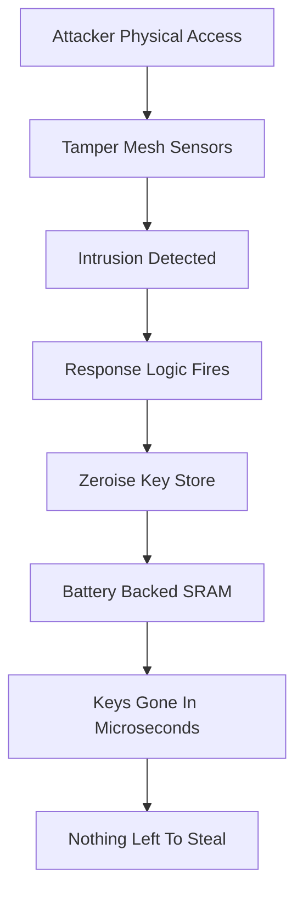

# Tamper Evidence vs Tamper Resistance vs Tamper Response

## English

People often use "tamper-proof" loosely, but HSM security is really a spectrum of three distinct properties, and knowing the difference tells you what a given device actually promises. Tamper evidence means that if someone opens or drills into the device, it will be obvious afterwards — think of a wax seal or a case that cracks irreversibly. Tamper resistance means the enclosure is physically hard to breach: hardened steel, epoxy potting, sensors embedded in the casing, and no exposed debug ports. Tamper response goes further: the device actively detects an intrusion attempt and reacts, typically by zeroising (erasing) all stored keys before the attacker can reach them.

Tamper response is the strongest and most interesting tier. The module is wrapped in a tamper-detection mesh — a lattice of fine conductive traces, sometimes called a tamper wrap or security mesh — that carries a small current. If an attacker drills, cuts, or chemically dissolves the mesh, the circuit breaks and a detection signal fires. Other sensors watch for voltage glitches, temperature extremes (both freezing and overheating), and unusual clock frequencies, because these are classic fault-injection techniques used to make a chip skip a security check. When any sensor trips, the response logic wipes the key store in microseconds. The design assumes the attacker may eventually get physical access, so the goal is to make sure that by the time they do, there is nothing left to steal.

This is why HSM key storage is often battery-backed SRAM rather than flash. SRAM loses its contents the instant power is removed, so the zeroisation is essentially instantaneous and cannot be undone. Flash, by contrast, retains data and can sometimes be recovered even after a logical erase, because wear-levelling leaves old copies in other cells. A battery keeps the SRAM alive during normal operation; pulling the case open cuts the battery or trips the mesh, and the keys vanish. Some modules also use a tamper-evident seal plus a response mechanism, so you get both a warning and a wipe.

A useful analogy is a document safe with a built-in shredder. A tamper-evident safe only tells you afterwards that it was opened. A tamper-resistant safe is hard to break into but, given enough time and tools, can be defeated. A tamper-responsive safe senses the attack and shreds the contents before the door opens. Real HSMs combine all three: hardened physical construction, detection sensors, and an automatic destructive response.

One practical consequence is that HSMs have strict handling rules. Opening the case, replacing the battery incorrectly, or exposing the device to extreme temperatures can trigger an irreversible zeroisation, which is why vendors specify environmental limits and why a failed module is often returned to the manufacturer rather than serviced on site. It also explains why "tamper-evident" labels on consumer hardware wallets are not the same guarantee as a FIPS-validated HSM's tamper response — the labels tell you something happened, but they do not guarantee the keys were destroyed.

## 中文

人們常把「防篡改」講得很籠統，但 HSM 的安全其實是由三種截然不同的性質組成，了解它們的分別，才知道某部裝置真正承諾了甚麼。防篡改痕跡（tamper evidence）是指：若有人打開或鑽開裝置，事後會很明顯——想像火漆封印，或一撬就永久破裂的外殼。防篡改能力（tamper resistance）是指外殼在物理上難以攻破：硬化鋼、環氧樹脂灌封、嵌入外殼的感應器，以及沒有外露的除錯埠。防篡改回應（tamper response）則更進一步：裝置會主動偵測入侵企圖並作出反應，通常是在攻擊者接觸到金鑰之前，把所有儲存的金鑰歸零（zeroise，即抹除）。

防篡改回應是最強、亦最有趣的一層。模組被一層防篡改偵測網包裹——那是一層由細微導電線路組成的網格，有時稱為 tamper wrap 或 security mesh——其中流通著微小電流。若攻擊者鑽穿、剪斷或化學溶解這層網格，電路就會斷開並觸發偵測訊號。其他感應器則監察電壓突變、極端溫度（冷凍與過熱皆然）以及異常時鐘頻率，因為這些都是令晶片跳過安全檢查的典型故障注入手法。當任何感應器被觸發，回應邏輯會在數微秒內抹除金鑰儲存區。這個設計假設攻擊者最終可能取得實體接觸，因此目標是確保到他們得手時，已經沒有東西可偷。

這正是為何 HSM 的金鑰儲存常用電池供電的 SRAM 而非快閃記憶體。SRAM 一斷電就立即失去內容，所以歸零幾乎是即時的，而且無法還原。相反，快閃記憶體會保留資料，即使經過邏輯抹除，有時仍可被復原，因為磨損均衡會把舊副本留在其他儲存格。電池在正常運作時維持 SRAM 帶電；一旦撬開外殼就會切斷電池或觸發網格，金鑰隨即消失。有些模組同時採用防篡改封條與回應機制，於是既有警示，也有抹除。

一個有用的比喻是內建碎紙機的夾萬。防篡改痕跡的夾萬只會事後告訴你它曾被開啟。防篡改能力的夾萬難以攻破，但給予足夠時間與工具仍可被破解。防篡改回應的夾萬則會感應攻擊，並在門打開之前把內容碎掉。真實的 HSM 結合三者：加固的物理結構、偵測感應器，以及自動的破壞性回應。

一個實際後果是 HSM 有嚴格的操作規則。打開外殼、錯誤地更換電池，或把裝置暴露於極端溫度，都可能觸發不可逆的歸零，這正是廠商會指定環境限制、而故障模組通常要送回原廠而非在現場維修的原因。這也解釋了為何消費級硬體錢包上的「防篡改」標籤，與經 FIPS 驗證的 HSM 的防篡改回應不是同一種保證——標籤只告訴你發生過事情，卻不保證金鑰已被銷毀。

## Key Takeaway

Tamper evidence only leaves a trace, tamper resistance slows an attacker down, and tamper response actively destroys keys the moment intrusion is detected.

## Related Concepts
- Zeroisation
- Fault injection attacks

## Diagram

