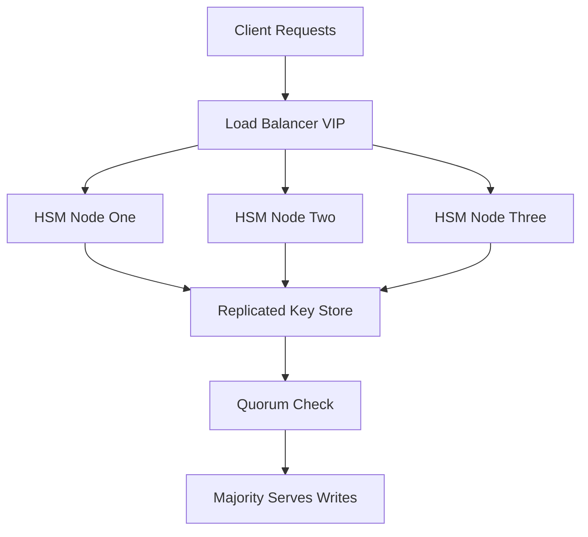

# HSM Clustering, High Availability, and Split-Brain Risk

## English

A single HSM is a single point of failure, and in production it is often the most critical box in the data centre: if it goes down, every TLS handshake, every payment authorisation, and every code-signing operation stops. The standard answer is to run HSMs in a cluster, but clustering cryptographic hardware is harder than clustering ordinary servers because the state that must be shared is secret. Understanding how clusters keep keys consistent — and what happens when the network partitions — is a genuinely important operational topic.

In a typical vendor cluster, several HSM appliances are joined into a group and share a replicated key store. When a key is generated on one member, it is securely replicated to the others, encrypted under a cluster key that is itself protected by the module. Load balancers or a virtual IP distribute client connections across members, and PKCS#11 clients see a single logical device. The replication channel is itself encrypted and authenticated, usually with keys established during a secure joining ceremony in which a new member is introduced by an authorised administrator using the existing cluster's credentials. This is why adding a node to an HSM cluster is a formal, audited procedure rather than a plug-and-play operation.

The hard problem is the network partition, sometimes called split-brain. Suppose a five-node cluster is split into a group of two and a group of three by a failed switch. Both groups can still serve clients, but they can no longer see each other. If both sides accept writes — generating new keys, rotating keys, changing PINs — the two halves diverge, and when the network heals you have conflicting key stores. The usual solution is a quorum rule: a partition must contain a majority of members (or a majority of a separate set of quorum devices) to continue serving. The minority side goes read-only or stops entirely, preserving consistency at the cost of availability. This is the same CAP-theorem trade-off that distributed databases face, applied to secret state.

A concrete failure story illustrates the stakes. If the minority partition kept accepting new key generations, an application might encrypt data with a key that exists only on that side. After the heal, the key is missing from the majority, and that data is permanently unreadable. Quorum prevents this by refusing to create new keys when the cluster cannot guarantee they will be replicated. Some designs also use a separate quorum device or witness node that holds no keys but votes on which partition is legitimate, so an even-numbered cluster can still break ties.

Operationally, this means HSM clusters need careful capacity planning (enough members to survive the loss of one and still hold a majority), monitoring of replication lag, and rehearsed procedures for replacing a failed member. It also means that "high availability" for an HSM is not just about uptime — it is about consistency of secret state. A cluster that stays up but splits its key store is worse than one that briefly refuses service, because inconsistency can silently destroy data that can never be decrypted again.

## 中文

單一 HSM 就是單點故障，而在生產環境中，它往往是資料中心裡最關鍵的一臺機器：一旦它停擺，每個 TLS 握手、每筆支付授權、每次程式碼簽署都會停頓。標準答案是讓 HSM 組成叢集，但把密碼硬體叢集化，比叢集化普通伺服器困難得多，因為必須共享的狀態是秘密。瞭解叢集如何保持金鑰一致——以及網路分割時會發生甚麼——是真正重要的營運課題。

在典型的廠商叢集中，數臺 HSM 裝置會組成一個群組，共享一套複製的金鑰儲存。當某一把金鑰在某個成員上產生，它會以叢集金鑰加密（而叢集金鑰本身由模組保護），安全地複製到其他成員。負載平衡器或虛擬 IP 把客戶端連線分散到各成員，PKCS#11 客戶端則看見單一的邏輯裝置。複製通道本身經過加密與認證，所用的金鑰通常在安全加入儀式中建立：新成員由授權管理員使用現有叢集的憑證引入。這就是為何把節點加入 HSM 叢集是一項正式且受稽核的程式，而非隨插即用的操作。

最棘手的問題是網路分割，有時稱為腦裂（split-brain）。假設一個五節點叢集因交換機故障而被分成兩組：一組兩個、一組三個。兩組都仍可服務客戶端，但彼此再也看不到對方。若雙方都接受寫入——產生新金鑰、輪換金鑰、更改 PIN——兩半就會分歧，待網路恢復後，你就有互相衝突的金鑰儲存。常見的解決辦法是法定人數（quorum）規則：一個分割必須包含多數成員（或另一組 quorum 裝置的多數）才能繼續服務。少數一方會轉為唯讀或完全停止，以可用性換取一致性。這與分散式資料庫面對的 CAP 定理取捨相同，只是套用在秘密狀態上。

一個具體的故障故事可說明利害。若少數分割繼續接受新的金鑰產生，某個應用程式可能用只存在於該側的金鑰加密資料。網路恢復後，該金鑰在多數一方並不存在，那份資料就永久無法解讀。Quorum 正是透過在叢集無法保證金鑰會被複製時拒絕產生新金鑰，來防止這種情況。有些設計另設一個不持有金鑰的 quorum 裝置或見證節點，就哪個分割合法進行投票，令偶數節點的叢集仍能打破平局。

在營運上，這意味著 HSM 叢集需要仔細的容量規劃（成員數目要足以承受失去一個成員後仍保有多數）、監察複製延遲，以及演練替換故障成員的程式。這也意味著 HSM 的「高可用性」不只是開機時間，而是秘密狀態的一致性。一個保持運作卻分裂了金鑰儲存的叢集，比一個短暫拒絕服務的叢集更糟，因為不一致可能悄悄摧毀永遠無法再解密的資料。

## Key Takeaway

HSM clustering trades availability for consistency using quorum rules, because a split key store can silently destroy data that can never be decrypted again.

## Related Concepts
- Quorum and split-brain
- CAP theorem

## Diagram

