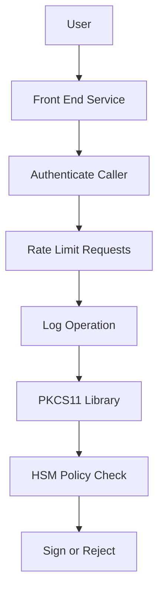

# What the HSM Can and Cannot Verify

## English

An HSM is excellent at answering the question "is this operation allowed with this key?" It is much worse at answering "is the person asking who they claim to be?" The module enforces the policy that lives inside it — which key handles, which mechanisms, which usage flags, which role is logged in — but everything outside that boundary is trusted input. If a web application is compromised and an attacker can call the PKCS#11 library with a valid session, the HSM will happily sign whatever the attacker sends, because from its point of view the request is perfectly legitimate. The HSM is a policy enforcement point, not an authentication oracle for your users. This is why real deployments put the HSM behind a front-end service that authenticates callers, rate-limits requests, and logs every operation before the request ever reaches the cryptographic boundary. The HSM's audit log tells you a signature happened; it cannot tell you whether the human behind it was who they said they were. Treat the HSM as one layer in a chain of trust, not the whole chain. A useful mental model: the HSM is like a bank vault with a very strict teller. The teller checks that the withdrawal slip is filled out correctly and that the account has funds, but the teller cannot know whether the person holding the slip stole the checkbook.

## 中文

HSM 非常擅長回答一個問題：「這個操作是否允許用這把金鑰進行？」但它對於「提出請求的人是否真的是他所聲稱的人」則明顯力不從心。模組只會執行存在於它內部的那套政策——哪些金鑰句柄、哪些機制、哪些用途旗標、哪個角色已登入——但邊界以外的一切都只是被信任的輸入。如果一個網頁應用被入侵，攻擊者能用一個有效的工作階段呼叫 PKCS#11 函式庫，HSM 就會樂意簽署攻擊者送來的任何東西，因為從它的角度來看，這個請求完全合法。HSM 是一個政策執行點，而不是你使用者的身分驗證神諭。這就是為什麼真實的部署會把 HSM 放在一個前端服務後面，由該服務驗證呼叫者、限制請求速率，並在請求到達密碼學邊界之前記錄每一次操作。HSM 的稽核日誌告訴你「發生了一次簽章」；它無法告訴你背後的人是否真是他所聲稱的那個人。把 HSM 視為信任鏈中的一層，而不是整條鏈。一個有用的心智模型：HSM 就像一間有非常嚴格櫃員的金庫。櫃員會檢查提款單是否填寫正確、帳戶是否有餘額，但櫃員無法知道拿著提款單的人是否偷了支票簿。

## Key Takeaway

An HSM enforces the policy inside its boundary but trusts whatever its caller sends, so authentication and rate-limiting must live in front of it.

## Related Concepts
- Policy enforcement point
- Trust boundary

## Diagram

