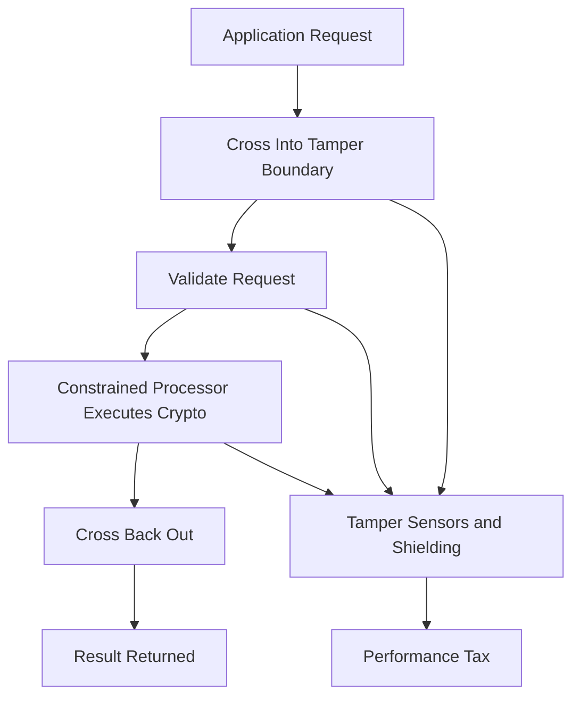

# The Performance Cost of the Tamper Boundary

## English

Every cryptographic operation inside an HSM pays a tax that software crypto does not: the request must cross into the tamper boundary, be validated, be executed by a constrained processor, and the result must cross back out. A general-purpose CPU running AES-NI can push gigabytes per second through AES; a typical network HSM does a small fraction of that, often measured in a few thousand RSA-2048 signatures per second or a few hundred megabytes per second of symmetric throughput. The gap is not because HSM designers are bad at engineering — it is because the boundary itself is the product. Tamper sensors, shielding, a hardened real-time operating system, and a processor that must never leak timing information all cost cycles. This has real architectural consequences. Bulk data encryption is usually done in software or on the application server, with the HSM protecting only the data encryption key (DEK) — the envelope encryption pattern. Signing is done on the HSM because the private key must never leave. TLS termination is a classic tension point: an HSM can hold the server's private key, but if it performs every handshake it becomes the bottleneck, so many designs use the HSM only for the initial key exchange or for a session-key wrapping step. When you size an HSM, ask what operations per second you actually need at peak, not average, and remember that key generation and backup operations are far more expensive than steady-state signing.

## 中文

HSM 內部的每一次密碼學操作都要繳一筆軟體密碼學不用繳的稅：請求必須跨越進入防篡改邊界、被驗證、由一顆受限制的處理器執行，然後結果再跨越出來。一顆跑 AES-NI 的通用 CPU 可以每秒推送數 GB 的 AES 流量；而典型的網路 HSM 只能做到其中一小部分，通常以每秒數千次 RSA-2048 簽章、或每秒數百 MB 的對稱吞吐量來衡量。這個差距不是因為 HSM 設計者工程能力差——而是因為邊界本身就是產品。防篡改感測器、遮蔽、強化的即時作業系統，以及一顆絕不能洩漏時序資訊的處理器，全都要消耗時脈週期。這帶來真實的架構後果。大量資料加密通常用軟體或在應用伺服器上做，HSM 只保護資料加密金鑰（DEK）——也就是信封加密模式。簽章在 HSM 上做，因為私鑰絕不能離開。TLS 終結是經典的張力點：HSM 可以持有伺服器的私鑰，但如果每一個握手都由它執行，它就會成為瓶頸，所以許多設計只在初始金鑰交換、或工作階段金鑰包裝這一步使用 HSM。當你為 HSM 做容量規劃時，要問的是尖峰時你實際需要每秒多少次操作，而不是平均值，並且記住金鑰產生與備份操作比穩定狀態的簽章昂貴得多。

## Key Takeaway

The tamper boundary costs throughput, so designs typically use envelope encryption and reserve the HSM for the operations that truly require the key to stay inside.

## Related Concepts
- Envelope encryption
- Throughput sizing

## Diagram

