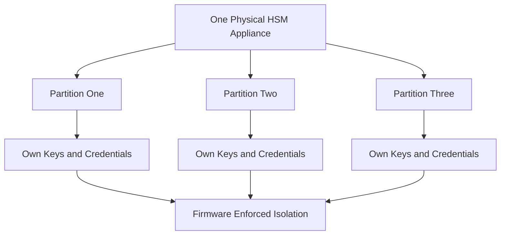

# Shared Tenancy and Partitioning Inside One Appliance

## English

A single HSM appliance is often not dedicated to one application. Modern network HSMs support partitioning: the physical device is divided into logical slots, each with its own keys, its own administrator or security officer credentials, and its own access policy. One partition might serve a certificate authority, another a payment switch, and a third a code-signing pipeline, all on the same hardware. Partitioning is not just an organisational nicety — it is a security boundary. A compromise of the credentials for one partition should not grant access to another, and the module's firmware is supposed to enforce that separation even against a logged-in administrator of a different partition. This matters for compliance too: an auditor may want evidence that the payment keys are isolated from the PKI keys, and a partition boundary is the artefact that demonstrates it. The trade-off is operational complexity. Backups must be taken per partition, firmware upgrades affect every tenant at once, and a hardware fault takes down all partitions simultaneously. Capacity planning becomes political: when the payment team spikes, the CA team feels it. Some organisations therefore prefer several smaller appliances over one large one, trading capital cost for blast-radius isolation. The right answer depends on how much you trust the firmware's partitioning guarantees and how much downtime one shared failure would cost.

## 中文

一臺 HSM 裝置往往不是專屬於單一應用。現代網路 HSM 支援分割（partitioning）：實體裝置被劃分為多個邏輯槽，每個槽有自己的金鑰、自己的管理員或安全主任憑證，以及自己的存取政策。一個分割可能服務憑證授權機構，另一個服務支付交換機，第三個服務程式碼簽章流程，全部在同一臺硬體上。分割不只是組織上的方便——它是一條安全邊界。一個分割的憑證被入侵，不應該能存取另一個分割，而模組的韌體理應即使面對另一個分割的已登入管理員，也能強制執行這種隔離。這對合規也很重要：稽核員可能想要證據，證明支付金鑰與 PKI 金鑰彼此隔離，而分割邊界就是用來證明這一點的產物。代價是營運複雜度。備份必須按分割進行，韌體升級會一次影響所有租戶，而硬體故障會同時讓所有分割下線。容量規劃會變得政治化：當支付團隊用量暴衝，CA 團隊就會感受到。因此有些組織寧願用幾臺較小的裝置，而不是一臺大型裝置，用資本成本換取爆炸半徑的隔離。正確答案取決於你有多信任韌體的分割保證，以及一次共用故障會造成多少停機成本。

## Key Takeaway

Partitioning lets one appliance serve many tenants, but it concentrates shared failure modes and firmware risk, so blast-radius isolation is a real design decision.

## Related Concepts
- Partition isolation
- Blast radius

## Diagram

