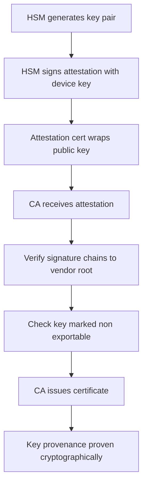

# The HSM as a Root of Trust: Attestation and Key Provenance

## English

An HSM is not just a place where keys happen to live; it can be a root of trust that vouches for the keys it holds. The key idea is attestation: the HSM can produce a signed statement, using a key that never leaves the device, saying something like 「public key P was generated inside this specific device, under this firmware version, and is marked non-exportable.」 A remote party can then verify that signature against the device vendor's certificate chain and decide whether to trust P. Without attestation, a server that hands you a public key is making a bare assertion — you have no way to tell whether the private half sits in an HSM, in a file on disk, or never existed at all.

A concrete example is a certificate authority that wants to issue a certificate only for keys generated in hardware. The applicant's HSM generates the key pair and emits an attestation certificate wrapping the public key. The CA checks the attestation signature chains to a trusted vendor root and that the key attributes say non-exportable and sensitive. Only then does it issue. This closes the gap where someone generates a key in software and merely claims it lives in an HSM.

Key provenance is the broader idea: for every key you should be able to answer where it was born, which device, which firmware, whether it ever existed in exportable form, and who could use it. An HSM that supports attestation turns those answers from paperwork into cryptographic proof. This matters for supply chains and for regulated environments where an auditor asks 「prove this signing key was never copyable.」

There is an important limit. Attestation proves properties of the device and the key object, not of the humans operating it. A valid attestation that a key is non-exportable tells you nothing about whether the right person pressed the button to use it — that is the job of authentication and quorum controls. Attestation and access control answer different questions and you need both.

Finally, attestation depends on trusting the vendor's root certificate and the firmware measurement chain. If the firmware is compromised before it measures itself, the attestation can lie. So attestation is a chain, and its strength is only as good as the weakest link between the silicon root and the signed statement you receive.

## 中文

HSM 唔止係「啲金鑰啱啱擺喺度」嘅地方；佢可以係一個信任根（root of trust），為自己保管嘅金鑰作擔保。核心概念係遠端證明（attestation）：HSM 可以用一條永遠唔會離開裝置嘅金鑰，簽發一份聲明，講明例如「公開金鑰 P 係喺呢部特定裝置、喺呢個韌體版本之下產生，並且標記為不可匯出」。遠端一方就可以用裝置廠商嘅憑證鏈去驗證嗰個簽名，再決定信唔信 P。冇 attestation 嘅話，一部伺服器交條公開金鑰俾你，只係一句空口白話——你根本冇辦法分辨私鑰嗰半係喺 HSM 入面、喺磁碟上面一個檔案，定係從來冇存在過。

一個具體例子：某憑證機構（CA）只想為喺硬件入面產生嘅金鑰簽發憑證。申請人嘅 HSM 產生金鑰對，並發出一張包裹住公開金鑰嘅 attestation 憑證。CA 檢查嗰個 attestation 簽名係咪鏈到一個受信任嘅廠商根憑證，同埋金鑰屬性有冇寫住不可匯出同敏感。全部過關先至簽發。咁就堵塞咗「喺軟件產生金鑰、但口頭聲稱放咗喺 HSM」嘅漏洞。

金鑰來源（key provenance）係更大嘅概念：對每一條金鑰，你都應該答得出佢喺邊度誕生、邊部裝置、邊個韌體、有冇以可匯出形式存在過、邊個可以用佢。支援 attestation 嘅 HSM 會將呢啲答案由紙上文件變成密碼學證明。呢點對供應鏈同受監管環境好重要——審計員會問「證明呢條簽署金鑰從來冇被複製過」。

但有一個重要限制。Attestation 證明嘅係裝置同金鑰物件嘅屬性，唔係操作佢嘅人嘅屬性。一份有效嘅 attestation 話你知條金鑰不可匯出，但完全冇話你知係咪啱嘅人撳咗掣去用佢——嗰樣係認證同法定人數（quorum）控制嘅工作。Attestation 同存取控制答嘅係唔同問題，兩樣都要有。

最後，attestation 依賴你信任廠商嘅根憑證同韌體度量鏈。如果韌體喺自我度量之前已經被入侵，attestation 都可以講大話。所以 attestation 係一條鏈，佢嘅強度只等於由矽晶信任根到你收到嘅簽署聲明之間最弱嗰一環。

## Key Takeaway

Attestation lets an HSM cryptographically prove where a key was born and that it is non-exportable, but it says nothing about who is allowed to use it.

## Related Concepts
- Remote attestation
- Key provenance

## Diagram

