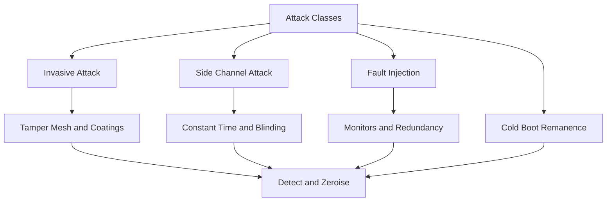

# Physical and Side-Channel Attacks: What the Tamper Boundary Is Really Defending Against

## English

It is easy to talk about tamper resistance abstractly. It becomes concrete when you look at the attack classes an HSM is built to defeat. The first is invasive attack: physically opening the package, probing internal buses with microprobes, or reading memory contents directly. Defences include a mesh of fine wires wrapped around the circuitry that shorts or opens when drilled, chemically sensitive layers, and opaque coatings that make decapsulation destroy the die. The goal is that any attempt to reach the secrets physically triggers a response — zeroising keys — or at least leaves evidence.

A second class is side-channel attack, which does not break the package at all. The device leaks information through power consumption, electromagnetic emissions, or the time it takes to compute. A classic example is timing analysis of a modular exponentiation: if the implementation branches differently depending on key bits, the total runtime correlates with the secret. Simple power analysis looks at a single trace; differential power analysis averages thousands of traces to amplify tiny correlations. HSMs counter this with constant-time algorithms, randomised blinding of the exponent, and hardware that balances power draw.

A third class is fault injection. The attacker glitches the clock, dips the supply voltage, or shines a laser to flip a bit mid-computation. A single flipped bit during a signature can leak the private key through the resulting faulty output compared against a correct one. Defences include voltage and clock monitors, redundant computation with result comparison, and designed-in checks that abort and zeroise on anomaly. This is why an HSM is more than a sealed box: it must actively detect that something is wrong.

A fourth class is the cold-boot and memory-remnant family: chilling memory to preserve its contents after power loss. Inside an HSM this is mitigated by keeping keys only in dedicated secure memory, encrypting DRAM, and zeroising on any detected tamper event rather than relying on power loss alone.

What this means practically: the tamper boundary is not a wall, it is an active defence system with sensors, redundant logic, and response circuitry. When you evaluate an HSM, the interesting questions are which attack classes it claims to resist, at what cost in performance, and what the response is on detection — zeroise, lock, or alert. A device that merely resists opening but leaks through power is only half-protected.

## 中文

講防篡改（tamper resistance）好容易流於抽象。當你睇清楚 HSM 要打低邊幾類攻擊，就會變得具體。第一類係侵入式攻擊：實體開啟封裝、用微探針去探內部匯流排、或者直接讀記憶體內容。防禦包括圍住電路嘅細線網（一鑽就會短路或斷開）、對化學物質敏感嘅塗層、同埋令拆封會摧毀晶粒嘅不透明封裝。目標係：任何想實體接觸機密嘅嘗試，都會觸發反應——將金鑰清零——或者至少留下痕跡。

第二類係側通道攻擊（side-channel attack），完全唔使拆封裝。裝置會透過耗電、電磁輻射、或者運算所需時間洩漏資訊。經典例子係模組指數運算嘅時間分析：如果實作會因應金鑰位元而走唔同分支，總執行時間就會同秘密相關。簡單功率分析睇單一條軌跡；差分功率分析就平均幾千條軌跡，放大微弱嘅相關性。HSM 用恆定時間演演算法、指數隨機盲化（blinding）、同埋平衡耗電嘅硬體去對抗。

第三類係故障注入（fault injection）。攻擊者幹擾時鐘、拉低供電電壓、或者用雷射令運算中途某個位元翻轉。簽名運算中翻轉一個位元，就可能透過將錯誤輸出同正確輸出比較而洩漏私鑰。防禦包括電壓同時鐘監測器、冗餘運算加結果比對、同埋內建檢查——一有異常就中止並清零。呢個就係點解 HSM 唔止係一個密封盒：佢必須主動偵測到有嘢唔妥。

第四類係冷開機同記憶體殘留嗰一家人：將記憶體降溫，令斷電後內容仍然保留。喺 HSM 內部，呢點靠將金鑰只存放喺專用安全記憶體、加密 DRAM、同埋一偵測到篡改事件就清零（而唔係單靠斷電）去緩解。

實際意義係：篡改邊界唔係一道牆，而係一套有感測器、冗餘邏輯同反應電路嘅主動防禦系統。你評估一部 HSM 時，有趣嘅問題係：佢聲稱抵抗邊幾類攻擊、代價係幾多效能、偵測到之後嘅反應係咩——清零、鎖定、定係警報。一部只係防到拆開、但會透過耗電洩漏嘅裝置，只係保護咗一半。

## Key Takeaway

The tamper boundary defends against four distinct attack families — invasive probing, side channels, fault injection, and memory remanence — each needing active countermeasures, not just a sealed enclosure.

## Related Concepts
- Side-channel analysis
- Fault injection

## Diagram

