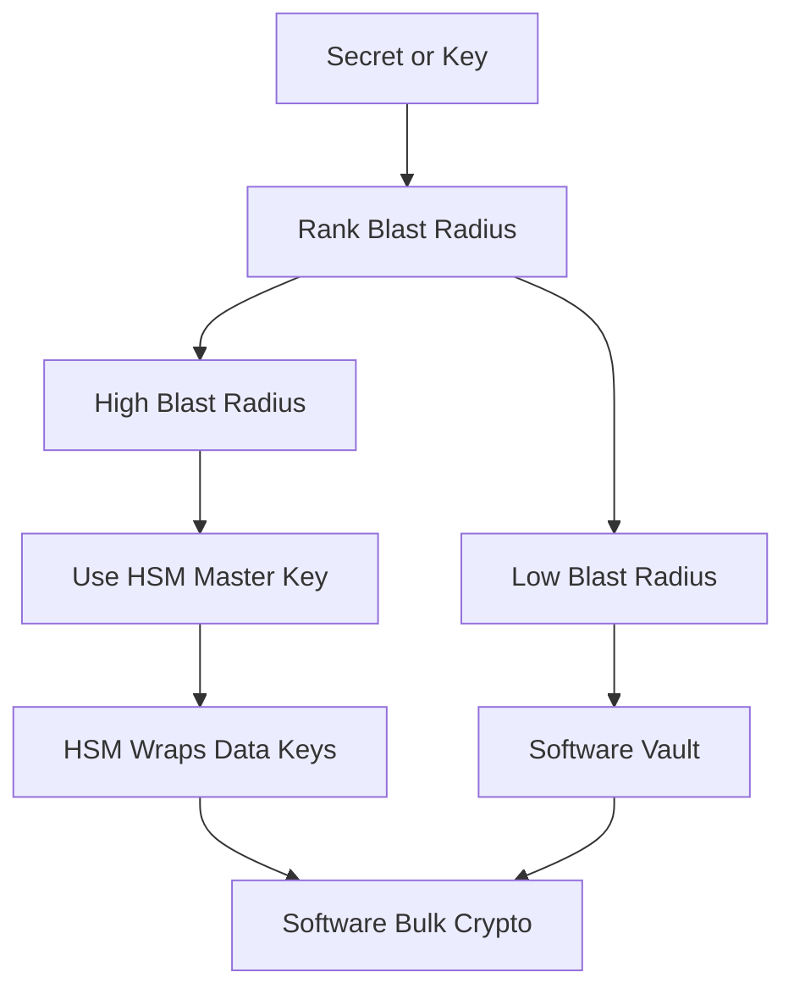

# When Not to Use an HSM: Cost, Throughput, and the Architecture of Last Resort

## English

HSMs are powerful, but reaching for one for every secret is a mistake. The honest engineering question is: which keys actually need the guarantees an HSM provides, and which do not? A useful frame is to rank secrets by blast radius — what an attacker gains if the key is stolen. A root signing key that can mint other certificates is catastrophic; a session key protecting one short-lived TLS connection is not. Spend the HSM budget where the blast radius is largest.

Throughput is a real constraint. An HSM performs crypto inside a constrained, hardened environment, and per-operation latency is higher than a general-purpose CPU running optimised software. If your workload is millions of small symmetric operations per second, an HSM is the wrong tool. The common architecture is a hybrid: the HSM holds and protects a long-term master key, and that key wraps (encrypts) short-lived data keys that software uses for bulk encryption. The HSM only touches the master key occasionally, so its cost is amortised, while the data keys never need to be as strongly protected because they are ephemeral. This is exactly the pattern used in many key-management designs.

Availability is another reason to be careful. An HSM is a single point of failure unless clustered, and clustering brings its own complexity. For secrets where a brief outage is tolerable and the value is modest — say, a development environment's API token — a software vault with strong access control may be entirely adequate. The threat model, not the marketing, should decide.

There is also an operational cost that is easy to underestimate. HSMs bring ceremonies, quorum rules, backup procedures, firmware upgrade cycles, and vendor dependency. Every one of those is a place where a rushed change can lock you out of your own keys. A team that cannot reliably run a key ceremony may be safer with a well-operated software system than with an HSM they misconfigure.

So the mature position is not 「HSM everywhere」 but 「HSM where the key's compromise would be unrecoverable, and software protection elsewhere, with clear reasoning recorded for each choice.」 Document the blast radius, the throughput requirement, the availability target, and the operational maturity, then decide. The best architecture is the one whose weakest link you can actually name.

## 中文

HSM 好強大，但係為每一個秘密都出動 HSM 就係錯誤。誠實嘅工程問題係：邊啲金鑰真正需要 HSM 提供嘅保證，邊啲唔需要？一個好用嘅框架係按「爆炸半徑」替秘密排序——即係金鑰被偷之後攻擊者得到幾多。一條可以簽發其他憑證嘅根簽署金鑰，後果係災難性；一條只保護單一短暫 TLS 連線嘅工作階段金鑰，就唔係。將 HSM 嘅預算放喺爆炸半徑最大嘅地方。

吞吐量係真實嘅限制。HSM 喺一個受限、加固嘅環境入面做密碼運算，每次操作嘅延遲比一部行最佳化軟體嘅通用 CPU 高。如果你嘅工作負載係每秒幾百萬次細型對稱運算，HSM 就係錯嘅工具。常見架構係混合式：HSM 保管同保護一條長期主金鑰，而呢條主金鑰會包裹（加密）短暫嘅資料金鑰，軟體就用資料金鑰做大量加密。HSM 只偶爾接觸主金鑰，成本就被攤薄；而資料金鑰因為係短暫嘅，唔需要咁強嘅保護。呢個正正係好多金鑰管理設計用嘅模式。

可用性係另一個要小心嘅理由。除非做叢集，否則 HSM 係單點故障，而叢集本身又帶嚟複雜性。對於短暫中斷可以接受、價值又唔高嘅秘密——例如開發環境嘅 API 權杖——一個有強存取控制嘅軟體保險庫可能完全夠用。應該由威脅模型決定，而唔係由市場推廣決定。

仲有一項容易低估嘅營運成本。HSM 帶嚟金鑰儀式、法定人數規則、備份程式、韌體升級週期同廠商依賴。每一項都係一個「一急就改錯、然後鎖死自己金鑰」嘅位置。一個唔能夠可靠咁執行金鑰儀式嘅團隊，用一部設定錯誤嘅 HSM，可能比用一套營運良好嘅軟體系統更危險。

所以成熟嘅立場唔係「周圍都擺 HSM」，而係「喺金鑰一旦洩漏就無法挽回嘅地方用 HSM，其他地方用軟體保護，並且為每個選擇記錄清晰嘅理由」。寫低爆炸半徑、吞吐量要求、可用性目標同營運成熟度，然後先決定。最好嘅架構，就係你講得出佢最弱一環係邊嘅嗰個。

## Key Takeaway

Use an HSM where key compromise would be unrecoverable, and use cheaper software protection elsewhere — with the reasoning documented, because the weakest link matters more than the strongest box.

## Related Concepts
- Blast radius
- Key wrapping

## Diagram

