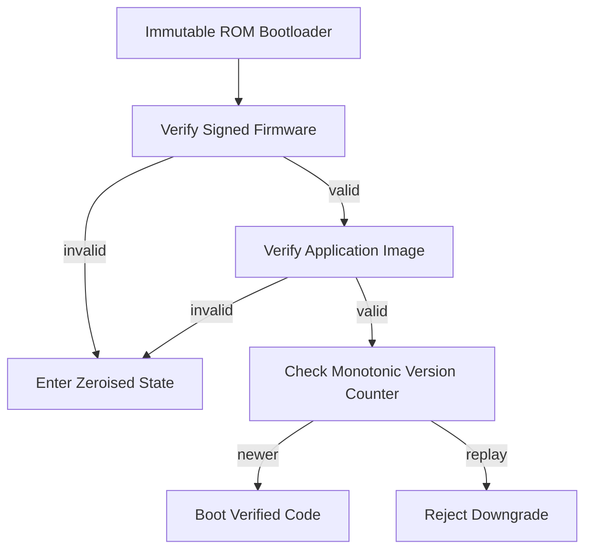

# HSM Firmware Updates and the Trust Chain Problem

## English

An HSM is only as trustworthy as the code running on it, which means firmware updates are simultaneously essential and terrifying. On one hand, a cryptographic module that cannot be patched will eventually ship with a vulnerability in its RSA padding check, its random number generator seeding, or its PKCS#11 session handling — and unlike a web server, you cannot simply rotate the box out overnight without a key ceremony. On the other hand, the update mechanism is itself a high-value attack surface: whoever can push firmware into the tamper boundary owns every key inside it. Vendors therefore sign firmware images with a key held in another HSM, and the device verifies that signature using a public key burned into immutable ROM at manufacture. This is a chain of trust rooted in silicon: ROM bootloader verifies the signed firmware, which then verifies the loaded application image, each stage refusing to hand control to the next unless the signature checks out. If any link fails, the module typically enters a restricted or zeroised state rather than booting unverified code.

A concrete illustration of why this matters: a firmware update that adds a new cipher suite must not accidentally weaken an existing one, and a rollback to an older, vulnerable version must be blocked. Many HSMs enforce monotonic version counters in tamper-protected non-volatile memory, so an attacker replaying an old signed image gets rejected even though the signature is technically valid. This anti-rollback property is subtle but critical — a valid signature on an obsolete image is still a downgrade attack.

The operational friction is real. Firmware updates on certified modules often require re-validation under FIPS 140-3 or Common Criteria, which can take months and cost a great deal, so vendors batch changes and security fixes may lag. Some deployments run 'field upgradeable' modules where the firmware update is itself part of the certified boundary; others pin a specific firmware version and accept that patching means a full re-certification cycle. Organisations with strict compliance obligations sometimes deliberately freeze firmware and compensate with network segmentation and monitoring.

For architects, the practical takeaway is to treat firmware version as part of your key inventory. Record which firmware each partition runs, monitor vendor security advisories, and rehearse the update procedure including the possibility that the device fails verification and enters a locked state. A firmware update on an HSM is not like a routine OS patch; it is a controlled change to the root of trust, and it deserves the same ceremony as a key generation event.

## 中文

一部 HSM 的可信程度，取決於它上面跑的程式碼，所以韌體更新既不可或缺，又令人心驚膽跳。一方面，一個無法修補的密碼模組，遲早會在 RSA padding 檢查、亂數產生器種子、或 PKCS#11 session 處理上帶著漏洞出貨——而且它不像 web server，你不可能隔夜把機器換掉而不做一次金鑰儀式。另一方面，更新機制本身就是高價值的攻擊面：誰能把韌體推入防篡改邊界之內，誰就掌握了裡面所有金鑰。因此廠商會用另一部 HSM 保管的金鑰來簽署韌體映像，裝置則用製造時燒錄在不可變 ROM 裡的公鑰來驗證簽章。這是一條扎根於矽晶的信任鏈：ROM 開機載入器驗證已簽署的韌體，韌體再驗證載入的應用映像，每一階段若簽章不符就拒絕把控制權交給下一階段。任何一環失敗，模組通常會進入受限或清零狀態，而不是啟動未經驗證的程式碼。

一個具體例子說明為何這很重要：一個新增密碼套件的韌體更新，絕不能順手削弱既有的套件；而回滾到舊的、有漏洞的版本必須被阻止。許多 HSM 在防篡改的非揮發記憶體中維護單調遞增的版本計數器，因此攻擊者重放舊的已簽署映像會被拒絕，即使簽章在技術上有效。這個防回滾特性很細微但關鍵——對過時映像的有效簽章，仍然是一次降級攻擊。

營運上的摩擦是真實的。已認證模組的韌體更新，往往需要在 FIPS 140-3 或 Common Criteria 下重新驗證，可能耗時數月、所費不貲，所以廠商會把變更批次處理，安全修補可能因此落後。有些部署採用「可現場升級」的模組，更新本身屬於認證邊界的一部分；另一些則釘住特定韌體版本，接受修補就等於整個重新認證週期。有嚴格合規義務的組織，有時會刻意凍結韌體，並以網絡分段與監控來補償。

對架構師而言，實務上的要點是把韌體版本視為金鑰清單的一部分。記錄每個分割區跑哪個韌體、監看廠商的安全公告，並演練更新程序，包括裝置驗證失敗而進入鎖定狀態的可能性。HSM 的韌體更新不像例行作業系統修補；它是對信任根源的一次受控變更，值得與金鑰產生事件同等的儀式規格。

## Key Takeaway

Firmware updates on an HSM are a controlled change to the root of trust, so treat firmware version as part of your key inventory and rehearse the update and failure states.

## Related Concepts
- Chain of trust / secure boot
- Anti-rollback protection

## Diagram

