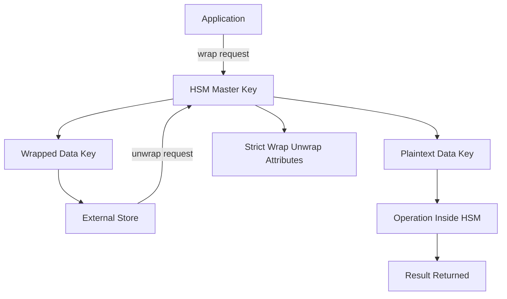

# Key Wrapping and the Envelope Pattern Inside the HSM

## English

A common misconception is that keys only ever exist inside the HSM. In practice, most real systems use an envelope or key-wrapping pattern: the HSM holds a small number of long-lived master keys, and those masters encrypt (wrap) many short-lived data keys that travel outside the boundary. The wrapped form is just ciphertext plus metadata, so it can sit in a database, a config file, or a cloud object store without exposing the plaintext key. When the application needs to use the data key, it sends the wrapped blob to the HSM, which unwraps it with the master key, performs the operation, and returns the result — the plaintext data key never has to leave the boundary.

The wrapping itself uses an authenticated encryption mode, typically AES Key Wrap (RFC 3394) or AES Key Wrap with Padding (RFC 5649), which binds the wrapped key to an integrity check so an attacker cannot silently substitute one wrapped key for another. Crucially, the wrapping key must never be usable for anything except wrapping and unwrapping; if the same master key could also encrypt arbitrary data, an attacker who can get the HSM to unwrap might be able to use it as a decryption oracle. This is why HSM key attributes (in PKCS#11 terms, CKA_WRAP and CKA_UNWRAP versus CKA_ENCRYPT and CKA_DECRYPT) are set to strictly separate those roles, and why 'wrap' and 'unwrap' are distinct permissions a role can be granted or denied.

The envelope pattern solves several problems at once. It lets you have millions of per-tenant or per-record data keys without storing millions of keys in tamper-protected memory, which is expensive and finite. It lets you rotate the master key by re-wrapping all the data keys under a new master — a bulk operation the HSM can perform efficiently. And it lets you move wrapped keys between HSMs in a cluster or across a backup, provided both sides share the master key or a key-encryption-key hierarchy. The trade-off is that the wrapped blob's integrity and the master key's availability become single points of failure: lose the master and every wrapped key is permanently undecryptable, which is exactly why M-of-N backup of the master is so important.

A subtle security property is that wrapping does not protect against a compromised application. If an attacker controls the process that calls the HSM, they can ask it to unwrap any blob that process is authorised to unwrap. The envelope pattern reduces blast radius — the attacker gets the data keys that process can reach, not the master — but it does not eliminate the need for tight authorisation and auditing of unwrap calls. Think of wrapping as a way to keep keys out of storage and out of memory, not as a way to trust the caller.

## 中文

一個常見的誤解是金鑰只會存在於 HSM 內部。實務上，大多數真實系統採用信封式或金鑰包裝模式：HSM 保管少量長壽命的主金鑰，這些主金鑰加密（包裝）許多短壽命的資料金鑰，而這些資料金鑰會離開邊界。包裝後的形態只是密文加中繼資料，因此可以放在資料庫、設定檔或雲端物件儲存中，而不暴露明文金鑰。當應用程式需要使用資料金鑰時，它把包裝後的 blob 送進 HSM，HSM 用主金鑰解包、執行操作、回傳結果——明文的資料金鑰從不需要離開邊界。

包裝本身使用帶認證的加密模式，典型是 AES Key Wrap（RFC 3394）或帶填充的 AES Key Wrap（RFC 5649），它把包裝後的金鑰綁上完整性檢查，使攻擊者無法悄悄把一個包裝金鑰換成另一個。關鍵在於，包裝金鑰絕不能兼作其他用途；若同一把主金鑰也能加密任意資料，能讓 HSM 解包的攻擊者就可能把它當成解密預言機。這就是為何 HSM 的金鑰屬性（以 PKCS#11 術語來說，CKA_WRAP 與 CKA_UNWRAP 對比 CKA_ENCRYPT 與 CKA_DECRYPT）被嚴格區分，也是為何「包裝」與「解包」是角色可以被授予或拒絕的不同權限。

信封模式一次解決多個問題。它讓你擁有數百萬把按租戶或按紀錄的資料金鑰，而不必在防篡改記憶體中儲存數百萬把金鑰——那既昂貴又有限。它讓你透過把所有資料金鑰重新包裝到新主金鑰之下來輪換主金鑰，這是 HSM 能高效執行的批次操作。它也讓你在一群叢集或備份之間搬移包裝金鑰，前提是兩邊共享主金鑰或一組金鑰加密金鑰階層。代價是：包裝 blob 的完整性與主金鑰的可用性成為單點故障——失去主金鑰，每一把包裝金鑰都永久無法解密，這正是為何主金鑰的 M-of-N 備份如此重要。

一個細微的安全性質是：包裝並不能防禦被入侵的應用程式。若攻擊者控制了呼叫 HSM 的行程，他們就能要求它解包該行程有權解包的任何 blob。信封模式縮小了爆炸半徑——攻擊者只拿到該行程可觸及的資料金鑰，而非主金鑰——但它並沒有消除對解包呼叫做嚴格授權與稽核的需要。把包裝想成一種讓金鑰遠離儲存與記憶體的手段，而不是一種信任呼叫者的手段。

## Key Takeaway

The envelope pattern keeps plaintext data keys out of storage by wrapping them under HSM-resident masters, but it protects key material, not the application that calls unwrap.

## Related Concepts
- AES Key Wrap (RFC 3394)
- Key-encryption-key hierarchy

## Diagram

