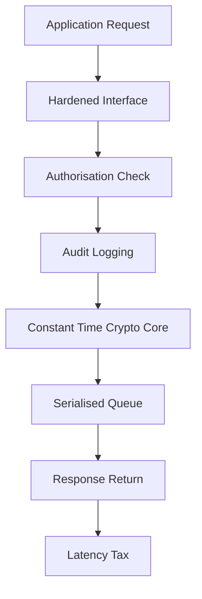

# Why HSMs Are Slow: The Latency Budget of a Cryptographic Vault

## English

People are often surprised that a device dedicated to cryptography can be slower than a laptop CPU at the same operation. The reason is that the tamper boundary imposes a latency tax at every layer. Inside the boundary, cryptographic operations are performed by a dedicated processor or FPGA, but every command must pass through a hardened interface, be checked against the caller's authorisation, logged for audit, and executed in a controlled environment that resists power analysis and timing attacks. Constant-time implementations — which avoid data-dependent branches and memory access patterns so that timing cannot leak key bits — are inherently slower than the optimised, branch-heavy code a general CPU runs. A single RSA-2048 signature might take a few milliseconds; an ECDSA P-256 signature on a modern HSM might take under a millisecond but still far longer than the tens of microseconds a server CPU needs.

The bigger cost is often the round trip, not the math. If the HSM is a network appliance, each operation pays for TCP, TLS (if the management channel is encrypted), request serialisation, queueing, and response. A local PCIe card avoids the network but still pays for driver overhead and context switching. When an application needs thousands of signatures per second — think a busy certificate authority or a high-volume payment switch — the per-operation latency multiplies into a throughput wall. Architects respond with batching, connection pooling, and session reuse, but the fundamental limit remains: the HSM serialises work through a small number of cryptographic cores behind a single secure boundary.

The classic mitigation is to use the HSM only for the operations that genuinely need the boundary. Bulk data encryption is usually done with symmetric keys in software, using a data key that the HSM wrapped and unwrapped once per session, rather than sending every block through the device. TLS termination is often done on general-purpose servers with the private key stored in the HSM, using the HSM only for the handshake's key agreement or signature. This 'HSM at the edges, software in the middle' pattern keeps the boundary where it matters — protecting long-lived keys — while letting high-volume, short-lived operations run at CPU speed.

Finally, capacity planning must account for the fact that HSMs are sized in cryptographic operations per second for specific algorithms, and those numbers vary wildly between RSA, ECDSA, and AES. A device rated for 10,000 RSA-2048 signs per second may handle far fewer ECDSA operations, or vice versa, and clustering adds coordination overhead. Measure with your actual algorithm mix and key sizes, not the vendor's headline number, and leave headroom for failover: if one node in a cluster dies, the survivors must absorb its load without breaching latency targets.

## 中文

人們常感到意外：一部專門做密碼運算的裝置，同一個操作竟可能比筆記型電腦的 CPU 還慢。原因是防篡改邊界在每一層都課了延遲稅。在邊界之內，密碼運算由專用處理器或 FPGA 執行，但每個命令都必須穿過強化介面、接受呼叫者授權檢查、寫入稽核日誌，並在能抵抗功耗分析與時序攻擊的受控環境中執行。常數時間實作——避開依資料而定的分支與記憶體存取模式，使時序無法洩漏金鑰位元——本質上比一般 CPU 跑的、充滿分支的最佳化程式碼更慢。一次 RSA-2048 簽章可能要幾毫秒；現代 HSM 上的 ECDSA P-256 簽章可能不到一毫秒，但仍遠長於伺服器 CPU 所需的數十微秒。

更大的成本往往是來回傳輸，而非數學運算。若 HSM 是網絡設備，每次操作都要付出 TCP、TLS（若管理通道加密）、請求序列化、排隊與回應的代價。本機 PCIe 卡避開了網絡，但仍要付驅動程式開銷與上下文切換。當應用程式每秒需要數千次簽章——想想繁忙的憑證授權中心或高流量支付交換機——每次操作的延遲就會疊加成一道吞吐量高牆。架構師會用批次處理、連線池與 session 重用來回應，但根本限制仍在：HSM 透過單一安全邊界後方的少數密碼核心，把工作序列化。

經典的緩解之道，是只把 HSM 用於真正需要邊界的操作。大量資料加密通常用軟體中的對稱金鑰完成，使用一把每個 session 由 HSM 包裝與解包一次的資料金鑰，而不是把每個區塊都送進裝置。TLS 終結常在一般用途伺服器上完成，私鑰存於 HSM，只在握手時的金鑰協商或簽章才動用 HSM。這種「邊緣用 HSM、中間用軟體」的模式，把邊界留在真正重要的地方——保護長壽命金鑰——同時讓高流量、短壽命的操作以 CPU 速度運行。

最後，容量規劃必須考慮到：HSM 的規格是以特定演算法的每秒密碼操作數來標示，而這些數字在 RSA、ECDSA 與 AES 之間差異極大。一部標稱每秒一萬次 RSA-2048 簽章的裝置，處理 ECDSA 的次數可能少得多，反之亦然，而叢集又會增加協調開銷。請用你實際的演算法組合與金鑰長度來量測，而不是廠商的海報數字，並為容錯預留餘裕：若叢集中一個節點掛掉，存活節點必須吸收它的負載而不超出延遲目標。

## Key Takeaway

The tamper boundary and constant-time code make HSMs inherently slower per operation, so design systems that keep the HSM at the edges and let high-volume work run in software.

## Related Concepts
- Constant-time cryptography
- TLS termination architecture

## Diagram

