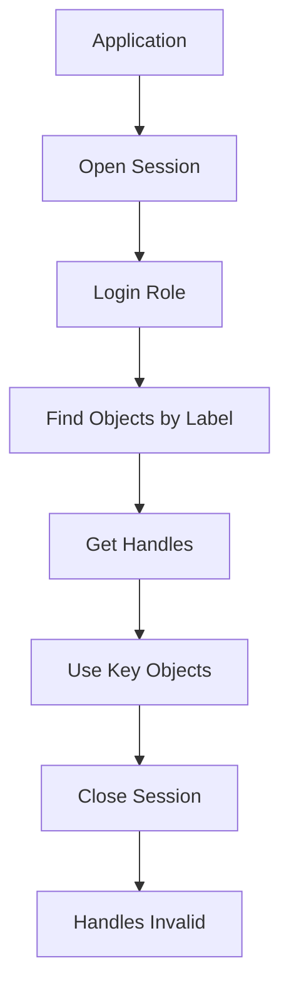

# The HSM as a State Machine: Why Sessions, Handles, and Objects Matter

## English

Most people picture an HSM as a black box that takes a key and some data and returns a signature. In practice, a PKCS#11-style HSM is a stateful device: you open a session, log in, create or find objects, and reference them by opaque handles. That object model is the real interface, and misunderstanding it is a common source of bugs and outages.

A session (sometimes called a context or channel) is a logical connection to the token. Sessions can be read-only or read-write, and they carry an authentication state. When you call C_Login, you are not logging into the whole appliance — you are elevating one session (or, in some implementations, a whole application context) into a role such as user or crypto officer. Close the session and the login state may be gone. This is why connection pooling in an application must be paired with careful session lifecycle management: a pooled session that was never logged in will fail every signing call with a cryptic error.

Objects are the HSM's internal data structures: keys, certificates, and data blobs. Each one has attributes (class, key type, whether it is sensitive, extractable, or allowed to sign vs decrypt) and is addressed by a handle that is only valid within the session that discovered it. Handles are not stable identifiers. If you cache a handle across sessions or across a reconnect, you may silently operate on the wrong object or get an invalid-handle error. The robust pattern is to look up objects by a stable label or ID attribute each time you need them.

The attribute flags are where a lot of security engineering lives. Marking a key as non-extractable (often called CKA_EXTRACTABLE = false, or 'sensitive') means the HSM will refuse to wrap it out, even for a backup. Marking it non-exportable in the usage sense means it can only be used for the operations you allow. These flags are enforced inside the tamper boundary, which is precisely the point: software cannot override them, so a compromised application server holding the PIN still cannot exfiltrate the raw key material.

A practical consequence: treat the HSM's object store as a database with its own schema and migrations. When you rotate keys, you create a new object with a new label; you do not mutate the old one. When you decommission a key, you destroy the object and verify it is gone. Model these transitions explicitly in your application code, and the HSM stops being a mysterious appliance and becomes a well-understood stateful service.

## 中文

多數人想像中的 HSM 是一個黑盒：丟入金鑰和資料，吐出簽章。實際上，走 PKCS#11 風格的 HSM 是一部有狀態的裝置：你要開啟 session、登入、建立或尋找物件，然後用不透明的 handle 去引用它們。這個物件模型才是真正的介面，誤解它往往是程式錯誤和服務中斷的根源。

Session（有時叫 context 或 channel）是通往 token 的邏輯連線。Session 可以是唯讀或可讀寫，並攜帶認證狀態。當你呼叫 C_Login，你不是登入整部設備，而是把某個 session（某些實作則是整個應用程式情境）提升到某個角色，例如 user 或 crypto officer。關閉 session，登入狀態可能就消失了。這就是為何應用程式的連線池必須配搭嚴謹的 session 生命週期管理：一個從未登入的池化 session，每次簽章呼叫都會以晦澀的錯誤失敗。

物件是 HSM 內部的資料結構：金鑰、憑證、資料 blob。每個物件有屬性（類別、金鑰類型、是否敏感、是否可匯出、允許簽章還是解密），並以 handle 定址，而 handle 只在發現它的那個 session 內有效。Handle 不是穩定識別碼。若你把 handle 快取到其他 session 或重連之後，你可能會默默地操作錯物件，或得到無效 handle 的錯誤。穩健的做法是每次需要時，用穩定的 label 或 ID 屬性重新查找物件。

屬性旗標正是許多安全工程所在之處。把金鑰標記為不可匯出（常寫成 CKA_EXTRACTABLE = false，或稱 sensitive），代表 HSM 會拒絕把它包裝出去，連備份也不行。在用途上標記為不可匯出，代表它只能用於你允許的操作。這些旗標在防篡改邊界內強制執行，重點正在於此：軟件無法覆寫它們，所以即使持有 PIN 的應用伺服器被攻陷，仍然無法把原始金鑰材料偷運出去。

實務上的結論：把 HSM 的物件儲存當成一個有自己 schema 和遷移的資料庫。輪換金鑰時，你建立一個帶新 label 的新物件，而不是改動舊的。退役金鑰時，你銷毀物件並確認它真的不在了。在應用程式碼中明確地建模這些狀態轉換，HSM 就不再是神秘的設備，而是一個理解透徹的有狀態服務。

## Key Takeaway

An HSM is a stateful object store with session-scoped handles and enforced attribute flags, so treat it like a database with a schema, not a stateless function call.

## Related Concepts
- PKCS#11 object attributes
- Session lifecycle management

## Diagram

