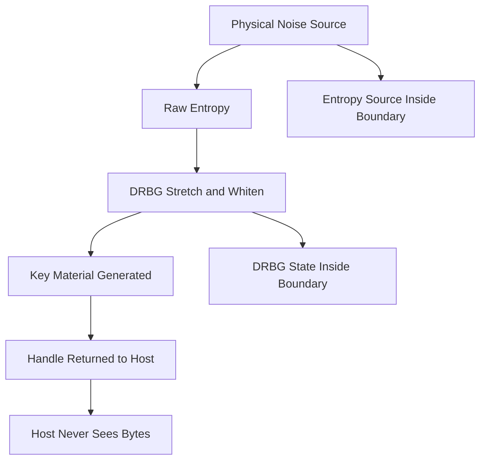

# Entropy and Key Generation Inside the Vault: Where Randomness Comes From

## English

A cryptographic key is only as good as the randomness used to create it. An HSM's job in key generation is not just to store the result but to be the source of that randomness, inside the tamper boundary, so nobody outside can observe or bias it. This is a subtler protection than people assume, and it explains why 'just use openssl rand' is not equivalent.

HSMs contain a hardware random number generator (HRNG, also called a TRNG for true random number generator) that harvests physical noise — thermal noise, ring oscillator jitter, or similar phenomena. Raw physical sources are biased and slow, so the HSM feeds them into a deterministic random bit generator (DRBG) that stretches and whitens the output. Standards such as NIST SP 800-90A describe approved DRBG constructions, and FIPS validation checks that the implementation follows them. The key point: the DRBG state and the raw entropy source both live inside the boundary, so an attacker on the host cannot read the DRBG state or predict its output.

Why does this matter more than it sounds? If key material is generated on a general-purpose server, the operating system's entropy pool is shared with every process on that machine. A compromised or merely noisy neighbour could, in principle, influence or observe the pool. Virtual machines have historically had entropy-starved boot scenarios, producing weak keys. Generating inside the HSM removes the host from the trust path entirely: the host asks the HSM to generate a key of a given type and size, and receives only a handle, never the bytes.

There is also a compliance dimension. Many standards require that keys be generated within a validated cryptographic module. If you generate a key in software and import it, you often cannot claim the same assurance level as a key born inside the module, because the import path itself is a trust question. Some HSMs support 'key import with attestation' where the imported key is bound to the module, but native generation is the cleanest story.

One practical wrinkle: deterministic key generation from a seed or passphrase (as some backup schemes use) deliberately trades entropy for reproducibility. That is fine for recovery workflows but should never be the primary generation path for long-lived keys. Keep the two concepts separate in your design: fresh keys come from the HSM's entropy source; recovery material is a separate, carefully guarded artifact.

## 中文

一把加密金鑰的好壞，取決於產生它時所用的隨機性。HSM 在金鑰產生上的職責，不只是儲存結果，而是要在防篡改邊界內成為隨機性的來源，讓外面的人無法觀察或偏誤它。這種保護比一般人想像的更細緻，也說明了為何「直接用 openssl rand」並不對等。

HSM 內含硬件隨機數產生器（HRNG，也叫 TRNG，真隨機數產生器），從物理雜訊中採集熵——熱雜訊、環形振盪器的抖動，或類似現象。原始物理來源有偏誤又慢，所以 HSM 把它餵進確定性隨機位元產生器（DRBG），由它延伸並白化輸出。NIST SP 800-90A 等標準描述了認可的 DRBG 構造，FIPS 驗證會檢查實作是否遵循。重點是：DRBG 狀態和原始熵源都位於邊界之內，所以主機上的攻擊者無法讀取 DRBG 狀態或預測其輸出。

為何這比聽起來更重要？若金鑰材料在通用伺服器上產生，作業系統的熵池就與該機器上每個程序共享。一個被攻陷、或只是雜訊很多的鄰居，原則上可能影響或觀察這個池。虛擬機在歷史上出現過開機時熵不足的情境，產生弱金鑰。在 HSM 內產生，就把主機完全移出信任路徑：主機要求 HSM 產生某類型、某大小的金鑰，只收到一個 handle，永遠拿不到位元組。

這還有合規層面。許多標準要求金鑰必須在經驗證的密碼模組內產生。若你在軟件中產生金鑰再匯入，通常無法宣稱與模組內誕生的金鑰同等的保證等級，因為匯入路徑本身就是一個信任問題。有些 HSM 支援「帶證明的金鑰匯入」，把匯入的金鑰綁定到模組，但原生產生才是最乾淨的說法。

一個實務上的小麻煩：從種子或通行短語確定性產生金鑰（某些備份方案會用），是刻意以熵換取可重現性。這對復原流程沒問題，但絕不應成為長期金鑰的主要產生路徑。在設計中把這兩個概念分開：新金鑰來自 HSM 的熵源；復原材料是另一個小心守護的產物。

## Key Takeaway

Generating keys inside the HSM keeps the entropy source and DRBG state within the tamper boundary, removing the host from the trust path and satisfying standards that require in-module generation.

## Related Concepts
- Hardware random number generators
- NIST SP 800-90A DRBG

## Diagram

