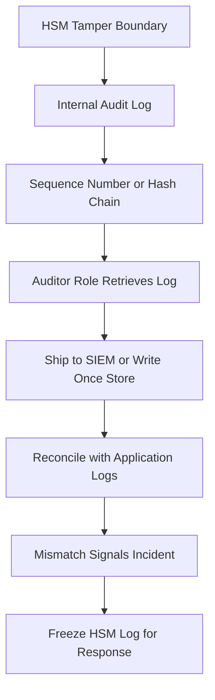

# Logging, Audit Trails, and the HSM as a Witness

## English

An HSM is one of the few components in your stack that can produce an audit trail you actually trust. Because its logs are generated inside the tamper boundary and (on good appliances) protected from modification, they answer a question software logs cannot: did this key really perform this operation at this time, and under whose authority? Treating the HSM as a witness, not just a worker, changes how you design operations.

Most HSMs maintain an internal audit log of security-relevant events: logins and failed logins, role changes, key generation, key destruction, and sometimes every cryptographic operation with the key identifier and a result code. Some appliances store this in tamper-protected memory with a rolling sequence number or hash chain, so gaps or edits are detectable. The log is typically retrieved over a management interface by an auditor role, and then shipped to a SIEM or a write-once store. The crucial property is provenance: the record originates from the device, not from an application that could have been compromised.

This matters for separation of duties. If your application server is compromised, its own logs can be forged or deleted. But the HSM's log still shows, for example, that signing key 'payments-2024' was used 4,000 times in a five-minute window, or that a crypto officer logged in at 3 a.m. and destroyed a key. Reconciliation between application logs and HSM logs is a powerful detection technique: a mismatch is itself a signal. Many incident response playbooks for key compromise start by pulling the HSM audit log and freezing it.

There are practical limits to be honest about. HSM logs are often small and rotate quickly; high-throughput signing can overwhelm the buffer, so many deployments log only administrative events and key lifecycle events, not every operation. Clock accuracy inside the device may be imperfect, so correlate timestamps with an external trusted time source. And log retrieval itself is a privileged operation that should be audited and rate-limited.

Design implication: decide up front which events you need the HSM to witness. At minimum, log all administrative actions, all key creation and destruction, and authentication failures. For high-value keys (root CAs, payment signing), consider enabling per-operation logging even at a performance cost, or use a dedicated low-volume key for the most sensitive actions. The HSM is your most credible witness — make sure it is actually watching the things that matter.

## 中文

HSM 是你整個技術堆疊中少數能產生真正可信審計軌跡的元件之一。因為它的日誌在防篡改邊界內產生，而且在優良的設備上受到防止修改的保護，它們能回答軟件日誌回答不了的問題：這把金鑰是否真的在某時執行了某操作，又是依據誰的授權？把 HSM 當成證人而不只是工人，會改變你設計營運的方式。

多數 HSM 會維護一份內部審計日誌，記錄安全相關事件：登入與登入失敗、角色變更、金鑰產生、金鑰銷毀，有時還包括每一次密碼操作及其金鑰識別碼與結果碼。有些設備把日誌存在防篡改記憶體中，附帶遞增序號或雜湊鏈，所以缺口或竄改可被偵測。日誌通常由審計員角色透過管理介面取出，再送到 SIEM 或一次性寫入的儲存。關鍵屬性是出處：紀錄源自裝置，而不是可能已被攻陷的應用程式。

這對職責分離很重要。若你的應用伺服器被攻陷，它自己的日誌可以被偽造或刪除。但 HSM 的日誌仍然顯示，例如簽章金鑰「payments-2024」在五分鐘窗口內被使用了四千次，或某位 crypto officer 在凌晨三點登入並銷毀了一把金鑰。把應用日誌與 HSM 日誌對帳，是強大的偵測技巧：不一致本身就是訊號。許多金鑰外洩的事件應變手冊，第一步就是取出 HSM 審計日誌並將其凍結。

也有實務限制要誠實面對。HSM 日誌通常很小且輪替很快；高吞吐量的簽章可能淹沒緩衝區，所以許多部署只記錄管理事件與金鑰生命週期事件，而非每一次操作。裝置內的時鐘準確度可能不完美，所以要與外部可信時間源對時。而且取日誌本身是特權操作，應被審計並限速。

設計上的含意：事先決定你要 HSM 見證哪些事件。至少記錄所有管理動作、所有金鑰建立與銷毀，以及認證失敗。對於高價值金鑰（根 CA、支付簽章），即使有效能代價，也考慮啟用逐次操作記錄，或為最敏感的動作使用一把專用的低流量金鑰。HSM 是你最可信的證人——確保它真的在注視重要的事。

## Key Takeaway

The HSM's internal audit log is a tamper-protected witness that survives application compromise, so decide deliberately which administrative and key events it must record and reconcile those logs against application logs.

## Related Concepts
- Separation of duties
- Security information and event management

## Diagram

