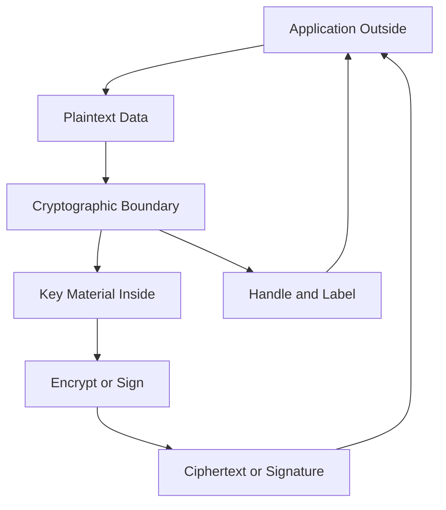

# HSM as a Cryptographic Boundary: What Actually Crosses It

## English

The most useful mental model for an HSM is not a box but a boundary — a line that separates key material from everything else. Understanding what is allowed to cross that line is the real skill. On the outside you have plaintext data, application code, network packets, and people. On the inside you have the key, the random number generator, and the arithmetic that uses the key. The whole design goal is that plaintext keys never cross the line in either direction; only ciphertext, signatures, MACs, and metadata like handles and labels are allowed through.

Consider a database encryption scenario. The application sends plaintext records into the boundary and gets ciphertext back. The key stays inside. That sounds simple, but think about the consequences: the application can never log the key, never cache it in memory, never put it in a debug dump, and never accidentally ship it to a crash reporting service. The boundary is doing security work simply by existing, because it removes an entire class of mistakes that developers make with secrets.

Now consider the harder cases. A signing operation sends a hash across the boundary and receives a signature. The hash is not secret, so crossing is fine. But what about a MAC verification? You send data and a claimed tag, and the HSM returns a yes or no. That single bit is a crossing point — an oracle that an attacker might try to exploit with timing or padding tricks. This is why well-designed HSM APIs perform constant-time comparison internally and why some operations (like raw RSA decryption without padding) are deliberately restricted or disabled.

The boundary also has a directionality problem. Some operations need to bring key material out — for example, wrapping a key under another key for backup. That is a controlled crossing, governed by policies, quorums, and audit. The distinction between an uncontrolled crossing (a plaintext key export) and a controlled one (a wrapped export under a key that itself never leaves) is the heart of HSM security architecture. When people say an HSM 'protects keys', they mean it enforces this distinction.

Finally, the boundary is not just cryptographic — it is also a policy boundary. The HSM enforces rules like 'this key may only be used for signing, never for decryption' or 'this key may only be used by these roles'. Those rules live inside the boundary alongside the key, so even a fully compromised application cannot talk the HSM into misusing a key. The application can ask; the HSM decides. That inversion of authority is what makes the boundary meaningful.

## 中文

理解 HSM 最有用嘅心智模型唔係一個箱，而係一條界線——一條將密鑰材料同其他一切分開嘅線。真正嘅功夫，係搞清楚乜嘢可以跨越呢條線。界線外面有明文資料、應用程式碼、網絡封包同人；界線裡面有密鑰、隨機數產生器，以及用密鑰做運算嘅算術。整個設計目標就係：明文密鑰永遠唔會以任何方向跨越呢條線；只有密文、簽名、MAC，同埋 handle、標籤之類嘅元資料可以通過。

諗一個資料庫加密嘅場景。應用程式將明文記錄送入界線，攞返密文。密鑰留喺裡面。聽落好簡單，但諗嚇後果：應用程式永遠唔可以記錄密鑰、唔可以喺記憶體快取密鑰、唔可以喺 debug dump 出現密鑰、亦都唔會唔小心將密鑰送去 crash reporting 服務。呢條界線單單因為存在就已經做緊保安工作，因為佢消除咗開發人員處理秘密時一整類嘅錯誤。

再諗嚇難啲嘅情況。簽名操作會送一個雜湊值跨越界線，攞返一個簽名。雜湊值唔係秘密，所以跨越冇問題。但 MAC 驗證又點呢？你送資料同一個聲稱嘅 tag 入去，HSM 回一個係或否。嗰一個 bit 就係一個跨越點——一個攻擊者可能用時序或者填充技巧去利用嘅 oracle。呢個就係點解設計良好嘅 HSM API 會喺內部做常數時間比較，亦都係點解某啲操作（例如冇填充嘅原始 RSA 解密）會被刻意限制或者停用。

條界線仲有個方向性問題。有啲操作需要將密鑰材料帶出嚟——例如用另一條密鑰包裹一條密鑰以作備份。呢個係受控嘅跨越，受政策、quorum 同審計規管。不受控嘅跨越（明文匯出密鑰）同受控嘅跨越（用一條本身永遠唔離開嘅密鑰去包裹匯出）之間嘅分別，就係 HSM 保安架構嘅核心。當人講 HSM「保護密鑰」，佢哋意思就係佢強制執行呢個區分。

最後，條界線唔止係密碼學上嘅，亦都係政策上嘅。HSM 會強制執行好似「呢條密鑰只可以用嚟簽名，永遠唔可以用嚟解密」或者「呢條密鑰只可以由呢啲角色使用」嘅規則。呢啲規則同密鑰一齊住喺界線裡面，所以即使應用程式完全被攻陷，都冇辦法說服 HSM 濫用一條密鑰。應用程式可以問；HSM 決定。呢種權限嘅倒置，就係令條界線有意義嘅原因。

## Key Takeaway

An HSM's security comes from enforcing what may cross its boundary, not from the box itself — plaintext keys never cross, and even single-bit answers like MAC verification are treated as potential oracles.

## Related Concepts
- Key Wrapping and the Envelope Pattern Inside the HSM
- What the HSM Can and Cannot Verify

## Diagram

