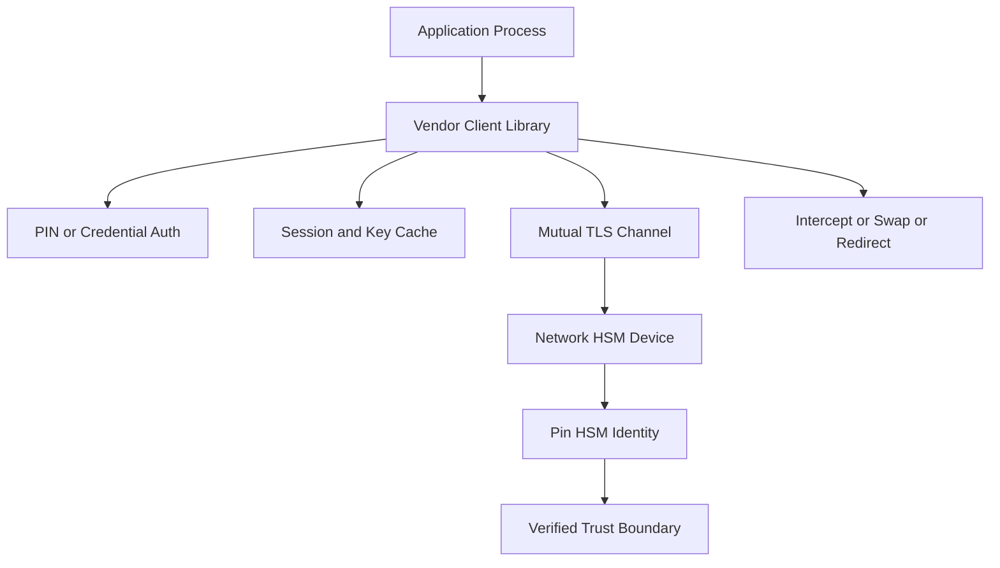

# HSM Client Libraries and the Trust Problem at the Edge

## English

When you talk to a network HSM, you do not speak its protocol directly. You install a vendor client library — sometimes called a PKCS#11 provider or a crypto provider — that runs on your application server and translates function calls into the HSM's wire protocol. This library is a fascinating and underappreciated attack surface, because it sits exactly at the boundary between your trusted application and the trusted device, and it is itself neither fully trusted nor fully untrusted.

Think about what the client library holds. To open a session, it needs to authenticate — often with a PIN or credentials — and it may cache session state, key handles, and even cryptographic material during multi-part operations. If the library is compromised, an attacker can intercept plaintext before it is encrypted, swap parameters, replay old ciphertexts, or redirect operations to a fake HSM. The HSM itself may behave perfectly while the library in front of it lies. This is why the client library is often signed by the vendor, why its integrity is checked at load time, and why some deployments pin the library version as part of their security baseline.

The network link between library and HSM also matters. Most network HSMs use mutually authenticated TLS or a vendor-specific encrypted channel, so both ends prove identity. But mutual TLS only proves you are talking to a genuine HSM; it does not prove the HSM is the one you expect, unless you also pin its certificate or verify its identity out of band. A rogue HSM (or a man-in-the-middle with a valid certificate from a compromised CA) could accept your operations and record everything. Pinning the HSM's identity — its certificate fingerprint, its serial number, or a vendor attestation — closes that gap.

There is a subtler issue: the client library runs in the same process as your application, sharing memory, environment variables, and sometimes the same user account. If your application is compromised, the attacker can call the library's API directly, using whatever session the application already has. The HSM will happily sign anything the library asks, because from its perspective the request is legitimate. This is why least privilege matters at the HSM level: the application's HSM identity should only be able to use the specific keys it needs, and nothing more. The library cannot save you from a compromised application; only the HSM's own policy can.

Practically, this means treating the client library as part of your trusted computing base, not as a black box. Pin its version, verify its signature, restrict which accounts can load it, monitor for unexpected upgrades, and keep its configuration (which HSM endpoint, which credentials, which key labels) under the same change control as your application code. The boundary between application and HSM is only as strong as the software standing on it.

## 中文

當你同網絡 HSM 通訊，你唔會直接講佢嘅協定。你會裝一套廠商嘅客戶端程式庫——有時叫做 PKCS#11 provider 或者 crypto provider——佢喺你嘅應用伺服器行，將函數呼叫翻譯成 HSM 嘅網絡協定。呢個程式庫係一個引人入勝但被低估嘅攻擊面，因為佢啱啱好坐喺你信任嘅應用程式同信任嘅裝置之間，而佢本身既唔完全可信，亦唔完全不可信。

諗嚇客戶端程式庫揸住啲乜。要開一個 session，佢需要認證——通常用 PIN 或者憑證——而且佢可能會喺多部分操作期間快取 session 狀態、密鑰 handle，甚至密碼學材料。如果程式庫被攻陷，攻擊者可以喺明文被加密之前截取、掉換參數、重播舊密文，或者將操作重定向去一個假 HSM。HSM 本身可能表現完美，但佢前面嘅程式庫講大話。呢個就係點解客戶端程式庫通常由廠商簽署、點解載入時會檢查完整性，亦都係點解有啲部署會將程式庫版本 pin 死作為保安基線嘅一部分。

程式庫同 HSM 之間嘅網絡連線都好重要。大部分網絡 HSM 用互相認證嘅 TLS 或者廠商專用嘅加密通道，所以兩端都會證明身份。但互相 TLS 只係證明你同一個真 HSM 講緊嘢；除非你同時 pin 佢嘅憑證或者喺頻外核實佢嘅身份，否則佢唔會證明嗰個 HSM 就係你預期嗰個。一個 rogue HSM（或者一個持有效憑證、來自被攻陷 CA 嘅中間人）可以接收你嘅操作並記錄一切。Pin 死 HSM 嘅身份——佢嘅憑證指紋、序號，或者廠商 attestation——就堵住呢個窿。

有個更微妙嘅問題：客戶端程式庫同你嘅應用程式喺同一個 process 行，共用記憶體、環境變數，有時仲共用同一個使用者帳戶。如果應用程式被攻陷，攻擊者可以直接呼叫程式庫嘅 API，用應用程式已經有嘅 session。HSM 會樂意簽署程式庫要求嘅任何嘢，因為由佢角度睇，個請求係合法嘅。呢個就係點解 HSM 層面嘅最小權限咁重要：應用程式嘅 HSM 身份應該只可以用佢需要嘅特定密鑰，僅此而已。程式庫救唔到被攻陷嘅應用程式；只有 HSM 自己嘅政策做得到。

實際上，呢個意味住要將客戶端程式庫當作你嘅可信運算基礎嘅一部分，而唔係黑盒。Pin 死佢嘅版本、核實佢嘅簽名、限制邊啲帳戶可以載入佢、監察意外嘅升級，並將佢嘅設定（邊個 HSM 端點、邊啲憑證、邊個密鑰標籤）納入同應用程式碼一樣嘅變更控制。應用程式同 HSM 之間嘅界線，只有喺企喺上面嘅軟件同樣咁穩固嘅時候，先會咁穩固。

## Key Takeaway

The client library and network channel between application and HSM are part of your trusted computing base — pin the library version and the HSM's identity, and rely on HSM-side policy rather than the library to contain a compromised application.

## Related Concepts
- HSM Interfaces — PKCS#11, JCE, REST APIs
- The HSM Boundary, PKCS#11, and M-of-N Key Ceremonies

## Diagram

