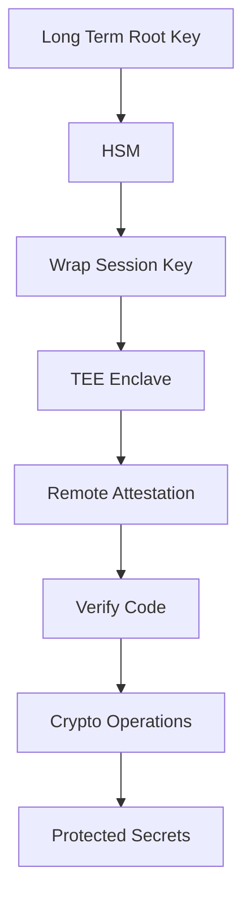

# HSM in the Age of Enclaves and Confidential Computing

## English

For decades the HSM was the only place where a key could be used without exposing it. That assumption is now being challenged by a family of technologies — secure enclaves, confidential VMs, trusted execution environments (TEEs) — that promise to protect secrets inside ordinary CPUs. It is worth understanding what these technologies actually do, and where they still fall short of an HSM, because the comparison sharpens your intuition about what 'hardware protection' really means.

A TEE like Intel SGX, AMD SEV, or ARM TrustZone creates an isolated execution environment where code and data are protected from the host operating system and hypervisor. Remote attestation lets a remote party verify which code is running in the enclave before sending it secrets. This is genuinely powerful: it lets you run cryptographic operations on machines you do not physically control, and it can protect keys in memory from a compromised cloud operator. For some workloads — like a multi-party computation or a privacy-preserving data pipeline — a TEE is the right tool.

But a TEE and an HSM defend against different threats. A TEE protects against software attackers on the same machine and against a curious cloud provider. It does not protect against physical attacks on the CPU package, side-channel attacks that exploit microarchitectural behaviour, or firmware-level compromises below the enclave. The HSM, by contrast, is built from the ground up to resist physical probing, voltage glitching, and side-channel analysis, and it is certified to do so under standards like FIPS 140-3. The two are complementary: a TEE gives you a large, flexible trusted environment; an HSM gives you a small, hardened one.

A common and sensible pattern is to combine them. The HSM holds the long-term root key — the one that must never be exposed, even to a physical attacker. The TEE holds short-lived session keys derived from it, so that high-volume operations happen close to the data without a round trip to the HSM. The HSM acts as the anchor; the TEE acts as the workhorse. This split respects the strengths of each: the HSM is slow but unbreakable, the TEE is fast but only as trustworthy as its attestation and its vendor's security record.

What should you take away? Do not treat 'hardware security' as a single property. Ask which attacker you are defending against, and where the key lives at each moment. If the key must survive a physical adversary with lab equipment, only an HSM (or a smart card, or a TPM in some cases) will do. If the key only needs to survive a compromised hypervisor for the duration of a session, a TEE may be enough. The right architecture usually uses both, with the HSM as the root of trust and the TEE as the scalable execution layer.

## 中文

幾十年嚟，HSM 係唯一可以喺唔暴露密鑰嘅情況下使用密鑰嘅地方。呢個假設而家受到一系列技術挑戰——安全圍欄（secure enclave）、機密 VM、可信執行環境（TEE）——佢哋承諾喺普通 CPU 裡面保護秘密。值得理解呢啲技術實際做啲乜，以及佢哋喺邊度仍然及唔上 HSM，因為呢個比較會磨利你對「硬件保護」真正意思嘅直覺。

好似 Intel SGX、AMD SEV 或者 ARM TrustZone 嘅 TEE，會建立一個隔離嘅執行環境，喺裡面程式碼同資料受到保護，唔受宿主作業系統同 hypervisor 影響。遠端 attestation 讓遠方嘅一方喺送秘密之前，核實圍欄裡面行緊邊啲程式碼。呢個真係好強大：佢讓你喺你唔物理控制嘅機器上做密碼學操作，亦可以保護記憶體中嘅密鑰，免受被攻陷嘅雲端營運商侵害。對某啲工作負載——例如多方計算或者私隱保護資料管道——TEE 係啱嘅工具。

但 TEE 同 HSM 防禦嘅係唔同嘅威脅。TEE 防禦同一部機器上嘅軟件攻擊者，以及好奇嘅雲端供應商。佢唔防禦對 CPU 封裝嘅物理攻擊、利用微架構行為嘅旁通道攻擊，或者圍欄以下嘅韌體層面攻陷。相比之下，HSM 由底層開始就係為抵抗物理探測、電壓毛刺同旁通道分析而建，而且喺 FIPS 140-3 之類嘅標準下獲得認證。兩者係互補嘅：TEE 給你一個大而靈活嘅可信環境；HSM 給你一個小而硬化嘅環境。

一個常見而合理嘅模式係將兩者結合。HSM 揸住長期根密鑰——嗰條即使面對物理攻擊者都永遠唔可以暴露嘅密鑰。TEE 揸住由佢衍生出嚟嘅短暫 session 密鑰，令大量操作可以喺資料附近發生，唔需要來回 HSM。HSM 做錨；TEE 做主力。呢個分工尊重各自嘅長處：HSM 慢但打唔破，TEE 快但只係同佢嘅 attestation 同廠商嘅保安紀錄一樣可信。

你應該帶走啲乜？唔好將「硬件保安」當作單一屬性。問嚇你防禦緊邊個攻擊者，以及密鑰喺每一刻住喺邊。如果密鑰要喺有實驗室設備嘅物理對手面前存活，就只有 HSM（或者智能卡，或者某啲情況下 TPM）做得到。如果密鑰只需要喺一個 session 期間喺被攻陷嘅 hypervisor 面前存活，TEE 可能已經夠。啱嘅架構通常兩者都用，以 HSM 做信任根，TEE 做可擴展嘅執行層。

## Key Takeaway

TEEs and HSMs defend against different adversaries — enclaves resist software and hypervisor attackers, HSMs resist physical and side-channel ones — so the strongest designs use the HSM as root of trust and the TEE as the scalable execution layer.

## Related Concepts
- The HSM as a Root of Trust: Attestation and Key Provenance
- Physical and Side-Channel Attacks: What the Tamper Boundary Is Really Defending Against

## Diagram

