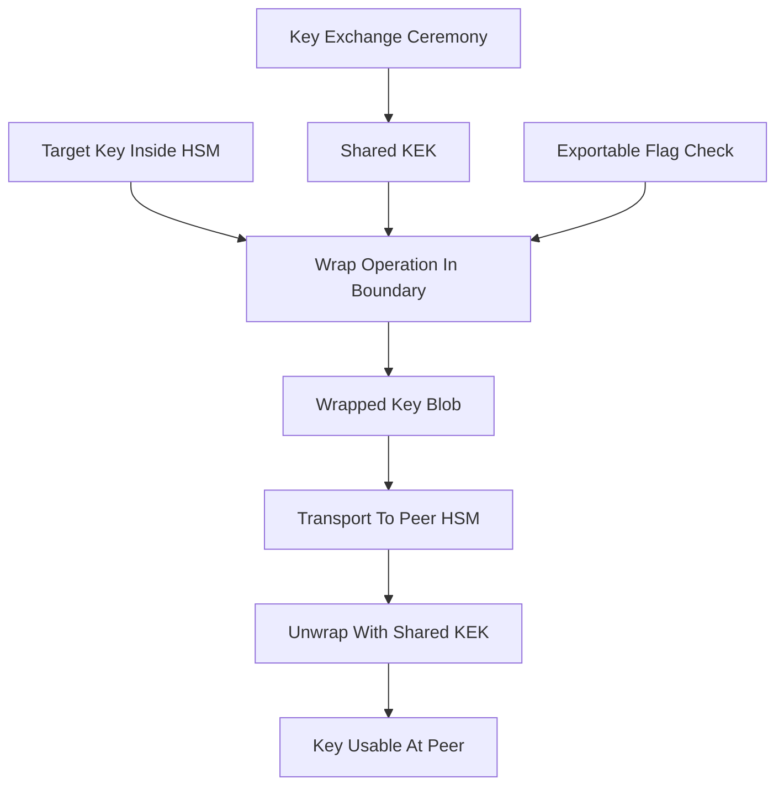

# How Keys Move Between HSMs: Wrapping, Export Rules, and the Trust Bind

## English

An HSM is designed so that key material never leaves the tamper boundary in the clear. But real systems need keys to travel: to a backup HSM, to a peer in a cluster, to a new appliance during a hardware refresh, or to a remote site for disaster recovery. The mechanism that makes this possible is key wrapping — encrypting one key under another key so the plaintext key is never exposed outside a cryptographic operation. The wrapping key (sometimes called a key-encryption key, or KEK) is itself protected by the HSM, and the wrap operation happens inside the boundary: the HSM decrypts nothing, it simply takes the target key, encrypts it under the KEK with an approved algorithm such as AES Key Wrap (RFC 3394) or RSA-OAEP, and emits the ciphertext blob. The plaintext key exists only briefly inside the HSM's protected memory, never on the host bus or in application memory.

What makes this subtle is that the wrapping key must already be shared between the two HSMs before any wrapped key can be unwrapped. This creates a chicken-and-egg problem: to move keys securely, you first need a shared secret. HSMs solve this with a key exchange ceremony — often a Diffie-Hellman or RSA-based exchange performed under dual control, where two or more custodians each contribute a component. The resulting shared KEK is then used to wrap everything else. Some vendors call this a 'key transport' or 'trust bind' step, and it is usually the most carefully audited part of an HSM deployment because a mistake here can leak the entire key hierarchy.

Not all keys are exportable. HSM key attributes typically include an 'extractable' or 'wrap' flag that the HSM enforces at the hardware level. A non-extractable key simply cannot be wrapped, even by an administrator with full credentials — the firmware refuses the operation. This is deliberate: root keys, CA private keys, and payment keys are often marked non-extractable so that even a compromised admin account cannot exfiltrate them. The trade-off is operational: if the HSM is destroyed and the key was never backed up, the key is gone forever. Key custodians must therefore decide, per key, whether the risk of loss or the risk of export is worse.

Wrapped keys are also bound to context. Good HSM implementations attach integrity checks and sometimes metadata to the wrapped blob — an HMAC or AEAD tag that detects tampering, and optionally a binding to the target HSM's identity so that a wrapped key cannot be unwrapped on a different device. Without this binding, an attacker who steals a wrapped blob and the KEK could import the key elsewhere. Modern HSMs support 'wrap with integrity' modes that make the blob self-authenticating, so a corrupted or forged blob is rejected before any key material is reconstructed.

In practice, key movement between HSMs follows a strict choreography: establish a shared KEK under multi-custodian control, verify the KEK fingerprint on both sides, wrap the target key with an approved algorithm and integrity tag, transport the blob over a channel that is itself protected, unwrap on the destination, and verify the key's fingerprint against the source record. Each step is logged, and the ceremony is witnessed. The goal is not just confidentiality but provable equivalence — after the ceremony, both HSMs hold the same key, and the audit trail proves it.

## 中文

HSM 的設計原則是：金鑰材料永遠不會以明文離開防篡改邊界。但真實系統需要金鑰移動：到備份 HSM、到叢集中的對等節點、到硬體更新時的新裝置，或到異地災難復原站點。實現這一點的機制是金鑰包裝（key wrapping）——用另一把金鑰加密一把金鑰，使明文金鑰永遠不會在加密操作之外暴露。包裝金鑰（有時稱為金鑰加密金鑰，KEK）本身由 HSM 保護，而包裝操作在邊界內進行：HSM 不解密任何東西，它只是取出目標金鑰，用 KEK 以 AES Key Wrap（RFC 3394）或 RSA-OAEP 等獲認可的演算法加密，然後輸出密文塊。明文金鑰只在 HSM 的受保護記憶體中短暫存在，永遠不會出現在主機匯流排或應用程式記憶體中。

微妙之處在於：在任何被包裝的金鑰可以被解包之前，包裝金鑰必須已經在兩臺 HSM 之間共享。這造成先有雞還是先有蛋的問題：要安全地移動金鑰，你首先需要一個共享秘密。HSM 透過金鑰交換儀式解決這個問題——通常是 Diffie-Hellman 或基於 RSA 的交換，在雙人控制下進行，由兩位或更多保管人各自貢獻一個分量。產生的共享 KEK 隨後用於包裝其他所有東西。有些廠商稱之為「金鑰傳輸」或「信任繫結」步驟，而這通常是 HSM 部署中最受仔細審計的部分，因為這裡出錯可能洩露整個金鑰階層。

並非所有金鑰都可匯出。HSM 金鑰屬性通常包括一個「可匯出」或「可包裝」標誌，由 HSM 在硬體層面強制執行。不可匯出的金鑰根本無法被包裝，即使擁有完整憑證的管理員也不行——韌體會拒絕該操作。這是刻意設計的：根金鑰、CA 私鑰和支付金鑰通常被標記為不可匯出，這樣即使管理員帳戶被入侵也無法外洩它們。代價是運維上的：如果 HSM 被摧毀而金鑰從未備份，金鑰就永遠消失了。因此金鑰保管人必須逐把金鑰決定：丟失的風險和匯出的風險哪個更糟。

被包裝的金鑰也繫結於上下文。良好的 HSM 實作會在包裝塊上附加完整性檢查，有時還有後設資料——一個 HMAC 或 AEAD 標籤用於偵測篡改，並可選地繫結到目標 HSM 的身份，使被包裝的金鑰無法在另一臺裝置上解包。沒有這種繫結，同時竊取包裝塊和 KEK 的攻擊者就可以把金鑰匯入別處。現代 HSM 支援「帶完整性的包裝」模式，使包裝塊自我認證，從而在重建任何金鑰材料之前就拒絕損壞或偽造的包裝塊。

在實踐中，HSM 之間的金鑰移動遵循嚴格的編排：在多保管人控制下建立共享 KEK，在兩端驗證 KEK 指紋，用獲認可的演算法和完整性標籤包裝目標金鑰，透過本身受保護的通道傳輸包裝塊，在目的地解包，並對照來源記錄驗證金鑰指紋。每一步都被記錄，儀式有見證人。目標不僅是機密性，而是可證明的等價性——儀式之後，兩臺 HSM 持有相同的金鑰，而審計軌跡證明這一點。

## Key Takeaway

Keys travel between HSMs only as wrapped blobs under a pre-shared key-encryption key, and the HSM's own attributes decide which keys may ever be wrapped at all.

## Related Concepts
- Key wrapping
- Key-encryption key (KEK)

## Diagram

