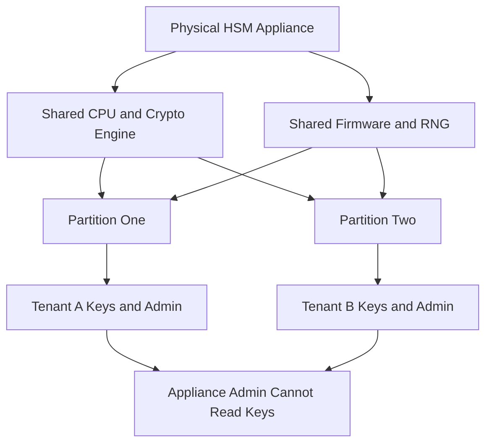

# Multi-Tenancy Inside the Vault: Partitions, Domains, and Why Isolation Is Hard

## English

A single HSM appliance is expensive, so organisations often want to share one device across teams, applications, or even customers. The HSM vendors support this through partitioning: the appliance is divided into logical compartments, each with its own administrator, its own key store, its own authentication credentials, and its own quota of cryptographic objects. On a PKCS#11-style device, each partition appears as a separate slot; on a network HSM, each partition is reached through a distinct virtual address or client identity. From the application's point of view, it is talking to a dedicated HSM. From the operator's point of view, one physical box serves many tenants.

Partitioning is not the same as virtualisation. The partitions share the same CPU, the same cryptographic engine, the same random number generator, and the same firmware. There is no hypervisor between them — isolation is enforced by the HSM's own access-control logic, which checks every request against the caller's authenticated identity and the partition it belongs to. This is a strong model when implemented correctly, because the enforcement point is inside the tamper boundary and cannot be bypassed by the host. But it is a different trust model from a physically separate device: a firmware bug that lets one partition read another's memory would break the boundary for every tenant at once.

Practical partitioning raises questions that a single-tenant deployment never faces. Who owns the appliance administrator role, and can that role see into a tenant's partition? On most platforms, the appliance-level administrator can create and delete partitions but cannot read the keys inside them — the partition's own security officer holds that authority. This separation is essential, because otherwise the hosting organisation could silently access tenant keys. Some vendors go further and support 'secure partitioning' where even a firmware-level compromise of the appliance cannot cross partition boundaries, usually by dedicating separate hardware security processors or memory regions per partition.

Resource contention is the other half of the story. Cryptographic engines have finite throughput, and a tenant running a heavy TLS workload can starve a tenant running batch signing. HSMs typically offer per-partition rate limits, queue quotas, and sometimes dedicated crypto cores. Operators must also think about failure domains: if one partition fills its key store, does it affect the others? If a firmware update reboots the appliance, every tenant is interrupted simultaneously, which is a very different maintenance conversation than a single-tenant device. Capacity planning becomes a shared responsibility, and the SLA you can offer a tenant depends on what the other tenants are doing.

Finally, partitioning interacts with compliance. An auditor will ask whether the boundary between tenants is as strong as the boundary between the HSM and the outside world. The answer depends on the vendor's implementation and on the certification scope: some FIPS 140-3 certificates explicitly cover multi-tenant operation, others do not. Regulated workloads — payment processing, certificate authorities, government keys — often require dedicated appliances precisely because the compliance framework has not caught up with the technical isolation. Partitioning is therefore a genuine engineering trade-off: it lowers cost and operational overhead, but it concentrates risk and complicates the audit story.

## 中文

單一臺 HSM 裝置很昂貴，所以機構往往希望跨團隊、應用程式甚至客戶共享一臺裝置。HSM 廠商透過分割（partitioning）支援這一點：裝置被劃分為邏輯隔間，每個隔間有自己的管理員、自己的金鑰儲存、自己的認證憑證，以及自己的密碼學物件配額。在 PKCS#11 風格的裝置上，每個分割區顯示為一個獨立的槽（slot）；在網路 HSM 上，每個分割區透過不同的虛擬地址或客戶端身份到達。從應用程式的角度，它是在與一臺專用 HSM 對話。從操作員的角度，一臺物理機器服務多個租戶。

分割並不等同於虛擬化。各分割區共享相同的 CPU、相同的密碼學引擎、相同的隨機數產生器和相同的韌體。它們之間沒有 hypervisor——隔離由 HSM 自己的存取控制邏輯強制執行，該邏輯根據呼叫者的已認證身份及其所屬分割區檢查每一個請求。實作正確時這是強大的模型，因為執行點在防篡改邊界之內，主機無法繞過。但它與物理隔離裝置是不同的信任模型：一個讓某分割區讀取另一分割區記憶體的韌體漏洞，會同時破壞所有租戶的邊界。

實際分割帶來單租戶部署從未面對的問題。誰擁有裝置管理員角色，該角色能否窺視租戶的分割區？在大多數平臺上，裝置級管理員可以建立和刪除分割區，但無法讀取其中的金鑰——分割區自己的安全主任（security officer）持有該許可權。這種分離至關重要，否則託管機構可以悄悄存取租戶金鑰。有些廠商更進一步支援「安全分割」，即使裝置在韌體層面被入侵也無法跨越分割區邊界，通常透過為每個分割區專用獨立的硬體安全處理器或記憶體區域來實現。

資源爭用是故事的另一半。密碼學引擎的吞吐量有限，一個執行繁重 TLS 工作負載的租戶可能餓死一個執行批次簽名的租戶。HSM 通常提供每分割區的速率限制、佇列配額，有時還有專用密碼學核心。操作員還必須考慮故障域：如果一個分割區填滿其金鑰儲存，會影響其他分割區嗎？如果韌體更新重啟裝置，每個租戶同時中斷，這與單租戶裝置的維護對話截然不同。容量規劃成為共同責任，你能向租戶提供的 SLA 取決於其他租戶在做什麼。

最後，分割與合規相互作用。審計員會問：租戶之間的邊界是否與 HSM 和外部世界之間的邊界一樣強大？答案取決於廠商的實作和認證範圍：有些 FIPS 140-3 證書明確涵蓋多租戶操作，有些則不涵蓋。受監管的工作負載——支付處理、憑證授權機構、政府金鑰——往往要求專用裝置，正因為合規框架尚未趕上技術隔離。因此，分割是真正的工程權衡：它降低成本和運維開銷，但集中了風險並使審計敘事複雜化。

## Key Takeaway

Partitioning lets one appliance serve many tenants, but the isolation is enforced by firmware rather than a hypervisor, so a single bug can cross every boundary at once.

## Related Concepts
- Partitioning
- Multi-tenant isolation

## Diagram

