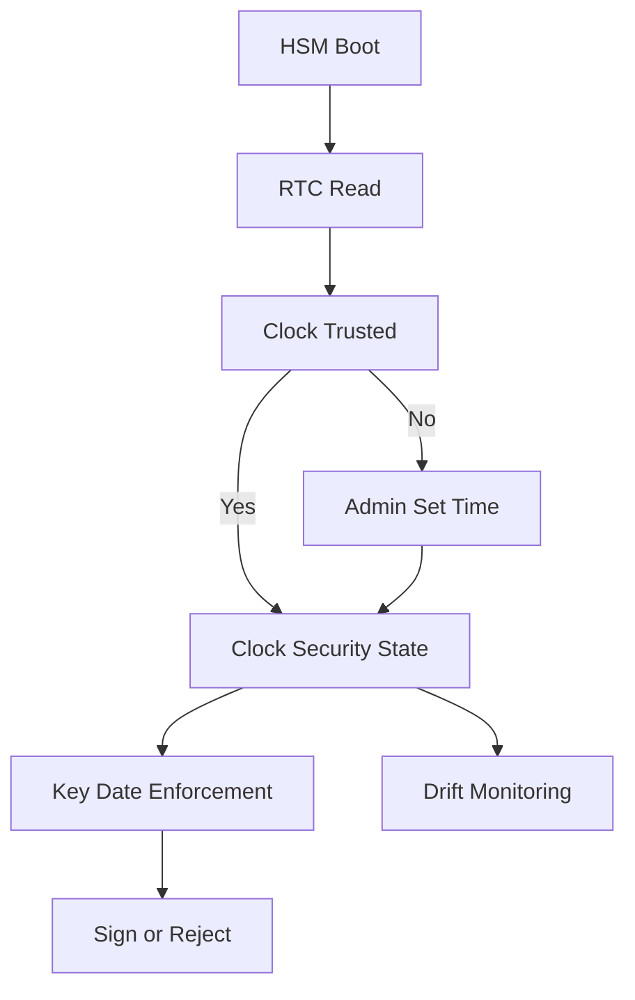

# Clock, Time, and Monotonicity Inside an HSM

## English

Many cryptographic guarantees depend on time. Certificate validity windows, key activation and expiry dates, replay protection for authentication tokens, and audit log ordering all assume that the device knows what time it is and that the clock moves forward. An HSM is a sealed box with no user-facing display, a real-time clock backed by a small battery or supercapacitor that can expire, and a firmware that may reboot unexpectedly. How it handles time is a surprisingly deep design question, and getting it wrong can quietly undermine security properties that look fine on paper.

HSMs typically have a real-time clock (RTC) backed by a small battery or supercapacitor, but the clock is not trusted on its own. On boot, the HSM may require an administrator to set the time, or it may synchronise with a trusted time source over its management interface. Some high-assurance devices refuse to perform time-dependent operations until the clock has been explicitly set and attested, precisely because a device that boots with a 1970 timestamp could issue certificates that are already expired or accept keys that should have been revoked. The clock is therefore treated as part of the security state, not as a convenience.

Key attributes make this concrete. PKCS#11 defines CKA_START_DATE and CKA_END_DATE, which record when a key is meant to be valid. Importantly, the standard states these attributes are informational only — it does not restrict key usage according to them, and enforcing them is left to the application or to vendor-specific policy. So expiry enforcement is not automatic: a host application that ignores the dates can keep using a key past its intended window, which is exactly why application-level expiry checks still matter. Enforcement is where the HSM's clock becomes a single point of failure for every key on the device. If the clock drifts forward, keys expire early and services break; if it drifts backward, expired keys come back to life. Vendors therefore provide clock-drift monitoring and alerts, and operators are expected to treat clock health as a monitored metric alongside temperature and fan speed.

Monotonicity is a separate concern from wall-clock accuracy. Some operations need to know that time has moved forward, not what the actual time is — for example, ensuring that an audit log entry cannot be inserted before an earlier one, or that a nonce is never reused. HSMs often maintain a monotonic counter that increments on every relevant event, independent of the RTC. This counter is stored in non-volatile memory and survives reboots. If the counter and the RTC disagree, the device may enter a safe state and refuse operations until an administrator reconciles them, because the disagreement could indicate tampering or a failed battery.

For architects, the practical lesson is to treat HSM time as an input you must design around, not an ambient fact. Applications should not assume that the HSM's clock matches the host's clock; they should handle 'key not yet valid' and 'key expired' errors as normal outcomes. Monitoring should alert on clock drift, battery failure, and any safe-state transitions. And in designs where multiple HSMs must agree on time — clustered devices, replicated key stores — the time synchronisation mechanism itself becomes part of the trust boundary and must be authenticated, because an attacker who can move one HSM's clock can change which keys are usable.

## 中文

許多密碼學保證依賴時間。憑證有效期視窗、金鑰啟用和到期日期、認證令牌的重放保護，以及審計日誌排序，都假設裝置知道現在幾點，並且時鐘向前走。HSM 是一個密封的盒子，沒有面向使用者的顯示器，一個由小電池或超級電容供電、但可能耗盡的實時時鐘，以及可能意外重啟的韌體。它如何處理時間是一個出乎意料地深的設計問題，弄錯了會悄悄削弱紙上看起來沒問題的安全屬性。

HSM 通常有一個由小電池或超級電容供電的實時時鐘（RTC），但時鐘本身不被信任。啟動時，HSM 可能要求管理員設定時間，或透過其管理介面與受信任的時間源同步。一些高保證裝置拒絕執行依賴時間的操作，直到時鐘被明確設定並證明，正因為一臺以 1970 年時間戳啟動的裝置可能簽發已經過期的憑證，或接受本應被撤銷的金鑰。因此時鐘被視為安全狀態的一部分，而不是便利設施。

金鑰屬性使這一點具體化。PKCS#11 定義了 CKA_START_DATE 和 CKA_END_DATE，用來記錄金鑰預計有效的時段。重要的是，標準說明這些屬性純屬資訊性——它並不按日期限制金鑰使用，是否執行由應用程式或廠商特定政策決定。所以到期強制執行並非自動發生：若主機應用程式忽略這些日期，就可以在超出預期窗口之後繼續使用金鑰，這正是應用層級到期檢查仍然重要的原因。而在執行強制檢查的地方，HSM 的時鐘就成為裝置上每把金鑰的單點故障。如果時鐘向前漂移，金鑰提前到期，服務中斷；如果向後漂移，過期金鑰復活。因此廠商提供時鐘漂移監控和警報，操作員應將時鐘健康視為與溫度和風扇轉速並列的監控指標。

單調性與牆鐘準確性是分開的關注點。有些操作需要知道時間已向前移動，而不是實際時間是什麼——例如確保審計日誌條目不能插入到較早條目之前，或 nonce 永遠不會被重用。HSM 通常維護一個單調計數器，在每個相關事件時遞增，獨立於 RTC。該計數器儲存在非易失性記憶體中，重啟後仍然存在。如果計數器和 RTC 不一致，裝置可能進入安全狀態並拒絕操作，直到管理員調和它們，因為不一致可能表示篡改或電池故障。

對架構師而言，實際教訓是把 HSM 時間視為你必須圍繞設計的輸入，而不是環境事實。應用程式不應假設 HSM 的時鐘與主機時鐘匹配；它們應把「金鑰尚未生效」和「金鑰已過期」錯誤當作正常結果處理。監控應對時鐘漂移、電池故障和任何安全狀態轉換發出警報。在必須就時間達成一致的多臺 HSM 設計中——叢集裝置、複製金鑰儲存——時間同步機制本身成為信任邊界的一部分，必須經過認證，因為能移動一臺 HSM 時鐘的攻擊者可以改變哪些金鑰可用。

## Key Takeaway

An HSM's clock is part of its security state: key validity dates are informational in PKCS#11 and only enforced if the application or vendor policy does so, so clock drift or battery failure can silently change which keys work.

## Related Concepts
- Real-time clock (RTC)
- Key validity attributes

## Diagram

