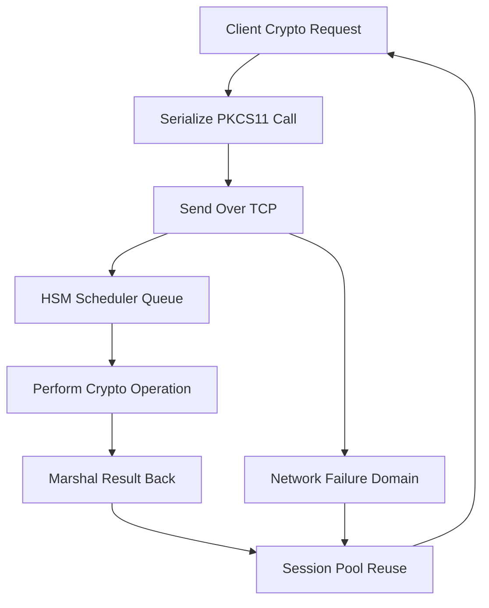

# The HSM as a Network Service: Latency, Connection Pooling, and Failure Domains

## English

When an HSM sits on the network rather than on a PCI card or USB stick, every cryptographic operation becomes a remote procedure call. A TLS handshake that used to take a few microseconds of local CPU now involves serialising a PKCS#11 call into a vendor protocol, sending it over TCP, waiting for the appliance to schedule the job, performing the operation, and marshalling the result back. In practice, round-trip time dominates: a local software RSA-2048 signature might take tens of microseconds, while the same signature through a network HSM often lands in the low single-digit milliseconds. That sounds small until you multiply by thousands of handshakes per second, at which point the HSM becomes a throughput bottleneck that shapes your entire capacity plan.

The standard mitigation is connection pooling and session reuse. PKCS#11 distinguishes between a slot, a session (a logical channel bound to a login state), and an object handle (a reference that is only valid within one session). Opening a session is comparatively expensive because it may involve PIN verification and internal state allocation, so mature client libraries keep a pool of pre-opened sessions and hand them out per thread. If you naively open and close a session per request, you can easily spend more time on session setup than on the crypto itself. Some libraries also support asynchronous or parallel operations, but the HSM's internal scheduler may still serialise them, so the pool size has to be tuned empirically rather than guessed.

Network HSMs also introduce a new failure domain: the network path. A dropped TCP connection mid-operation leaves the client uncertain whether the signature was produced. This is why idempotency matters — signing the same digest twice should produce the same result (for deterministic schemes like PKCS#1 v1.5) or at least a valid signature either way. For stateful operations like generating a key pair, retries can silently create orphaned keys, so operations that mutate HSM state need careful deduplication or a two-phase commit pattern. This is a subtle but real operational hazard that rarely appears with local HSMs.

High availability adds another layer. An HSM cluster may present a single virtual IP, but behind it there are multiple appliances that must share or replicate key material. If a client reconnects to a different node, the object handles from the old session are meaningless. Well-designed clients therefore treat handles as ephemeral and re-lookup keys by label or ID on reconnect, and they treat session state as disposable. Understanding this distinction — persistent key material versus transient session state — is the mental model that makes network HSM integration tractable.

Finally, consider the latency budget holistically. If your service does ten HSM calls per request and each costs 2 ms, you have added 20 ms of irreducible latency to every request, which may dwarf your application logic. The architectural response is often to batch, cache derived results (like wrapped keys or certificates), or push the HSM out of the hot path entirely and reserve it for key custody rather than bulk signing. Recognising when the HSM is a key vault versus a signing engine is the difference between a system that scales and one that collapses under load.

## 中文

當 HSM 以網絡設備而非 PCI 卡或 USB 令牌的形式存在時，每一次密碼學操作都變成一次遠端程序呼叫。一個原本只需本機 CPU 數微秒的 TLS 握手，現在要把 PKCS#11 呼叫序列化為廠商協議、透過 TCP 送出、等待設備排程、執行操作，再把結果編組回來。實務上，往返時間（round-trip time）主宰一切：本機軟件做一次 RSA-2048 簽名可能只需數十微秒，而經網絡 HSM 做同一個簽名往往落在低個位數毫秒。聽起來不多，但乘以每秒數千次握手，HSM 就成為吞吐量瓶頸，直接左右整個容量規劃。

標準的緩解方法是連線池化與會話重用。PKCS#11 區分 slot（插槽）、session（會話，綁定登入狀態的邏輯通道）與 object handle（物件句柄，只在單一會話內有效）。開啟會話相對昂貴，因為可能涉及 PIN 驗證與內部狀態配置，所以成熟的客戶端函式庫會維持一個預先開啟的會話池，按執行緒派發。若你天真地每個請求都開關會話，花在會話建立上的時間很容易超過密碼運算本身。部分函式庫支援非同步或並行操作，但 HSM 內部排程器仍可能把它們序列化，因此池的大小必須實測調校，不能憑空猜測。

網絡 HSM 還引入新的故障域：網絡路徑。操作中途 TCP 連線中斷，客戶端便無法確定簽名是否已產生。這正是冪等性重要的原因——對同一摘要簽名兩次應得到相同結果（對 PKCS#1 v1.5 這類確定性方案而言），或至少兩次都是有效簽名。至於產生金鑰對這類有狀態操作，重試可能悄悄留下孤兒金鑰，所以會改變 HSM 狀態的操作需要謹慎去重或採用兩階段提交模式。這是本地 HSM 罕見、卻真實存在的運維風險。

高可用性再加一層複雜度。HSM 叢集可能對外呈現單一虛擬 IP，但背後是多台設備，必須共享或複製金鑰材料。若客戶端重連到另一節點，舊會話的物件句柄便毫無意義。設計良好的客戶端因此視句柄為短暫的，重連時按標籤或 ID 重新查找金鑰，並把會話狀態當作可丟棄的。理解這個區分——持久金鑰材料對比短暫會話狀態——正是讓網絡 HSM 整合變得可處理的心智模型。

最後要整體考慮延遲預算。若你的服務每個請求做十次 HSM 呼叫、每次 2 毫秒，你就為每個請求加上 20 毫秒不可削減的延遲，可能遠超應用邏輯本身。架構上的回應通常是批次處理、快取衍生結果（如包裝金鑰或憑證），或索性把 HSM 移出熱路徑，只保留作金鑰保管而非大量簽名。認清 HSM 何時是金鑰保險箱、何時是簽名引擎，就是系統能否擴展的分水嶺。

## Key Takeaway

A network HSM turns every crypto call into a remote procedure call, so session pooling, handle ephemerality, and latency budgeting become first-class design concerns.

## Related Concepts
- PKCS#11 sessions and object handles
- Latency budget of a cryptographic vault

## Diagram

