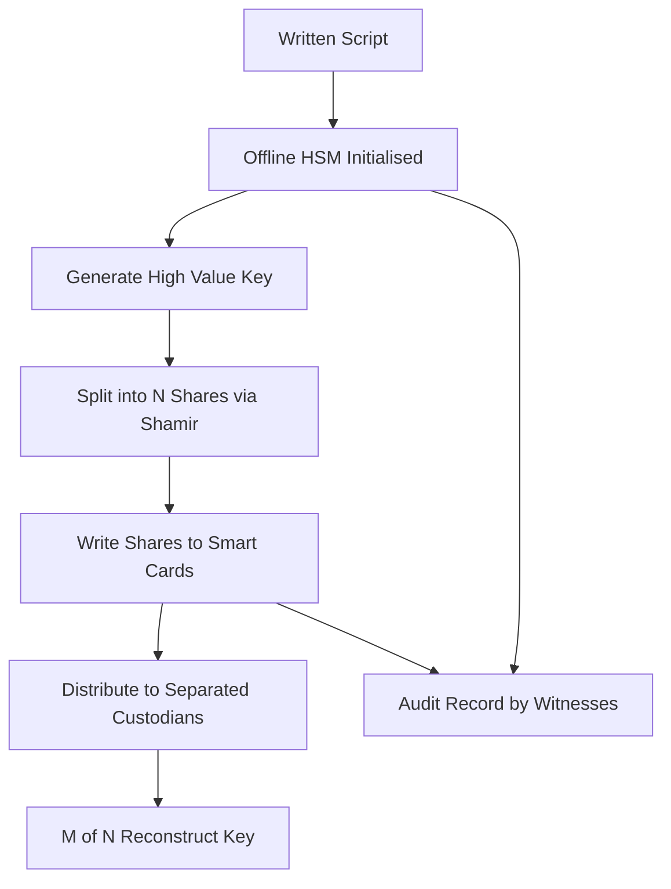

# Key Ceremony Mechanics: Scripts, Quorum Tokens, and the Audit Record

## English

A key ceremony is the carefully choreographed procedure by which a high-value key is generated, split, and entrusted to multiple custodians. It is easy to describe abstractly but the mechanics matter enormously. A typical ceremony for a root CA or payment key involves a written script that every participant reads aloud and follows step by step, witnesses who record timestamps and serial numbers, sealed tamper-evident bags containing smart cards or USB tokens, and a dedicated offline HSM that has been freshly initialised and physically inspected. The script exists so that the procedure is reproducible and auditable rather than improvised; deviations are logged and justified.

The core cryptographic idea is secret sharing, most famously Shamir's Secret Sharing. The HSM generates the key, then exports it (or a wrapping key) split into N shares such that any M of them reconstruct the secret but M-1 reveal nothing. Each share is written to a separate smart card, each card is protected by its own PIN, and each is given to a different custodian who is physically separated from the others. The HSM itself is then often returned to a factory-default state or stored in a vault, so that no single person and no single location holds enough to reconstruct the key. The M-of-N threshold is a policy decision: 3-of-5 is common because it tolerates two unavailable or compromised custodians while still requiring genuine collusion to break.

Operational discipline is where ceremonies live or die. Custodians must be present in person, often in a room with no network access, no cameras with remote access, and sometimes with Faraday shielding. Tokens are checked against serial numbers recorded at manufacture. The ceremony is video-recorded or at least transcribed by a notary. At the end, the assembled team performs a verification step: reconstructing the key in a test HSM and confirming that a known test signature matches, proving the shares are valid before everyone disperses. Skipping this step is a classic failure mode — discovering a bad share months later, when the custodians are scattered and the original environment is gone.

Recovery ceremonies are the mirror image. To bring a key back into service, the required number of custodians must physically reassemble, present their tokens and PINs, and reconstruct the key into a replacement HSM. This is deliberately inconvenient: the whole point is that no one can do it alone or remotely. Modern practice increasingly uses hardware tokens with built-in PIN pads and tamper response, so that a stolen token cannot be brute-forced offline. The ceremony record — script, participant list, serial numbers, hashes of the resulting key's public component, and signatures over the whole transcript — becomes the evidence that the key was generated and handled correctly, which auditors and relying parties may demand years later.

For an undergraduate thinking about security engineering, the lesson is that cryptography alone is insufficient. A mathematically perfect M-of-N scheme is worthless if the shares are stored in the same building, if the script is ambiguous, or if no one verifies the reconstruction. Ceremonies are the human protocol layer that makes the mathematics trustworthy in the real world, and they are as much about documentation, physical control, and rehearsal as about elliptic curves.

## 中文

金鑰儀式（key ceremony）是一套精心編排的程序，用來產生、分割並把高價值金鑰託付給多位保管人。抽象描述很容易，但實際機制極為重要。以根憑證授權（root CA）或支付金鑰為例，典型儀式包括：一份書面腳本，每位參與者都要朗讀並逐步跟隨；見證人記錄時間戳與序號；內含智能卡或 USB 令牌的防篡改密封袋；以及一台全新初始化並經實體檢查的離線 HSM。腳本的存在是為了讓程序可重現、可審計，而非即興發揮；任何偏離都要記錄並說明理由。

核心密碼學概念是秘密分享，最著名的是 Shamir 秘密分享。HSM 產生金鑰後，把它（或一把包裝金鑰）匯出並分割成 N 份，使得任意 M 份可重建秘密，而 M-1 份則毫無所獲。每份寫入獨立的智能卡，每張卡由自己的 PIN 保護，交給彼此實體隔離的不同保管人。之後 HSM 本身通常回復出廠預設狀態或存入保險庫，令任何單一個人、任何單一地點都不足以重建金鑰。M-of-N 門檻是政策決定：3-of-5 很常見，因為它容許兩位保管人缺席或失陷，同時仍要求真正的串謀才能破解。

儀式的成敗取決於操作紀律。保管人必須親自到場，通常在無網絡、無遠端攝影機、有時甚至有法拉第屏蔽的房間內進行。令牌要與出廠時記錄的序號核對。儀式會被錄影或至少由公證人筆錄。最後，團隊會做驗證步驟：在測試 HSM 中重建金鑰，確認已知測試簽名吻合，在眾人散去前證明各份有效。跳過這一步是經典的失敗模式——數月後才發現某份有問題，而保管人已四散、原始環境亦不復存在。

恢復儀式是鏡像的另一半。要讓金鑰重新投入服務，所需數量的保管人必須親自重聚，出示令牌與 PIN，把金鑰重建到替換的 HSM 中。這種不便正是刻意設計：重點就是沒有人能單獨或遠端完成。現代做法日益採用內建 PIN 鍵盤與防篡改反應的硬件令牌，令被竊令牌無法離線暴力破解。儀式記錄——腳本、參與者名單、序號、所得金鑰公開部分的雜湊，以及對整份記錄的簽名——就是金鑰曾被正確產生與處理的證據，審計師與依賴方可能在多年後要求查閱。

對思考安全工程的本科生而言，教訓是：單靠密碼學並不足夠。數學上完美的 M-of-N 方案，若各份存放在同一棟大樓、腳本含糊不清、或無人驗證重建，便毫無價值。儀式是讓人類協議層使數學在現實世界中可信的機制，它關乎文件、實體控制與演練，程度不亞於橢圓曲線。

## Key Takeaway

A key ceremony is a rehearsed human protocol — scripted steps, M-of-N secret sharing, physical separation, and a verified reconstruction — that turns a mathematical threshold scheme into real-world trust.

## Related Concepts
- Shamir's Secret Sharing
- M-of-N key ceremonies

## Diagram

