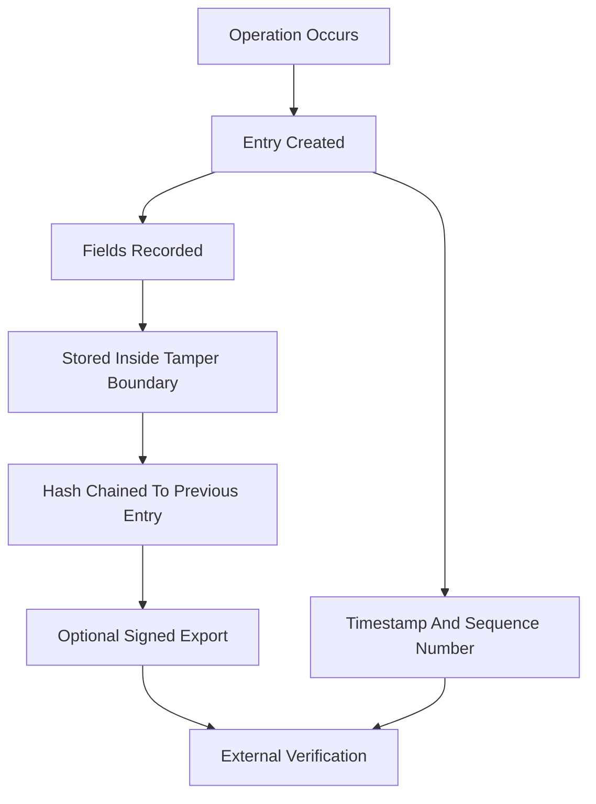

# Reading an HSM's Audit Log: What the Witness Actually Records

## English

An HSM's audit log is often described as making the device a witness, but the value of that witness depends entirely on what it records and how it is protected. A typical log entry contains a timestamp, an operation code (for example, a sign or key-generate event), the identity of the authenticated user or session, the object handle or key label involved, and a result code indicating success or failure. Some appliances record the mechanism used, the length of the input, and a monotonically increasing sequence number. Critically, most HSMs do not log the plaintext or the key itself — they log that an operation happened, not what was operated on. Understanding this boundary is essential for both compliance and incident response.

The log is protected in two ways. First, it is stored inside the tamper boundary, often in a ring buffer or append-only store that ordinary users cannot modify or delete. Second, entries may be chained with a hash (each entry includes a hash of the previous one) so that tampering is detectable even if an attacker gains physical access. Some HSMs can export log records signed with an internal key, allowing an external system to verify that the records came from that specific device and were not altered in transit. Without such chaining or signing, a log is only as trustworthy as the appliance's physical security.

A subtle but important issue is clock accuracy. Timestamps in HSM logs are only as good as the device's time source. Many HSMs have no battery-backed real-time clock, or rely on NTP, which itself can be attacked or simply unavailable in an offline ceremony environment. If timestamps are unreliable, sequence numbers and external correlation (matching an HSM log entry to an application log line) become the practical way to reconstruct events. This is why mature deployments ship HSM logs to a central, append-only log system in near real time, so that the external system's clock provides the authoritative ordering.

Log volume is another practical concern. A busy signing HSM can produce enormous numbers of entries, and the internal buffer is finite. If the buffer fills, some devices overwrite the oldest entries, others stop accepting operations, and others raise an alarm. Each behaviour has security implications: overwriting loses evidence, stopping operations is a denial-of-service risk, and alarming requires someone to be listening. Deployments therefore need a log-forwarding pipeline with back-pressure handling, and a retention policy that balances evidentiary needs against storage cost. Auditors often want a defined retention period, sometimes years, which means the external log store must itself be protected and immutable.

Finally, reading the log is an interpretive skill. A failed authentication followed by a successful one may indicate a legitimate retry or a brute-force attempt that succeeded. A key-generation event with no corresponding certificate issuance may indicate an orphaned key or a misconfigured client. The log is evidence, not a conclusion; it must be correlated with application logs, network logs, and physical access records. The HSM tells you what happened inside the vault, but the meaning of those events is constructed by the people who read them — which is why log review is a recurring operational task, not a one-time setup step.

## 中文

HSM 的審計日誌常被形容為讓設備成為見證者，但這個見證的價值完全取決於它記錄了什麼、以及如何受保護。典型的日誌條目包含時間戳、操作碼（例如簽名或產生金鑰事件）、已驗證使用者或會話的身份、涉及的物件句柄或金鑰標籤，以及表示成功或失敗的結果碼。部分設備會記錄所用機制、輸入長度與單調遞增的序號。關鍵是，大多數 HSM 不記錄明文或金鑰本身——它們記錄「發生了某操作」，而非「對什麼內容操作」。理解這條界線，對合規與事故應變都至關重要。

日誌以兩種方式受保護。第一，它存放在防篡改邊界之內，通常是環形緩衝區或僅可追加的儲存，普通使用者無法修改或刪除。第二，條目可能以雜湊串接（每條包含前一條的雜湊），即使攻擊者取得實體接觸，篡改仍可被偵測。部分 HSM 可匯出以內部金鑰簽名的日誌記錄，讓外部系統驗證記錄確來自該設備、且傳輸中未被改動。若無此類串接或簽名，日誌的可信度就僅等於設備的實體安全程度。

一個微妙但重要的問題是時鐘準確性。HSM 日誌的時間戳只與設備的時間來源一樣可靠。許多 HSM 沒有電池供電的實時時鐘，或依賴 NTP，而 NTP 本身可能被攻擊，或在離線儀式環境中根本不可用。若時間戳不可靠，序號與外部關聯（把 HSM 日誌條目對應到應用程式日誌行）便成為重建事件順序的實務方法。這正是成熟部署會近乎實時地把 HSM 日誌送往中央、僅可追加的日誌系統，讓外部系統的時鐘提供權威排序。

日誌量是另一個實務顧慮。繁忙的簽名 HSM 可產生海量條目，而內部緩衝區有限。緩衝區滿時，有些設備覆寫最舊條目，有些停止接受操作，有些發出警報。每種行為都有安全含義：覆寫會失去證據，停止操作是阻斷服務風險，發出警報則需要有人監聽。因此部署需要具備背壓處理的日誌轉發管道，以及兼顧證據需求與儲存成本的保留政策。審計師常要求明確的保留期，有時長達數年，這意味著外部日誌儲存本身也必須受保護且不可篡改。

最後，讀日誌是一種詮釋技能。一次失敗驗證後緊接一次成功，可能是合法重試，也可能是成功的暴力破解。一次產生金鑰事件卻無對應的憑證簽發，可能代表孤兒金鑰或客戶端設定錯誤。日誌是證據，不是結論；它必須與應用程式日誌、網絡日誌及實體進出記錄相互關聯。HSM 告訴你保險庫內發生了什麼，但這些事件的意義由閱讀者建構——這就是為何日誌審閱是持續的運維任務，而非一次性的設定步驟。

## Key Takeaway

An HSM log records that operations occurred, not their contents, and its evidentiary value depends on tamper-evident chaining, reliable time, forwarding pipelines, and human interpretation.

## Related Concepts
- Logging and audit trails
- Clock, time, and monotonicity inside an HSM

## Diagram

