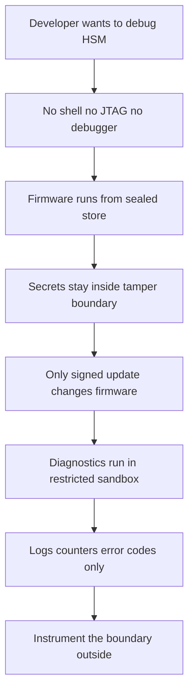

# Why an HSM Has No Debugger: The Sealed Firmware Problem

## English

An ordinary computer lets you attach a debugger, dump memory, and step through code. An HSM deliberately cannot. If you could pause execution of the firmware and read RAM, you would find the unwrapped key material sitting in buffers during every operation — which is exactly what the tamper boundary exists to prevent. So HSM vendors build devices where the secure processor runs signed firmware from a read-only or sealed store, and the only way to change that firmware is through a cryptographically signed update that the device itself verifies before applying. There is no shell, no JTAG header on the production board, and often a physical mesh that shorts out and wipes secrets if the enclosure is opened.

The practical consequence is that debugging an HSM is done from the outside. Vendors ship diagnostic modes that run in a restricted sandbox, produce structured logs, and expose counters — but not memory dumps. When something goes wrong, you get error codes and audit records, not a stack trace. This is frustrating for developers used to `gdb`, but it is the same trade-off as a flight recorder: you get the evidence the system chose to keep, not full visibility.

This shapes how you build software against an HSM. You cannot instrument inside the vault, so you instrument the boundary. Log every call, its arguments, its return code, and the latency. When a `CKR_*` error appears from PKCS#11, treat it as a black-box signal and correlate it against your own audit trail. Many teams build a thin wrapper library that records this metadata before and after each HSM call, so that when something fails at 3 a.m. there is a record of what was asked and what came back.

Firmware updates themselves are the one sanctioned way to change behaviour inside the sealed boundary. Because the device verifies signatures against a root of trust burned in at manufacture, a compromised update server cannot push malicious firmware — but a compromised signing key could. That is why update signing keys are typically held in another HSM, under multi-custodian control, and why the update process is itself audited. The sealed firmware is only as trustworthy as the chain that signs it.

For students, the mental model is: an HSM is a computer that has been deliberately made un-debuggable in exchange for being un-inspectable by attackers. You give up introspection to gain assurance. Design your systems accordingly — observe from outside, keep your own logs, and never assume you can look inside.

## 中文

普通電腦可以讓你掛上除錯器、傾印記憶體、逐行執行程式碼。HSM 就故意做唔到。如果你可以暫停韌體執行並讀取 RAM，你就會在每次操作期間的緩衝區裡面搵到未包裝嘅金鑰材料——而呢樣正正就係防篡改邊界要阻止嘅事。所以 HSM 廠商會造出咁嘅設備：安全處理器由唯讀或密封儲存區執行已簽署嘅韌體，而唯一可以改動韌體嘅方法，就係透過經過密碼學簽署嘅更新，並且由設備自己喺套用之前驗證簽章。生產版電路板上面冇 shell、冇 JTAG 接口，而且外殼通常有一層物理網格，一打開就會短路並抹除機密。

實際後果就係：除錯 HSM 要由外面做。廠商會提供喺受限沙箱入面執行嘅診斷模式，會產生結構化日誌、會公開計數器——但唔會俾記憶體傾印。出問題嘅時候，你攞到嘅係錯誤碼同稽核記錄，唔係堆疊追蹤。對於慣用 `gdb` 嘅開發者嚟講好難頂，但呢個同飛行記錄儀係同一個取捨：你攞到嘅係系統選擇保留嘅證據，唔係全部視野。

呢點會塑造你點樣對住 HSM 寫軟件。你冇辦法喺金庫內部做 instrumentation，所以你要喺邊界做。記錄每一次呼叫、佢嘅參數、回傳碼同延遲。當 PKCS#11 彈出 `CKR_*` 錯誤，就當佢係黑盒訊號，同你自己嘅稽核軌跡對照。好多團隊會寫一層薄薄嘅包裝程式庫，喺每次 HSM 呼叫前後記錄呢啲中繼資料，咁到凌晨三點出事嘅時候，就有記錄知道問過乜、答過乜。

韌體更新本身就係唯一獲准喺密封邊界內改變行為嘅途徑。因為設備會用出廠時燒錄嘅信任根去驗證簽章，所以被入侵嘅更新伺服器推唔到惡意韌體——但被入侵嘅簽署金鑰就得。所以更新簽署金鑰通常會放喺另一個 HSM 度，由多重保管人控制，而更新過程本身亦會被稽核。密封韌體有幾可信，就取決於簽署佢嘅信任鏈有幾可信。

對學生嚟講，心智模型係：HSM 係一部被刻意造成無法除錯嘅電腦，用嚟換取攻擊者亦無法窺探嘅保證。你放棄內省，換取保證。設計系統時要相應配合——由外面觀察、自己保留日誌、永遠唔好假設你可以望入去。

## Key Takeaway

An HSM trades introspection for assurance: you cannot debug inside the vault, so you must observe and log at the boundary and trust only the signed firmware chain.

## Related Concepts
- PKCS#11 return codes
- Signed firmware update chains

## Diagram

