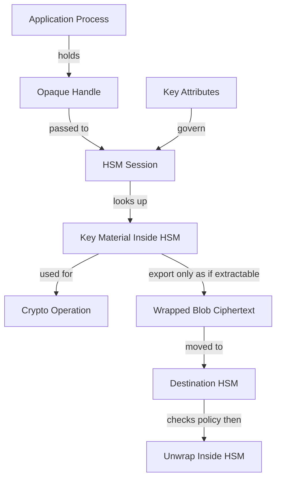

# Key Blobs and Opaque Handles: Why You Never See the Key

## English

When you use a software crypto library, the key is just bytes in your process memory. You can print it, copy it, hash it, or accidentally log it. An HSM inverts this: the key exists inside the device, and what your application holds is a handle — an opaque identifier, often just an integer or a byte string, that names an object inside the HSM's session. You pass the handle to a function like `C_EncryptInit` and the device looks up the actual key material internally. Your process never touches the bytes.

This design has a subtle but important consequence: the handle is not the key, and possession of a handle is not possession of a secret. If an attacker steals your process memory, they get handles and session state, not key material. They can try to use the handles while your session is alive, but they cannot exfiltrate the key and use it elsewhere. This is the core reason HSMs are useful for high-value keys: the secret's blast radius is limited to the lifetime and permissions of a live session.

HSMs also support wrapping, where a key is exported only in encrypted form under another key. The wrapped blob is opaque ciphertext; you can store it, back it up, or move it to another HSM that shares the wrapping key, but you cannot read it. Wrapping itself is only permitted for keys the device considers exportable — a non-extractable key cannot be wrapped at all. The unwrap operation happens inside the destination HSM, which checks whether the wrapping key is authorised to unwrap and whether the target key's attributes permit import. So key material does cross the boundary — but only as ciphertext, and only under policy the HSM enforces.

Attributes are the other half of the picture. Each object inside the HSM carries attributes such as `CKA_EXTRACTABLE`, `CKA_SENSITIVE`, `CKA_WRAP`, and `CKA_UNWRAP`, which determine what operations are permitted on it. A key marked non-extractable and sensitive can be used but can never leave the device — and it cannot even be wrapped: PKCS#11 v2.40 requires `CKA_EXTRACTABLE=TRUE` on the key being wrapped, so a non-extractable key is not a candidate for `C_Wrap` at all. PKCS#11 v3.x formalises this with `CKA_WRAPPABLE`, which by default follows `CKA_EXTRACTABLE` and therefore defaults to FALSE for a non-extractable key. These attributes are enforced by the device, not by your code, so a bug in your application cannot turn a non-extractable key into an extractable one. The policy lives with the key.

For students, the mental model is: the HSM is a safe, and the handle is a claim ticket. The ticket lets you ask the safe to do specific things with specific contents, but it does not let you walk out with the contents. Design your systems so that handles are short-lived, sessions are scoped tightly, and any code path that needs raw key bytes is treated as a design smell — because in a well-built HSM integration, that path should not exist.

## 中文

你用軟件密碼學程式庫嘅時候，金鑰只不過係你進程記憶體入面嘅位元組。你可以印佢、複製佢、雜湊佢，或者唔小心 log 佢。HSM 就反其道而行：金鑰存在喺設備內部，而你嘅應用程式揸住嘅係一個 handle——一個不透明識別碼，通常只係一個整數或者位元串，用嚟喺 HSM session 入面指住某個物件。你將 handle 傳俾 `C_EncryptInit` 之類嘅函數，設備內部就查返真正嘅金鑰材料。你嘅進程永遠唔會接触到嗰啲位元組。

呢個設計有一個微妙但重要嘅後果：handle 唔係金鑰，揸住 handle 唔等於揸住機密。如果攻擊者偷到你嘅進程記憶體，佢攞到嘅係 handle 同 session 狀態，唔係金鑰材料。佢可以趁你 session 仲活住嘅時候試用嗰啲 handle，但佢冇辦法將金鑰外洩再喺第二度用。呢個就係 HSM 對高價值金鑰有用嘅核心原因：機密嘅爆炸半徑只限於一個活 session 嘅壽命同權限。

HSM 亦支援包裝（wrapping），即係金鑰只會以另一條金鑰加密嘅形式匯出。包裝後嘅 blob 係不透明密文；你可以儲存佢、備份佢，或者搬去另一部共用包裝金鑰嘅 HSM，但你就讀唔到佢。不過包裝呢個動作本身，只允許對設備認為可匯出嘅金鑰進行——不可匯出嘅金鑰根本包裝唔到。解包操作喺目的地 HSM 內部發生，設備會檢查包裝金鑰有冇權解包，以及目標金鑰嘅屬性有冇允許匯入。所以金鑰材料係會跨越邊界——但只會以密文形式，而且只會喺 HSM 強制執行嘅政策之下。

屬性就係另一半圖畫。HSM 內部每個物件都帶有屬性，例如 `CKA_EXTRACTABLE`、`CKA_SENSITIVE`、`CKA_WRAP`、`CKA_UNWRAP`，決定咩操作可以對佢做。標記為不可匯出同敏感嘅金鑰可以俾人用，但永遠唔會離開設備——而且連包裝都唔做得：PKCS#11 v2.40 要求被包裝嘅金鑰必須有 `CKA_EXTRACTABLE=TRUE`，所以一條不可匯出嘅金鑰根本唔會成為 `C_Wrap` 嘅候選。PKCS#11 v3.x 就用 `CKA_WRAPPABLE` 明確規定呢件事，而佢預設跟隨 `CKA_EXTRACTABLE`，所以對不可匯出嘅金鑰嚟講預設就係 FALSE。呢啲屬性由設備強制執行，唔係由你嘅程式碼執行，所以你程式碼有 bug 都唔會將一條不可匯出嘅金鑰變成可匯出。政策係跟住金鑰走嘅。

對學生嚟講，心智模型係：HSM 係一個夾萬，handle 係一張提貨單。張單可以叫你叫夾萬用指定內容做指定嘅事，但唔可以俾你連內容一齊行出去。設計系統時要令 handle 短命、session 權限收窄，而任何需要原始金鑰位元組嘅程式碼路徑都應該當成設計異味——因為喺一個起得好的 HSM 整合入面，嗰條路徑根本唔應該存在。

## Key Takeaway

Your application holds handles, not keys: the HSM enforces extractability and usage attributes on the key itself, so a stolen handle never yields stolen key material.

## Related Concepts
- PKCS#11 object attributes
- Key wrapping and unwrapping

## Diagram

