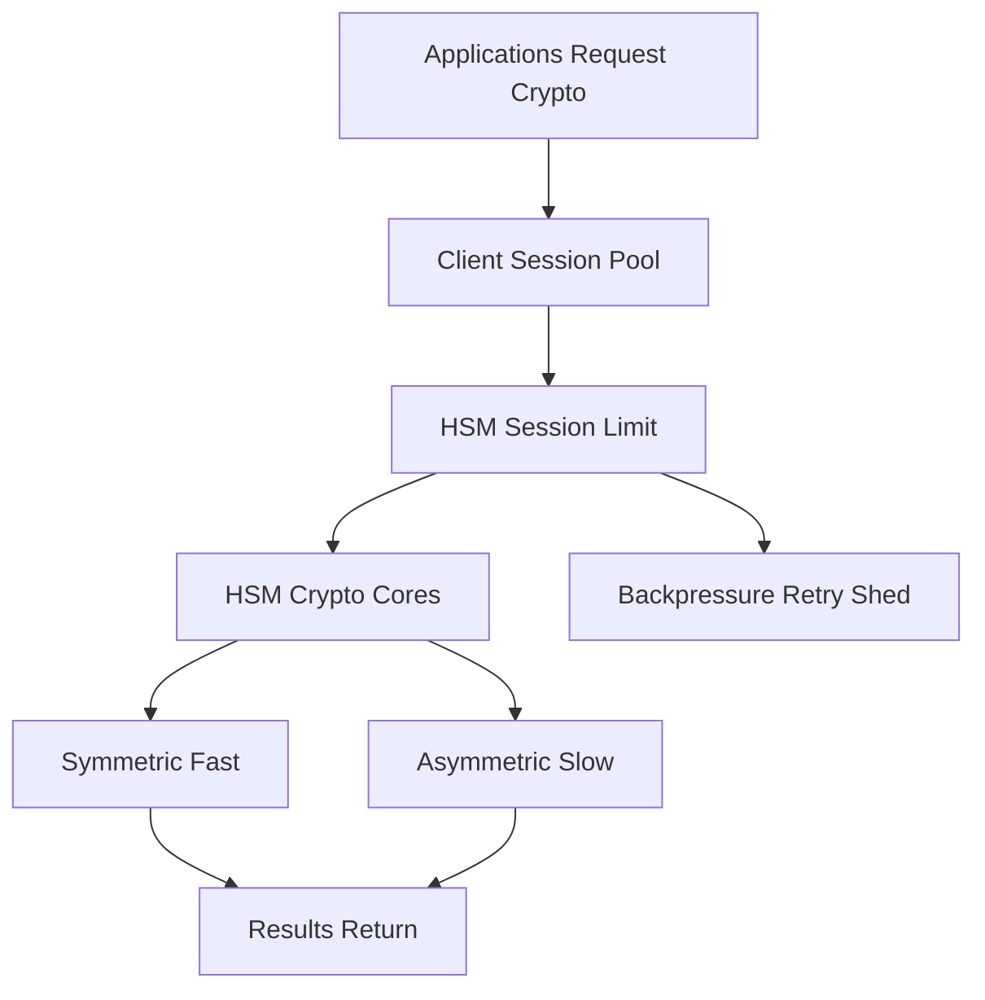

# The HSM as a Shared Bottleneck: Queues, Sessions, and Backpressure

## English

An HSM is a single device — or a small cluster — serving many applications. Every TLS handshake, every signature, every database column decryption that needs the vault has to reach it. Unlike a stateless web server that you can scale horizontally by adding pods, an HSM has a fixed number of cryptographic cores and a fixed number of concurrent sessions. When demand exceeds capacity, requests queue, and the queueing behaviour becomes part of your system's reliability story.

Sessions are the unit of concurrency. In PKCS#11, a session is a stateful connection to a slot, and the device has a hard limit on how many can be open at once. A common failure mode is session exhaustion: an application leaks sessions (opens them and never calls `C_CloseSession`), and eventually the HSM refuses new ones, which looks like a total outage to every other application sharing the device. Connection pooling at the client library helps, but pools must be sized against the device's real session limit, not against what feels generous.

Throughput is also asymmetric. Symmetric operations like AES are fast; asymmetric ones like RSA signing are much slower, and some operations (key generation, especially for large RSA keys) can take a noticeable fraction of a second and block a core. A workload that mixes these must be planned: if you fire a burst of RSA key generations at a shared HSM, you can starve the TLS handshakes that need signatures. Some teams dedicate partitions or separate devices for different workload classes for exactly this reason.

Backpressure is the discipline of handling this gracefully. When the HSM is saturated, your client should time out, retry with jitter, and shed load — not pile on more requests. A common anti-pattern is an unbounded retry loop that turns a brief slowdown into a thundering herd. Better designs put a bounded queue in front of the HSM, return a fast failure when the queue is full, and reserve capacity for critical operations (like authentication) so that a batch job cannot starve interactive traffic.

For students, the mental model is: an HSM is a scarce, shared, stateful resource — more like a database connection pool than a stateless API. Treat sessions as precious, size pools against device limits, separate workload classes, and design for the moment when the vault says no. The cryptographic guarantee is only useful if your system stays available when the device is busy.

## 中文

HSM 係一部單一設備——或者一個細細嘅叢集——要服務好多應用程式。每個 TLS 握手、每個簽章、每個需要金庫嘅資料庫欄位解密，都要去到佢度。同一個可以加 pod 橫向擴展嘅無狀態網頁伺服器唔同，HSM 有固定數量嘅密碼學核心同固定數量嘅並行 session。當需求超過容量，請求就會排隊，而排隊行為就會成為你系統可靠性故事嘅一部分。

Session 就係並行嘅單位。喺 PKCS#11 入面，session 係一條通往 slot 嘅有狀態連線，而設備對同時可以開幾多條有硬性上限。一個常見嘅故障模式係 session 耗盡：應用程式漏咗 session（開咗但永遠唔叫 `C_CloseSession`），最終 HSM 拒絕新 session，對其他共用同一部設備嘅應用程式嚟講就好似全面故障。喺客戶端程式庫做連線池有幫助，但池嘅大小要對住設備真實嘅 session 上限嚟定，唔係憑感覺覺得夠多。

吞吐量亦都唔對稱。AES 之類嘅對稱操作好快；RSA 簽章之類嘅非對稱操作慢好多，而有啲操作（尤其係大型 RSA 金鑰嘅金鑰生成）可以佔用核心一段明顯嘅時間。混合呢啲工作負載就一定要規劃：如果你向共用 HSM 連環發出大量 RSA 金鑰生成，你就可以餓死需要簽章嘅 TLS 握手。有啲團隊就係因為咁，將唔同工作負載類別分配到唔同分割區或者唔同設備。

背壓（backpressure）就係優雅處理呢件事嘅紀律。當 HSM 飽和，你嘅客戶端應該超時、帶抖動咁重試、同埋卸載——而唔係繼續堆更多請求。一個常見反模式係無上限嘅重試迴圈，會將短暫變慢變成雷群效應。更好嘅設計係喺 HSM 前面放一個有界佇列，佇列滿咗就快速失敗，並且為關鍵操作（例如認證）保留容量，咁批次工作就餓唔死互動式流量。

對學生嚟講，心智模型係：HSM 係一種稀缺、共用、有狀態嘅資源——更似資料庫連線池，多過似無狀態 API。要當 session 係寶貴資源、按設備上限定池嘅大小、分隔工作負載類別，並且為金庫講「唔」嘅嗰一刻做好設計。密碼學保證只有喺設備繁忙時你系統仍然可用，先至有用。

## Key Takeaway

Treat the HSM like a scarce stateful database: bound your session pools, separate workload classes, and design explicit backpressure so saturation degrades gracefully instead of cascading.

## Related Concepts
- PKCS#11 sessions and slots
- Backpressure and load shedding

## Diagram

