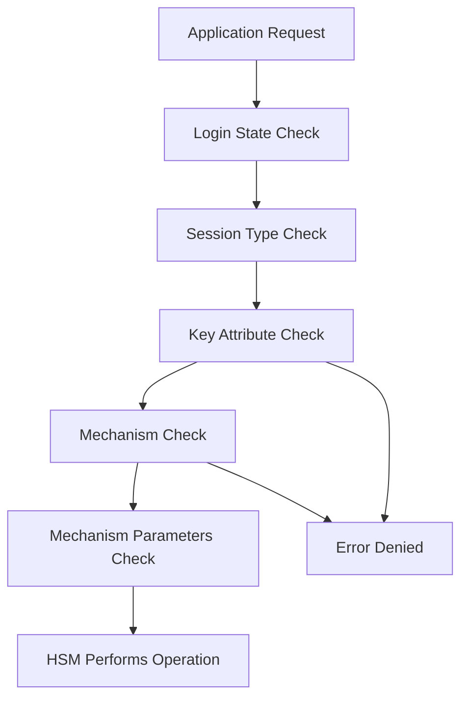

# Telling the HSM What to Do: Policy, Mechanism, and the Attribute Model

## English

When you send a key to an HSM, you rarely send just the key material. You send a bundle of attributes: is this key allowed to encrypt, to decrypt, to sign, to wrap other keys? Is it extractable? What algorithm and mode does it belong to? In PKCS#11 these are called key attributes (CKA_ENCRYPT, CKA_SIGN, CKA_EXTRACTABLE, CKA_SENSITIVE, and so on), and they are enforced by the device, not by your application. This is the single most important mental shift: the HSM is a policy enforcement point, not a calculator. If a key was created with CKA_SIGN=true and CKA_DECRYPT=false, then no amount of clever client code will make the device decrypt with it. The device simply returns an error. Your application's intentions are irrelevant; only the attributes stored alongside the key matter.

The second layer is the mechanism. A mechanism is the concrete cryptographic operation you request in a call: CKM_RSA_PKCS, CKM_AES_GCM, CKM_ECDSA, and so on. Mechanisms are not interchangeable, and the binding comes from the key's CKA_ALLOWED_MECHANISMS attribute rather than from the mechanism used to generate it. If a key lists only CKM_AES_CBC there, asking for CKM_AES_GCM will fail even though both involve AES; a key generated with CKM_AES_KEY_GEN and no CKA_ALLOWED_MECHANISMS set can be used with either. This binding is deliberate: it prevents an attacker who can call the API from using a signing key to decrypt, or a CBC key to perform a GCM operation with a different security profile. Mechanisms also carry parameters (IVs, associated data, padding modes) that must be supplied per call.

A third layer is the session and login state. Most HSMs distinguish public sessions (no authentication) from private sessions (after login), and read-only from read-write sessions. Objects created in a session can be session objects (destroyed when the session closes) or token objects (persisted in the token's storage, surviving reboots). This is why a key that 'worked yesterday' can vanish: someone created it as a session object in a session that has since closed. The distinction between session and token objects is one of the most common sources of operational surprise.

Finally, there is the concept of usage counters and per-key policy that some HSMs layer on top: maximum number of operations, allowed time windows, allowed clients. These are vendor-specific extensions, not part of the base PKCS#11 standard, but they follow the same philosophy: the device, not the caller, is the authority on what a key may do. When you design against an HSM, think of yourself as writing a request to a strict bureaucrat who consults a rulebook you cannot edit at runtime. That framing will save you hours of debugging.

A useful exercise: sketch the attribute set you would assign to a TLS server key, a code-signing key, and a key-encryption key, and notice how different the policy looks even though all three are 'just keys'. The TLS key needs sign and decrypt but must never be extractable; the code-signing key needs sign only and probably a usage counter; the KEK needs wrap and unwrap but never sign or encrypt. Getting these attributes right is a design decision, not an implementation detail.

## 中文

當你把金鑰送進 HSM 時，你很少只送金鑰材料本身。你送的是一整組屬性：這把金鑰可否加密、解密、簽章、包裹其他金鑰？它可否被匯出？它屬於哪種演算法與模式？在 PKCS#11 裡這些叫金鑰屬性（CKA_ENCRYPT、CKA_SIGN、CKA_EXTRACTABLE、CKA_SENSITIVE 等等），而它們是由裝置強制執行，不是由你的應用程式執行。這是最重要的心態轉換：HSM 是政策執行點，不是計算機。若某把金鑰建立時設了 CKA_SIGN=true 而 CKA_DECRYPT=false，那麼無論你的客戶端程式多聰明，都無法讓裝置用它解密。裝置只會回傳錯誤。你的應用程式的意圖無關緊要，只有與金鑰一同儲存的屬性才算數。

第二層是機制（mechanism）。機制是你在呼叫中要求的具體密碼操作：CKM_RSA_PKCS、CKM_AES_GCM、CKM_ECDSA 等等。機制不可互換，而綁定來自金鑰的 CKA_ALLOWED_MECHANISMS 屬性，而不是用來生成它的機制。若某把金鑰的 CKA_ALLOWED_MECHANISMS 只列出 CKM_AES_CBC，你要求 CKM_AES_GCM 就會失敗，即使兩者都涉及 AES；而一把以 CKM_AES_KEY_GEN 生成、且沒有設定 CKA_ALLOWED_MECHANISMS 的金鑰，兩種機制都可以用。這種綁定是刻意的：它防止能呼叫 API 的攻擊者用簽章金鑰去解密，或用 CBC 金鑰去執行安全設定不同的 GCM 操作。機制也帶參數（IV、附加資料、填充模式），每次呼叫都要提供。

第三層是 session 與登入狀態。多數 HSM 區分公開 session（未認證）與私有 session（登入後），以及唯讀與讀寫 session。在 session 中建立的物件可以是 session 物件（session 關閉即銷毀）或 token 物件（持久存於 token 儲存中，重開機後仍在）。這就是為什麼「昨天還能用的金鑰」今天消失了：有人在已關閉的 session 裡把它建成 session 物件。session 物件與 token 物件之分，是營運上最常見的意外來源之一。

最後，有些 HSM 會在之上加一層使用次數計數與逐金鑰政策：最大操作次數、允許的時間窗、允許的用戶端。這些是廠商延伸，不屬於 PKCS#11 基礎標準，但哲學相同：裝置而非呼叫者，才是金鑰能做什麼的權威。當你針對 HSM 設計時，把自己想成在向一位嚴格的公務員提出申請，他查閱一本你無法在執行期修改的規則手冊。這個框架會替你省下數小時的除錯。

一個有用的練習：為 TLS 伺服器金鑰、程式碼簽章金鑰、金鑰加密金鑰（KEK）各畫出你會指派的屬性集，並注意三者雖然都「只是金鑰」，政策卻多麼不同。TLS 金鑰需要簽章與解密，但絕不可匯出；程式碼簽章金鑰只需簽章，可能還需要次數計數；KEK 需要包裹與解包，但絕不簽章或加密。把這些屬性設對，是設計決策，不是實作細節。

## Key Takeaway

An HSM enforces key attributes and mechanisms as policy; the device, not your code, decides what a key is allowed to do.

## Related Concepts
- PKCS#11 key attributes
- Session vs token objects

## Diagram

