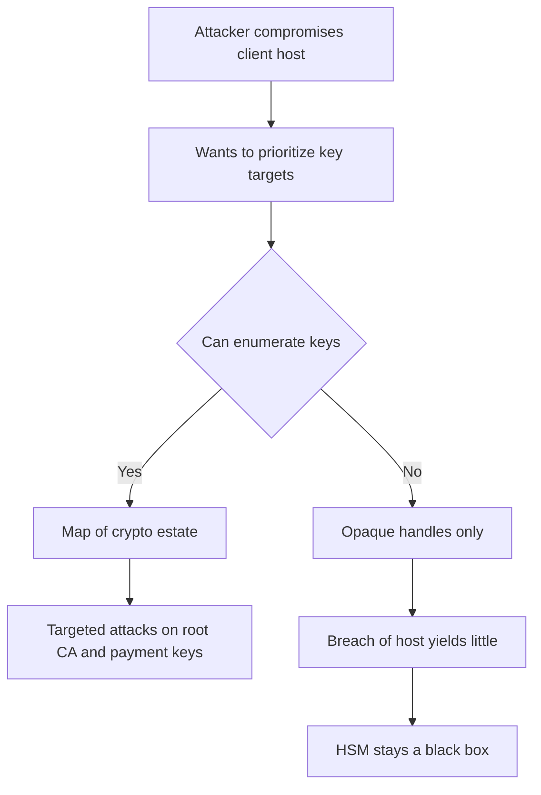

# Why the HSM Refuses to Tell You What It Holds

## English

A common first reaction when working with an HSM is frustration: 'I just want to list the keys and see what's there.' Many devices make this surprisingly hard, and some make it impossible by design. The reason is that the HSM's value comes from being a black box. If you could enumerate keys, read their attributes, and correlate them with application logs, you would have a map of the entire cryptographic estate. An attacker who compromises the client host could use that map to prioritize targets: which key is the root CA? which one signs payment messages? which one is extractable? The less the outside world knows about the interior, the less useful a breach of the outside world becomes.

This is why many HSMs restrict or disable key enumeration in production. Some require a specific login role to list objects; some hide private objects from anyone but their owner; some return only opaque handles that have meaning only within the session that created them. This is the same idea as the opaque handle pattern: the handle is a reference, not a description. You can ask the device to perform an operation on handle 42, but handle 42 does not tell you the key's algorithm, size, or purpose unless the device chooses to reveal it.

From an operational standpoint this means your key inventory must live outside the HSM. You need a configuration management database, a secrets catalog, or at minimum a well-maintained runbook that records: which key label was created, with which attributes, for which application, on which date, by whom, and under which change ticket. The HSM will not be your inventory system. It is a vault, and vaults do not come with a public catalog of their contents taped to the door.

There is a real trade-off here. Hiding key metadata makes incident response harder: when a key is suspected compromised, you need to know exactly which systems depend on it before you can rotate. Teams that skip the external inventory discover this the hard way during their first rotation drill. The practical rule is: treat the HSM as the authoritative source of key material and key policy, but treat your own inventory as the authoritative source of key meaning and key ownership. Both must be maintained.

One more nuance: some HSM management interfaces do expose aggregate statistics (number of objects, number of operations per mechanism, error counts) without exposing individual key identities. These are useful for capacity planning and anomaly detection. Learn which of these your device provides and wire them into monitoring, because they are often the only window you get into the interior.

## 中文

初次接觸 HSM 的人常有的一個反應是挫折感：「我只想列出金鑰，看看裡面有什麼。」許多裝置讓這件事出奇地難，有些更是刻意讓它不可能。原因是 HSM 的價值來自它是個黑箱。如果你能列舉金鑰、讀取屬性、並與應用程式日誌對照，你就等於握有整個密碼資產的地圖。攻陷了客戶端主機的攻擊者，就能用這張地圖排定優先目標：哪把是根 CA？哪把簽付款訊息？哪把可匯出？外界對內部知道得越少，攻破外界就越沒用。

這就是為什麼許多 HSM 在生產環境中限制或停用金鑰列舉。有些要求特定登入角色才能列出物件；有些對非擁有者隱藏私有物件；有些只回傳不透明句柄，其意義僅存在於建立它的 session 之內。這與不透明句柄模式是同一個概念：句柄是參照，不是描述。你可以要求裝置對句柄 42 執行操作，但句柄 42 不會告訴你金鑰的演算法、長度或用途，除非裝置選擇揭露。

從營運角度來看，這意味著你的金鑰清冊必須存在於 HSM 之外。你需要一個組態管理資料庫、一個機密目錄，或至少一份維護良好的操作手冊，記錄：哪個金鑰標籤被建立、帶哪些屬性、供哪個應用程式使用、在何日期、由誰、依哪張變更單。HSM 不會是你的清冊系統。它是金庫，而金庫不會在門上貼一張公開的內容目錄。

這裡有個真實的取捨。隱藏金鑰中介資料會讓事件應變更難：當某把金鑰疑似被洩露，你必須先確切知道哪些系統依賴它，才能輪替。跳過外部清冊的團隊，會在第一次輪替演練時吃足苦頭。實務原則是：把 HSM 當作金鑰材料與金鑰政策的權威來源，但把你自己的清冊當作金鑰意義與金鑰歸屬的權威來源。兩者都必須維護。

還有一點細微之處：有些 HSM 管理介面確實會揭露彙總統計（物件數量、各機制的操作次數、錯誤計數），而不揭露個別金鑰的身分。這些對容量規劃與異常偵測很有用。弄清楚你的裝置提供哪些，並接進監控，因為它們往往是你唯一能窺見內部的窗口。

## Key Takeaway

The HSM deliberately hides key metadata, so your key inventory and ownership records must live outside the vault and be maintained as first-class operational data.

## Related Concepts
- Opaque handles
- Key inventory and rotation drills

## Diagram

